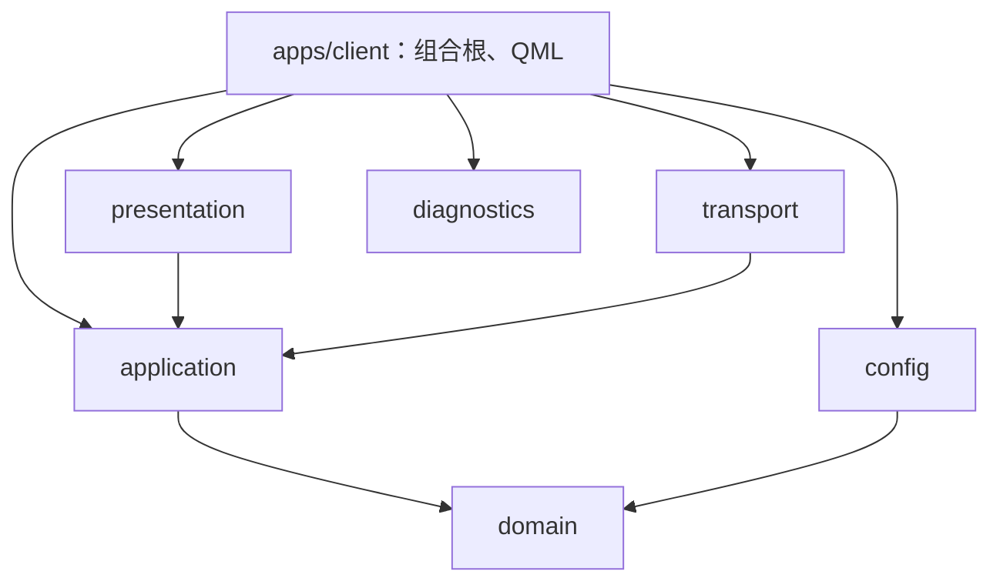

# 项目架构

RM27_Client 是 Qt Quick / C++17 客户端骨架。它借鉴 RM26_Client 的领域、接入、展示和应用组合边界，保留 RM27 现有的 `apps/ + libs/` 布局，便于逐步实现后续功能。

目前可运行的链路是：加载配置、创建会话、展示状态、启动或停止模拟数据源、记录日志。正式赛事通信、协议编解码、视频和回放尚未实现；项目不包含 CI/CD 或自动化测试配置。

## 目录与职责

```text
apps/client/
  main.cpp                  进程入口、应用元信息
  ClientApplication.*       参数、应用组合根与对象生命周期
  qml/                      主窗口、页面和可复用组件
libs/
  domain/                   纯 C++ 类型与状态快照
  application/              数据源接口和会话状态管理
  transport/                数据源实现
  presentation/             面向 QML 的 QObject 展示模型
  config/                   JSON 配置读取与校验
  diagnostics/              JSONL 日志
  protocol/                 协议扩展说明，当前不是构建目标
  video/                    视频扩展说明，当前不是构建目标
configs/                    默认配置、模拟模式示例
simulator/                  独立 Python 模拟器入口
docs/                       架构与本地开发说明
```

各代码模块使用独立 CMake target。新增源文件应登记到所属模块的 `CMakeLists.txt`，不要把所有代码继续堆入可执行程序。

## 与 RM26 的对应关系

| RM26 的职责 | RM27 的位置 |
| --- | --- |
| `GameData` 中的领域类型、比赛状态与规则 | `domain`，当前仅有运行模式、连接状态和演示快照 |
| `GameData` 中供界面读取的 Qt 属性 | `presentation/ClientViewModel` |
| `NetworkManager` 的会话接线与状态更新 | `application/ClientSession` |
| MQTT、UDP 等连接实现 | `transport`，待接入真实通信 |
| `Protocol`、Protobuf schema | `protocol`，待确定本赛季契约 |
| `VideoReceiver` 和解码器 | `video`，待实现 |
| `MainWindow` 的初始化与对象组合 | `apps/client/ClientApplication` |
| QML 面板 | `apps/client/qml` |
| 配置与运行日志 | `config`、`diagnostics` |
| 独立 `sim/` | `simulator/` |

RM26 的架构文档指出 `MainWindow`、`GameData`、`NetworkManager` 承担了较多职责。RM27 从骨架阶段就拆开这些职责，不复制这些大类，也不把 2026 年协议字段直接当作 2027 年协议。

## 依赖方向

下图中 **A → B 表示 A 依赖 B**，不是数据流方向。



- `domain` 不依赖 Qt、网络、QML 或其他项目模块。
- `application` 定义 `IDataSource` 接口，`ClientSession` 通过接口使用数据源，不认识具体传输实现。
- `transport` 实现接口，不创建窗口，不决定页面布局。
- `presentation` 将会话状态转换为 QML 属性，并提供明确的启动、停止入口；不解析原始字节或直接发布 topic。
- `apps/client` 创建具体对象并连接依赖。QML 负责布局与交互，不保存第二份权威会话状态。
- `simulator` 是独立开发程序，不参与客户端的编译和运行依赖。

## 一条数据链路

```text
界面操作 → ClientViewModel → ClientSession → IDataSource.start/stop
数据源状态/快照 → ClientSession → ClientViewModel 属性通知 → QML
```

`ClientSession` 管理当前会话状态。快照只包含演示序号、经过时间等骨架数据，不代表真实比赛状态。增加业务字段时，先确定领域含义和更新入口，再增加展示属性，最后绑定 QML。

配置决定组合根创建哪一种数据源：

- `official`：`UnavailableDataSource` 明确报告正式通信尚未接入，不假装连接成功。
- `simulation`：`MockDataSource` 用 Qt 定时器生成本地预览数据，便于验证页面绑定和启停流程。它不连接 Broker，也不启动 Python 模拟器。

所有现有 QObject 和定时器均在 Qt 主线程工作。当前处理轻量，无须预先引入后台线程。以后接入阻塞 I/O 或视频解码时，应在相应模块内部引入 worker，通过跨线程信号传递拥有明确所有权的数据；停止、重连和退出时应收回旧会话资源，避免迟到回调覆盖新状态。

## 后续功能放在哪里

1. **比赛状态**：在 `domain` 增加明确类型；由 `application` 更新统一状态。
2. **真实通信**：在 `transport` 实现 `IDataSource`，在组合根选择实现；新增依赖只引入需要它的 target。
3. **协议**：在 `protocol` 建立经过确认的 schema、编解码及版本说明，再连接传输与领域状态。
4. **界面**：新增展示属性和 QML 组件；用户动作走类型明确的 C++ 方法。
5. **视频**：在 `video` 分离收包、组帧和解码，向展示层输出帧与状态，不把解码器塞入领域对象。

构建方式、配置示例和手动检查步骤见 [本地开发](development.md)。
