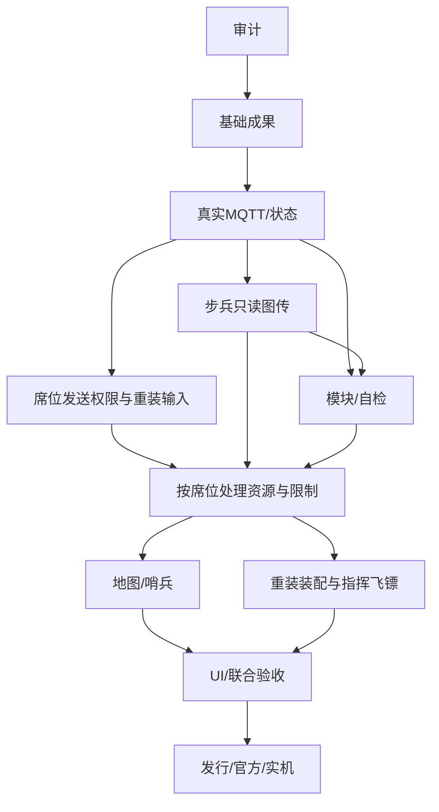

# 06 完整开发阶段及路线

2026-11-07按本队确定的席位分工更新。阶段编号沿用2026-11-02的审计。由[开发入口](README.md)进入任务和验收，实际进度见[13 进度记录](13_Progress_Log.md)。

## 路线入口和版本

共11阶段S0-S10：S0是本次审计基线，S1保持已实施成果，S2起安排后续开发。SX含4项可选增强，不计比赛交付阶段。用户继续按原六步每次选一个小任务；新阶段用于Codex安排依赖。

| 原入口         | 新阶段   | 可见交付                                 |
| ----------- | ----- | ------------------------------------ |
| 开始前         | S0    | 规划、问题记录和验收的追溯关系                      |
| 第1步         | S1    | 已有骨架/五类离线数据/独立模拟器                    |
| 第2步/最小可运行版  | S2-S3 | 五类接收与恢复，步兵只读，重装控制器输入与CustomControl发送 |
| 第3步         | S4    | 步兵连续UDP图传、飞镖命中时的画面与断流诊断；重装复用图传显示     |
| 第4步/核心功能版   | S5-S8 | 模块自检优先，逐组完整业务                        |
| 第5步         | S9    | 正式UI、联合/异常/稳定性证据                     |
| 第6步/正式比赛交付版 | S10   | 独立包、干净机、官方接口和机器人现场验收                 |

| 比赛席位 | 本队交付 | 验收重点 |
| --- | --- | --- |
| 重装 | 自研主客户端经HDMI输出到官方1080p屏。读取本队自定义控制器，通过RJ45发布MQTT `CustomControl`，由图传链路以机器人侧 `0x0311` 交付控制字节。装配、状态和适用赛事动作在本席完成。 | 从实际控制器操作追到机器人接收与执行，区分发布成功与机械动作成功。桌面发送Protobuf消息，旧 `0x0302` 只作迁移背景。 |
| 步兵 | 官方端承担全部控制和赛事操作，本队终端只显示图传、状态和告警。官方画面因飞镖命中被遮挡且终端仍收到合法图传时，步兵可继续看本队终端。 | 正常操作、热键、失焦、重连及飞镖事件下，步兵会话业务发布数始终为0。MQTT订阅和连接维护仍正常。断流应提示最新帧已过期。 |
| 指挥手 | 大地图、阵地与控制度、队友状态、标记、哨兵干预与反馈、飞镖选靶/闸门/确认。可用图源按实际席位授权确定。 | 检查对象、权限、费用、限频与执行结果，按P-007区分模拟身份与官方接入。 |

协议契约仍覆盖32类消息。每席实际发送的范围以此表及[任务表](07_Task_Backlog.md)为准。角色、机器人身份和权限分开校验。独立模拟器负责产生验证材料，比赛交付由S10记录官方设备和机器人实测结果。

状态模型接口先于收包适配器；视频帧通道先预留限制接口，S6按已明确来源集成，避免任务前置互环。测试、诊断、最小UI和展示模型贯穿各阶段，不留到S9才首次出现。跨阶段共享的schema/合法性/模拟器迁移/测试按消息切片推进，S8后收口32种全量。

## S0 审计和可追溯基线

- 对应原步骤：原六步的开始前工作。
- 阶段目标与具体任务：审计规则/协议/52历史功能/实码，建立80需求/任务/验收并反查。
- 前置条件：固定本地资料、当前工作树和用户约定。
- 需求ID：REQ-074。
- 涉及模块：docs/planning、问题/进度记录。
- 输入与输出：本地 PDF、源码、旧路线 → 规划、验收和问题记录。
- 依赖关系：无。
- 推荐测试：来源/REQ/协议/任务/验收与链接静态检查。
- 交付成果与完成标准：可追溯的规划、独立审查和文档入口。程序验证另记入进度。

## S1 保持基础数据与独立启动

- 对应原步骤：原第1步。
- 阶段目标与具体任务：保持开发骨架、固定依赖、P002/003、独立模拟器；触及后回归，不重写。
- 前置条件：S0结论及现有五类基础成果。
- 需求ID：REQ-001、REQ-004、REQ-005、REQ-008、REQ-061。
- 涉及模块：apps/client、protocol/domain、diagnostics、simulator、scripts。
- 输入与输出：现有源码/负载 → 可启动骨架和五类离线基线。
- 依赖关系：S0。
- 推荐测试：复用现有构建/字节/Python-C++检查；触及时重跑。
- 交付成果与完成标准：已有成果持续可用；本轮未构建/运行功能。

## S2 真实MQTT接收与最小数据显示

- 对应原步骤：原第2步前半；最小可运行版。
- 阶段目标与具体任务：先状态接口再连接/订阅/收包/显示，五类数据和来源/过期，断线重连；其余契约逐组扩展。
- 前置条件：S1五类基线、独立本地Broker参数明确。
- 需求ID：REQ-002、REQ-003、REQ-006、REQ-007、REQ-009、REQ-010、REQ-011、REQ-013、REQ-014、REQ-015、REQ-016、REQ-017、REQ-018、REQ-019、REQ-020、REQ-058、REQ-063。
- 涉及模块：transport、application、domain、protocol、presentation、最小QML、config。
- 输入与输出：模拟器五类实际报文 → Qt真实数字/新鲜度及抓包证据。
- 依赖关系：S1；不能以32种全量完成阻塞五类接收。
- 推荐测试：网页改HP→Qt；停单Topic/停Broker、切身份/旧回调、订阅被拒。
- 交付成果与完成标准：Qt从外部接收五类消息，缺失/过期可见，可独立启停恢复。T-013重订阅后等待本次会话的新数据，步兵接收会话不产生任何业务发布。

## S3 席位发送权限与重装控制器通道

- 对应原步骤：原第2步后半。
- 阶段目标与具体任务：先按席位约束业务发布，再接重装控制器。记录实际设备接入方式、输入样本及机载团队认可的载荷/安全停控约定。读取控制器的新输入，按约定编码 `CustomControl.data`（最多60字节），按协议75Hz频率要求限频，最高QoS 1。正常值、失效、设备断开与重连按同一接口约定验证。
- 前置条件：S2的接收、身份和时效接口。无队内样本时可先验席位权限、Protobuf封装与限频；真实设备的通道映射和机器人动作待双方接口确定。
- 需求ID：REQ-012、REQ-035、REQ-036、REQ-037、REQ-038。
- 涉及模块：application、protocol、transport、输入适配、simulator。
- 输入与输出：重装控制器 → 本队终端采集 → `CustomControl` 实际MQTT负载 → 图传链路 → 机器人侧 `0x0311`。限长针对data字段，桌面不再套机器人串口帧。
- 依赖关系：S2之后可与S4并行。P-006仅影响缺编码依据的赛事动作。确认队内控制器格式的工作不阻塞步兵视频或指挥席已有依据的指令。
- 推荐测试：记录输入样本与实际发布字节、频率、QoS；断开控制器、失焦、断网或换席后停止使用旧输入，恢复后等待新输入。步兵快捷键、定时器、清键及重连均不得产生业务PUBLISH。
- 交付成果与完成标准：本地证据能区分采集、编码与发布，官方链路和机器人执行留S10。通用键鼠消息保留契约覆盖，其实现不得作为重装操纵器或步兵只读的前置条件。

## S4 标准UDP图传闭环

- 对应原步骤：原第3步。
- 阶段目标与具体任务：先修模拟器≤1400与回绕，再收包/重组/解码/最小显示，限制资源并加恢复指标。
- 前置条件：S2独立会话、解码工具链小样、已知HEVC源。
- 需求ID：REQ-052、REQ-053、REQ-054、REQ-055、REQ-056、REQ-067。
- 涉及模块：video、UDP适配、Qt Quick帧面、simulator视频工具。
- 输入与输出：合规H265 UDP源 → Qt最新帧及断流诊断。
- 依赖关系：S2后可与S3并行；预留展示限制接口，S6集成。
- 推荐测试：固定字节/丢片重复乱序/65535回绕；1080p60；MQTT单独正常。
- 交付成果与完成标准：在步兵只读席持续显示合法新帧，业务发布为0。S4先测视频连续性与真断流/恢复；S6接入事件后，再用连续视频加飞镖命中场景核对新帧仍在更新，并分测黄牌、过热和后勤画质。官方端实际遮挡和本队终端同期画面留S10同场核对，限制边界见P-005。

## S5 模块状态与赛前自检

- 对应原步骤：原第4步第一组。
- 阶段目标与具体任务：11字段/角色适用性/42mm安装权限，三端同步；独立链路和模块自检。
- 前置条件：S2真实链路；综合视频自检还需S4状态接口。
- 需求ID：REQ-021、REQ-062、REQ-080。
- 涉及模块：protocol/domain/application、presentation/QML、simulator/server/static。
- 输入与输出：网页模块0/1/2、权限 → 实际MQTT → 模块提示/自检。
- 依赖关系：S2；综合视频自检依赖S4；REQ062持续逐组迁移至S8。
- 推荐测试：逐字段抓包；缺失不正常、不适用非故障；权限只0/1。
- 交付成果与完成标准：本组客户端/模拟器/网页均有实证，不只换标签，不提前宣称其他组完成。

## S6 资源、事件与通用交互

- 对应原步骤：原第4步通用组；核心功能版。
- 阶段目标与具体任务：伤害与复活状态、机制与 16 类事件、按来源处理增益、判罚限制、性能和通用交互、300 字节通道。通用交互先做依据明确的部分，普通 42 mm 兑换等未明确的线上参数按 [P-006](09_Open_Questions.md#p-006commoncommand部分param业务编码缺失) 处理。
- 前置条件：S3用例/输入、S4图传/限制接口、S5模块。
- 需求ID：REQ-022、REQ-023、REQ-024、REQ-025、REQ-026、REQ-027、REQ-028、REQ-029、REQ-030、REQ-031、REQ-032、REQ-033、REQ-034、REQ-039。
- 涉及模块：domain/application/protocol、presentation/QML、simulator三端。
- 输入与输出：阶段/资格/经济+请求 → 权威结果/可用性/正确限制。
- 依赖关系：P004单位、P005限制源、P006参数各仅阻塞受影响子项。
- 推荐测试：成功/拒绝/超时、10倍数、6秒与回血战亡失效、Buff来源差异。
- 交付成果与完成标准：步兵只读席显示资源、事件及各自适用的限制，全部购买、复活、性能选择等操作由官方端发出。重装席按资格发起适用的通用赛事请求，并展示权威结果；缺参数依据的动作按P-006隔离。单独模拟官方上行来验证契约时，不经步兵客户端转发。

## S7 地图、指挥手与哨兵

- 对应原步骤：原第4步地图哨兵组。
- 阶段目标与具体任务：先接原始位置/路径/标记/雷达，再做明确单位变换和发送；控制方式、姿态、干预结果。
- 前置条件：S3条件/限频、S6事件限制；逐来源坐标依据。
- 需求ID：REQ-040、REQ-041、REQ-042、REQ-043、REQ-044、REQ-045、REQ-049、REQ-050。
- 涉及模块：domain坐标、protocol、application、presentation/QML、simulator。
- 输入与输出：位置/雷达/标记 → 可追源地图；请求 → 哨兵结果。
- 依赖关系：S6；P001可按约定做；P004不明变换待确认；P007授权待接口证据。
- 推荐测试：红蓝/RB、7字节、0.5/3秒、49点；自动/半自动费用；同指令串行。
- 交付成果与完成标准：地图与哨兵各有闭环；原值接收不冒充准确地图或官方权限已验证。

## S8 重装、机关、飞镖分批交付

- 对应原步骤：原第4步角色组。
- 阶段目标与具体任务：重装席做装配/步骤/取消/战亡缓冲/结果；指挥席做飞镖目标/闸门/确认。能量机关的状态可供步兵查看，激活由官方端操作；上行契约保留独立测试。每组同步客户端、模拟器及网页。
- 前置条件：S3命令、S6事件资格/规则。
- 需求ID：REQ-046、REQ-047、REQ-048、REQ-051。
- 涉及模块：角色用例、protocol/domain、presentation/QML、simulator。
- 输入与输出：角色状态/请求 → 权威步骤和结果。
- 依赖关系：S6后各组可独立；P004时长单位只局部待确认。
- 推荐测试：重装HDMI工作台呈现装配9结果/四级45秒和协作例外/1秒屏蔽/15秒撤离；步兵机关20秒状态只读；指挥飞镖三态30秒。
- 交付成果与完成标准：各角色有成功/拒绝/异常的可运行交付；不恢复工程ID2/旧英雄业务。

## S9 联合联调、正式UI与可靠性

- 对应原步骤：原第5步；完整核心版本。
- 阶段目标与具体任务：完善工作台/告警/DPI焦点；各阶段已有E2E/故障/录包在此联合验收。
- 前置条件：相应角色S2-S8闭环。
- 需求ID：REQ-057、REQ-059、REQ-060、REQ-064、REQ-065、REQ-066、REQ-068。
- 涉及模块：presentation/QML、diagnostics、测试驱动、transport/video/application。
- 输入与输出：已验领域状态/用例 → 正式界面、故障记录、诊断包。
- 依赖关系：各席的相关能力就绪后即可联调，步兵只读图传与重装控制器/HDMI分别验收，指挥席衔接S7和S8的哨兵、飞镖流程。
- 推荐测试：完整7分钟与30分钟联合负载；断单链路/坏包/磁盘/退出；量化门槛见08。
- 交付成果与完成标准：承诺角色S2-S9范围P0/P1均有模拟实际结果，S10发行/现场另验；零假数据回退/无界资源；未决不写通过。

## S10 发行、目标机、官方与实机验收

- 对应原步骤：原第6步；正式比赛交付版。
- 阶段目标与具体任务：Release包/插件/许可证，干净机、官方身份控制源/码流/限制、整机和角色实测、稳定包回退。
- 前置条件：S9相应范围通过，目标机/官方设备/受控机器人可用。
- 需求ID：REQ-069、REQ-070、REQ-071、REQ-072、REQ-073、REQ-075。
- 涉及模块：发行scripts/CMake、configs、运行库、官方接口与队伍设备。
- 输入与输出：稳定源码/配置/证据 → 发行包/现场记录/回退包。
- 依赖关系：S9；没有设备只标未验证，不用模拟器代签，不暂停其他明确任务。
- 推荐测试：在无开发环境的目标机启动；重装经官方HDMI屏展示、真控制器采集和机器人响应；步兵官方控制期间在飞镖命中前后对照双屏、视频帧时效与零业务发布；指挥席按真实授权验证地图、哨兵与飞镖。记录断线恢复、适用限制和未验证项。
- 交付成果与完成标准：通过S49官方接口及整机条件，对实际支持角色逐项验收后才承诺比赛使用。

## 下一轮优先任务

S4 下一段做 T-055。本机步兵模拟配置复用 T-054 的后台像素帧，在工作台显示最近一帧。用内容可区分的本机短片观察画面更新，停流后标明画面已过期，重新推流后恢复更新。实际进度及现场依赖见 [13 进度记录](13_Progress_Log.md)。

阶段内的审查补充和对应验收见 [07 审查跟进](07_Task_Backlog.md#覆盖审查跟进)。

## 与原路线相比补足的内容

六步方向保持，原技术备查已有内容不冒称新发现。本次补足通俗版/任务层面缺少的逐项落点：32消息/字段及第1章硬件边界；需求任务验收ID；连接/订阅/时效分离；旧会话隔离；消费结果未知态/不重放；按来源Buff死亡差异；阶段0训练/重装战亡控制例外；裁判修正重赛；单位/坐标缺定义；遮挡权威来源和后勤清晰度责任；Web按钮是否真的发布；订阅无解析/空函数/旧cmd5丢弃；视频超包长/回绕/有界资源；原始录包/磁盘失败；干净机发行/许可证/上一稳定包回退和逐角色现场门槛。

模块状态已在2026-11-01加入原第4步，本次细化其11字段与自检验收，不能再说原路线没有模块任务。图传丢包/指标/官方接口等原技术备查已提，本次补的是可执行覆盖，不声称方向从未出现。

## 分支、提交和每轮协作

主线保持可构建，一个可验收切片一个短分支，如codex/mqtt-basic-receive、codex/module-status、codex/video-reassembly，验收回主线后结束。不要每字段建长期分支。小团队仅并行互不争写的状态/视频/模拟器测试；schema由明确负责人统一。提交说明写用户可见变化和实际验证，三端可同分支完成闭环，不拆成长期互相不可用状态。本次未建分支/提交，既有未提交程序改动保留。

每轮先读 [项目约束](../../AGENTS.md)、路线、[进度](13_Progress_Log.md)、[问题记录](09_Open_Questions.md) 并看实码，只做选定小任务。把改动、启动方式、预期、实际结果、剩余项和验证边界写入进度。按 09 中 P-001 至 P-003 的适用范围开发，尚未明确的部分单独处理。

SX：T-076/077/078/079由用户偏好另行启用，不是核心阶段前置。旧工业相机/机器人私有业务未获得本轮格式和范围授权，不自动纳入实现。
