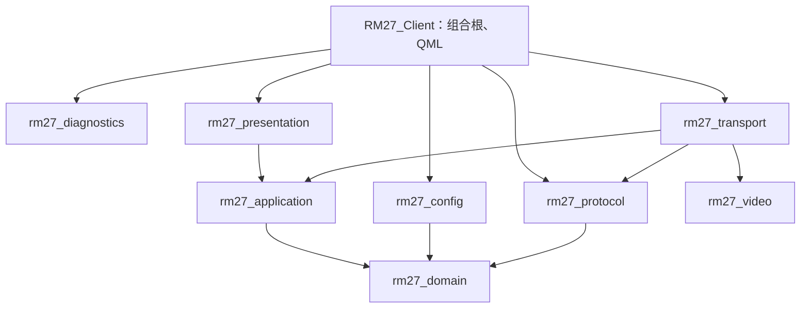

# 11 项目架构与扩展边界

初始核对日期为 2026-11-02，2026-11-15 补入本地步兵只读席位。本页说明当前源码分工及后续扩展位置。文档入口见 [README](README.md)，历史缺口见 [05 当前缺口](05_Current_Gap_Analysis.md)，范围和模块要求见 [02 需求说明](02_Requirements.md)。实际改动和验证见 [13 进度记录](13_Progress_Log.md)，构建和启动见 [12 开发说明](12_Build_and_Run.md)。

## 1. 当前架构的真实起点

客户端采用 Windows / C++17 / Qt Quick / CMake，保留 `apps/ + libs/` 分层。当前运行路径是读取配置、创建数据源和会话、接收五类基础 MQTT 消息、更新最小状态页、启停和写 JSONL 日志。显式 `preview` 模式单独提供演示心跳。

五类消息为 `GameStatus`、`GlobalUnitStatus`、`GlobalLogisticsStatus`、`RobotStaticStatus`、`RobotDynamicStatus`。`MqttDataSource` 精确订阅这五类 Topic，复用 `BasicCodec` 将负载转换为 `domain::BasicMessage`；`ClientSession` 保存逐类 `BasicSample`，`ClientViewModel` 向 QML 提供原值、缺失、过期、身份和来源。其他消息及命令链路尚未接入。

当前 `ClientApplication::run()` 按三种模式选择数据源：

| 配置模式 | 实际创建的对象 | 当前行为 |
| --- | --- | --- |
| `simulation` | `MqttDataSource` | 连接显式配置的外部模拟器 Broker，默认 `127.0.0.1:3333`；不启动模拟器或 Broker |
| `official` | `MqttDataSource` | 默认连接 `192.168.12.1:3333`，clientID 为配置的机器人 ID；不修改系统网卡，不推定官方授权 |
| `preview` | `MockDataSource` | Qt 定时器产生演示心跳；不连接 Broker，不写五类基础状态 |
| 配置读取失败 | `UnavailableDataSource`，不启动会话 | 用窗口展示配置错误，不开始收发 |

步兵只读会话并行运行五类 MQTT 接收和 UDP 图传诊断。本机模拟配置将回环输入的完整压缩帧交给后台解码，“运行信息”显示解码计数和尺寸。MQTT 断线自重连，UDP 绑定失败可停止会话后重试。工作台的画面显示由 T-055 接入。本地检查和设备验收范围见 [13](13_Progress_Log.md)。

## 2. 目录、职责和当前边界

以下路径均相对于仓库根目录。

| 位置 | 当前职责与关键入口 | 扩展时保持的边界 |
| --- | --- | --- |
| `apps/client/main.cpp` | 进程入口和应用元信息 | 保持轻量，不承载赛事状态或协议处理 |
| `apps/hevc-probe/` | 本地 Annex B HEVC 文件检查入口。接收视频库交付的 YUV420p 像素，计算并输出每一帧的 SHA-256 | 支持指定帧数停止、连续打开多个文件。每次打开有独立的序号与诊断 |
| `apps/client/ClientApplication.*` | 参数、配置与日志装配、选择具体数据源、创建会话和 QML，对象生命周期的组合根 | 负责接线和资源所有权，不集中实现业务算法 |
| `apps/client/qml/` | 主窗口、工作台/运行信息两页、通用卡片；通过 `ClientViewModel` 读状态及启停 | 负责布局和交互，不保存第二份权威比赛状态，不解析协议字节或直接发布 topic |
| `libs/domain/` | 不依赖 Qt 的纯 C++ 类型；三种 `RunMode`、`ConnectionState`、演示 `ClientSnapshot`、五类 `BasicData`/`BasicState` 及 ID/角色解释 | 保留字段原值和 optional 存在性；不得引入网络、Protobuf、QML 或视频解码实现 |
| `libs/application/` | `IDataSource` 接口、`ClientSession` 启停、订阅状态、五类独立状态、身份门控、时效和演示快照 | 管理会话和状态更新边界；后续用例、局间清理和命令条件放在这一层，避免堆成一个大类 |
| `libs/transport/` | `MqttDataSource`、`MockDataSource`、配置错误占位 `UnavailableDataSource` 和独立的 `UdpVideoReceiver` | MQTT 管理连接和订阅。UDP 在 Qt 事件线程按批读取，使用固定大小的缓冲区，合并计数通知 |
| `libs/protocol/` | 共享基础 schema、`BasicCodec`、生成 C++ 的 CMake 配置和离线检查器 | 只做协议转换及明确的边界检查，不建立连接、不合并赛事状态、不决定界面行为 |
| `libs/presentation/` | `ClientViewModel` 将会话状态投影成 QML 属性，暴露启动/停止方法 | 后续增加类型明确的展示模型和动作入口，不直接解析报文或操纵网络 |
| `libs/config/` | 校验 JSON，读取模式、窗口、心跳、日志、MQTT 及 UDP 本地监听地址和端口。原子保存个人配置中的步兵席位与接收机器人 | Qt Network 校验 IPv4 字面地址。保存机器人时保留视频设置，网卡地址由系统配置 |
| `libs/diagnostics/` | 启动、状态、停止等 JSONL 日志和写入错误报告 | 高频指标、容量限制、录包另按任务增加；日志不是权威赛事状态 |
| `libs/video/` | 定义 UDP 包头与诊断状态。`VideoFrameAssembler` 按来源和帧号组装模拟源字节。后台解码器读取本机模拟源的完整压缩帧或离线文件，交付 YUV420p 像素 | 使用 FFmpeg 软件解码及限当前用户的本机像素管道。待解码的模拟输入有帧数及字节上限，组帧器可独立测试 |
| `configs/`、`cmake/`、`scripts/`、`tests/` | 配置示例、固定依赖、开发脚本和基础检查 | 按所属用途维护，运行教程统一见 [12](12_Build_and_Run.md) |
| `simulator/` | 独立 Python 模拟器、网页、协议生成物及工具；基础五类已迁移，其余保留旧工具 | 独立运行；客户端、模拟器和网页按同一文档逐组更新，旧工具不自动算作 RM27 支持 |
| `docs/planning/` | 统一的需求、任务、架构、问题、开发说明与进度入口 | 问题全文只维护 [09](09_Open_Questions.md)，实际进度只维护 [13](13_Progress_Log.md)，避免重复更新 |

各已实现客户端模块有独立 CMake target。新增源文件应登记到所属模块的 `CMakeLists.txt`。顶层构建 `libs/video`，Python 模拟器仍独立运行。

## 3. 当前依赖方向

下图 `A → B` 表示 **A 在构建时依赖 B**，不是数据流。图中是当前项目 target 的直接依赖；Qt 和 Protobuf 单独说明，传递依赖未重复画出。



- `domain` 不依赖 Qt 或其他项目模块。
- `application` 依赖 `domain` 和 Qt Core，在这一层定义 `IDataSource`；`ClientSession` 通过接口使用数据源，不认识具体传输实现。
- `transport` 依赖 `application` 并实现接口，链接 `video` 组帧、`protocol`、Qt Network 和固定 **Eclipse Paho C 1.3.15** 的静态异步库。`presentation` 依赖 `application` 和 Qt Core，读取 UDP 状态值。
- `config` 依赖 `domain`、Qt Core 并在内部使用 Qt Network 校验地址。`diagnostics` 依赖 Qt Core。
- `protocol` 对外依赖 `domain` 和 Qt Core，内部链接 Protobuf；生成的 Protobuf 类型不进入领域模型。
- `RM27_Client` 链接上述直接模块及 Qt Gui/Qml/Quick/QuickControls2；组合根创建数据源，codec 调用留在传输适配器。Paho 和 Protobuf/Abseil 均从固定带 SHA256 的源归档构建，C/C++ 使用同套 MinGW。
- `simulator` 不参与客户端 CMake，也不依赖客户端进程或构建产物；客户端本地预览同样不要求模拟器启动。

这一方向让窗口、传输和协议可以分别替换。后续扩展消息和命令时继续通过明确接口组合，避免让领域数据反向依赖网络、让展示模型创建数据源，或形成模块循环依赖。

## 4. 当前数据链路、状态和生命周期

本地配置的 `seat`、MQTT 连接的 `robotId`、实收静态报文身份各有独立来源。启动时由组合根将配置交给会话和接收器。对于个人 MQTT 配置，工作台还可在停止后请求保存。配置层重新校验磁盘文件和打开时的版本，通过 `QSaveFile` 替换成功后，组合根才同步会话身份和接收器下次 CONNECT 的 ID。下次启动接收时重新建立连接并等待匹配的新报文。失败原因在工作台反馈，原身份仍可启动。

步兵工作台的赛事操作按钮与 F6 都经 `ClientViewModel` 进入 `ClientSession::requestBusinessAction()`。会话对步兵和未指定席位均立即返回拒绝，只更新本地操作反馈。该入口没有发送或入队调用。`IDataSource` 和 MQTT 适配器继续负责只读接收。会话将操作反馈与收包诊断分别保存，停止、重新启动和重连时清理旧反馈。

### 4.1 已进入运行界面的链路

```text
配置 → ClientApplication 选择数据源、创建会话和展示模型
界面启停 → ClientViewModel → ClientSession → IDataSource.start/stop
MockDataSource 连接状态/演示快照 → ClientSession → 属性通知 → QML
外部模拟器/官方接口 → Broker → MqttDataSource → BasicCodec.decode
→ IDataSource.basicMessageReceived → ClientSession.BasicState → ClientViewModel → QML
本机模拟视频 → UdpVideoReceiver → VideoFrameAssembler → frameAssembled（完整字节、来源）
UdpVideoReceiver → 收包、组帧计数 → 运行信息
frameAssembled → SimulationVideoDecode → HevcStreamDecoder → YUV420p 像素 → 解码计数、尺寸 → 运行信息
```

模拟组帧按来源 IP、源端口和 16 位帧号分开。首片号为 0，片号连续且实际字节总数与帧头相符才交付。首个到达分片启动 250 ms 期限，Qt 事件线程在最早期限回收缺片帧。相同重复片只计数，头或内容冲突作废整帧。最近结束的最多 256 个来源与帧号组合保留至多 250 ms，用于吸收迟到片。会话停止释放分片、截止定时器和近期记录。

工程上限为每帧 2 MiB、4096 片，同时在途最多 8 帧、8192 片、4 MiB 净数据。完整帧交付时另需至多 2 MiB 连续空间。片元数据、近期记录和完成帧有各自的上限。运行信息与日志只保存计数或摘要。

`ClientSnapshot` 只有 `sequence` 和 `elapsedSeconds`，仅供 preview；五类比赛数据使用独立 `BasicState`。连接过程区分 Connecting、Subscribing、Connected，只有五个 SUBACK 均返回 0/1 才进入 Connected；订阅就绪仍不等于已经收到状态。保留报文不当成本次实时数据，坏包不覆盖已有有效状态。

每类消息替换自己的全部字段，缺失值恢复未知，不抹掉其他 Topic；不由本地时间或比分推定结算。没有 robot_id 的单位、经济、动态消息，须先在本次会话收到与配置一致的静态身份；静态身份缺失或不匹配则清空这些相关状态。工程时效阈值为 Game/Dynamic 1 秒，其余三类 3 秒，每 250ms 刷新，过期值在页面隐藏。这些是诊断策略，不是比赛规则时长。

连接或订阅失败时，`MqttDataSource` 释放本次连接并进入 `RetryWaiting`。会话保持可停止，清空五类状态、身份和上一连接的报文诊断。Qt 单次定时器按 0.5、1、2、4 秒退避，连续失败保持 4 秒。五个 SUBACK 全部成功后复位退避，新连接重新等待数据及匹配的静态身份。手动启动也从初始间隔开始。这些间隔属于本地工程策略。

手动停止或退出会关闭会话接收入口、取消重试并释放连接。组合根令数据源比会话活得更久，QML 先于展示模型和会话销毁。退出信号和事件循环返回后都可安全调用停止。

### 4.2 共用的协议与离线链路

```text
topic + Protobuf payload → BasicCodec.decode → domain::BasicMessage
domain::BasicMessage → BasicCodec.encode → topic + Protobuf payload
```

唯一维护的基础 schema 是 `libs/protocol/proto/rm27_base.proto`；C++ 构建时生成，Python 对应生成文件为 `simulator/protocol/rm27_base_pb2.py`，不手改生成代码。`BasicCodec` 保留缺失与显式零/false的区别以及未知数字值；检查部分数组长度和有限浮点值。其单条 1 MiB 防护值是工程内存保护，不是官方消息长度。逐字段限制、原文来源和 P-002/P-003 指定约定见 [03 协议覆盖](03_Protocol_Coverage.md)、[09 问题记录](09_Open_Questions.md) 和源码中的契约。

网络路径与离线检查使用同一 codec；`snapshotReceived` 只传演示心跳，`basicMessageReceived` 传五类实际解码数据。五类之外没有自动旧版解析回退，基础 schema 与模拟器的现有已迁移发布器继续共用。

### 4.3 线程及旧会话隔离

数据源 QObject、会话、codec 调用、展示模型和 QML 均在 Qt 主线程。Paho 网络线程的回调只写互斥保护的有界邮箱、订阅结果和单条诊断。邮箱保留四类消息各自的最新值，以及最多八个按序保存的静态身份报文。身份队列超限时释放本次连接、清状态并等待重连。主线程每 20ms 按实际到达顺序排空。

应用层邮箱至多十二份负载，每份最大 1 MiB。每份负载记录网络回调时的单调时钟，交给会话时传入缓存年龄。域名先通过 Qt Network 异步解析，再将数值地址交给 Paho。每次连接尝试拥有独立回调上下文和代号。退出该次尝试时先停止轮询、取消地址解析、禁用回调写入并清空邮箱，再销毁 Paho handle，上下文存活至库完成回收。同步信号返回后复核代号以处理重入停止或重启。接收器统一调度重试，Paho 自带的自动重连关闭。实测见 [13](13_Progress_Log.md)。

解码子进程及像素管道由视频工作线程管理。线程将一个完整的 YUV420p 帧按值交给回调，调用方可保存像素，后续帧和下一次打开各有独立数据。回调返回后再交付下一帧。离线工具读到文件末尾会排出剩余帧。本机模拟输入由 UDP 接收端提交到有界队列。会话停止时清理等待输入并回收线程，重新启动后只统计新交付的像素。

本机模拟源最多等待 32 个完整压缩帧、合计 4 MiB，单帧最大 2 MiB。超限时拒绝新来的帧，保留已排队的顺序。向 FFmpeg 写入时另外最多持有一个压缩帧。同一段使用一个发送地址和端口，其他来源的帧单独计数。队列排空且输入静默约 1 秒后关闭本段输入以排出尾帧，累计计数继续保留。收尾时连续 5 秒没有帧交付进展会终止该解码进程并报告超时。下一段可以接受新的来源。这两个间隔用于本机模拟录屏，协议没有给出流结束标志。

## 5. 独立模拟器的关系

模拟器提供开发输入、报文和操作场景，通过自己的 Python 入口、网页及脚本运行。它不是客户端内置的 `MockDataSource`，不需要 Qt 先启动；客户端也不应为了接入而导入模拟器业务或把其 Python/Docker/FFmpeg 依赖加入 Qt 构建。

五类基础消息已接入“模拟器或官方接口 → 真实传输适配 → 协议转换 → 应用状态 → 展示模型 → QML”的程序路径；实际验证层次见13，官方设备并不因复用适配器而自动通过。模拟器的状态处理、实际发布内容和网页输入必须随所选功能一起核对；按钮存在、网页保存或两边互通，都不能代替原文符合性和实际负载检查。

五类基础消息之外，模拟器仍保留旧模块、角色、命令、UDP 和视频工具。其已有实现只能作为迁移定位，不能成为整套 RM27 合规声明；具体差异见 [05](05_Current_Gap_Analysis.md)。规则与协议依据固定使用 [01 资料审计](01_Source_Audit.md) 所列本地文件；用户指定的 P-001/P-002/P-003 只按 [09](09_Open_Questions.md) 的各自范围执行。

模拟器作为独立子项目移植自 `ClearWei/RM26_Client` 的 `sim/`，固定上游提交为 `e291f2f65f5a5924509e4e2fe1b148ff9d4b24af`，原 Python 项目版本为 `0.1.0`。源码保留 [MIT 许可证](../../simulator/LICENSE)；Vue、Socket.IO 的许可证留在 `simulator/server/static/vendor/`。素材来源和再分发边界以本地 [素材清单](../../simulator/licenses/upstream-public-assets.json) 及01登记的上游 `ASSET_LICENSES.md`、`THIRD_PARTY_NOTICES.md` 为证据，代码 MIT 许可不替代素材或商标声明。本次只迁移说明，不变更许可证、素材授权状态或复制开发者私有素材。

## 6. 剩余功能的落点（计划，尚未实现）

本节只规定放置边界，不另建阶段或完成状态；先后顺序以 [06 开发路线](06_Development_Roadmap.md) 和 [07 任务](07_Task_Backlog.md) 为准。

2026-11-07确定了三个正式席位。会话应同时记录席位、所连机器人和已获准的操作。界面按席位给出动作入口，实际业务发布前仍须在应用和发送路径检查席位与有效会话。切换会话时先停止旧设备采集和发送定时器、作废待发输入；重连后只采用本次会话的新状态与新输入。

| 席位 | 数据及操作路径 |
| --- | --- |
| 重装 | 带线控制器接入本队终端，由设备适配层读取实际样本。应用层按与机载端确认的格式生成输入，协议层把载荷封入 `CustomControl.data`（≤60字节），传输层按官方频率和QoS约束发布；机器人按 `0x0311` 接收。HDMI只负责向官方显示屏输出本队客户端画面，装配等赛事动作另经对应官方消息。 |
| 步兵 | 会话仅订阅比赛数据并接收UDP视频。无业务发布入口，热键、失焦清键、重连或迟到的回调也须在发布前被拦截。飞镖命中事件可提示命中情况；只要有合法新帧就继续显示。断流时明确标出过期/无视频，黄牌和其他限制按P-005处理。 |
| 指挥手 | 共用状态与身份校验，大地图接收已获知位置/控制度、队友、哨兵与飞镖状态；指挥操作按规则资格、对象、限频和实际接入权限发送，回执与权威结果分别展示。 |

| 扩展内容 | 主要落点与实施边界 |
| --- | --- |
| 更多比赛数据与完整状态生命周期 | 在现有五类状态边界上增加其余明确类型，由 `application` 管理局间清理、存在性、来源和时效；先确定更新入口，再增加展示属性，最后绑定 QML |
| 后续 MQTT 业务指令 | 在接入发布出口时验证席位和失效请求清理。现有自动恢复只重建五类订阅。`protocol` 管字节转换，`application` 管条件、限频与结果 |
| 更多消息与 schema | 按当前本地协议和限定用户约定扩展 `protocol`，同步模拟器实际消息及必要检查；不能直接采用旧 wrapper 或依据“双方一致”跳过原文 |
| 模块自检和角色功能 | 领域状态、应用用例、展示模型和 QML 各司其职；客户端、模拟器后端与网页按同一个小任务闭环，模块状态优先顺序见06 |
| 地图、输入和限制 | 数据含义、坐标依据、权限及控制来源在领域/应用边界明确，界面采集交互；未明确单位/业务参数不能由 UI 猜测，按09保留受影响部分待确认 |
| UDP 图传 | 按 `transport`/`video` 边界组织接入，以独立视频 target 管理所需依赖；收包 → 校验/重组 → 解码 → 明确所有权的帧 → Qt Quick。UI 不管理 socket/解码器，配置和领域模块不链接解码库 |
| 标准图传与私有字节内容 | 标准 UDP 图传和协议自定义字节通道分别实现与验收；模拟器保留的 H.264 工业相机分片属于旧私有业务，不因通道可传字节就自动获得业务格式或本轮范围授权 |
| 视频状态与资源 | 分清正在收包、已解码、已呈现；耗时工作放 worker，缓存与队列有界，切源/停止回收旧会话；先完成一条可用链路，再按明确需求扩展多路、录制或回放 |
| 诊断与可选增强 | 通用日志/指标在 `diagnostics`，业务状态不靠日志重建；完整回放、AI/AR、战术分析和声音主题按02的可选需求另行推进，不进入核心接入前置依赖 |

未明确且无用户处理说明的协议行为保持未实现/待确认；只隔离受影响部分，继续明确的任务。问题全文和处理状态只在 [09](09_Open_Questions.md) 维护，架构文档不复制完整问题记录。

## 7. 与 RM26 的对应及迁移原则

| RM26 中的职责 | RM27 中的承接位置 |
| --- | --- |
| `GameData` 的领域类型、比赛状态与规则 | `domain` 数据及 `application` 状态更新/用例；五类运行态与 preview 演示快照分开 |
| `GameData` 的 Qt 属性 | `presentation/ClientViewModel` 及后续展示模型 |
| `NetworkManager` 的会话接线和状态更新 | `application/ClientSession` 及明确的状态/命令接口 |
| MQTT、UDP 连接实现 | `transport` 接入五类 MQTT 和步兵图传 UDP，两者独立报告状态 |
| `Protocol`、Protobuf schema | `protocol`；当前五类基础实现已存在，其余按批次扩展 |
| `VideoReceiver`、解码器与视频控件 | `UdpVideoReceiver` 与 `VideoFrameAssembler` 接收本机模拟源并交付压缩帧，T-054 将其接入后台解码。运行信息页显示收包、组帧和解码读数。工作台画面由 T-055 单独接入 |
| `MainWindow` 的初始化与对象组合 | `apps/client/ClientApplication` |
| QML 面板、配置、日志及独立 `sim/` | 分别由 `apps/client/qml`、`config`、`diagnostics`、`simulator` 承接 |

借鉴的是职责，不复制承担过多业务的 `MainWindow`、`GameData`、`NetworkManager` 大类。旧赛季字段与业务不得直接视为当前协议；仅09中用户明确指定的局部参照按其范围执行。历史功能逐项继承、替代或舍弃的依据见 [04 参考对照](04_Reference_Comparison.md)。

## 8. 原架构文档迁移覆盖

本文件承接原 `docs/architecture.md` 的独有结构说明；原文不再作为第二套维护入口。

| 原文内容 | 本文件承接位置 |
| --- | --- |
| `apps/ + libs/` 布局、目录职责、每模块独立 target | 第2节 |
| RM26 职责对应、避免复制大类和旧赛季协议 | 第7节，并指向04的完整迁移对照 |
| 依赖箭头含义、纯领域层、接口与组合根、QML不持第二份权威状态、模拟器独立 | 第2、3、5节 |
| 界面启停/状态流、当前快照含义、两种数据源选择 | 第1、4节 |
| 主线程起点、worker/跨线程所有权、停止重连和旧回调约束 | 第4.3节 |
| 比赛状态/真实通信/协议/界面/视频的扩展落点及分目标依赖 | 第6节 |
| 构建、配置和检查入口 | 统一指向12；不在此重复教程 |
| 早期“无协议编解码、无自动测试”等状态判断 | 第1、3、4节按实际源码更正；完整状态和证据仍以02/05/13为准 |

2026-11-03 文档迁移只整理架构说明和链接，没有推进真实通信；该历史边界保留。2026-11-04 已按上文更新五类接收架构，实际改动与验证只以13的当轮记录为准，原始 PDF 未改。
