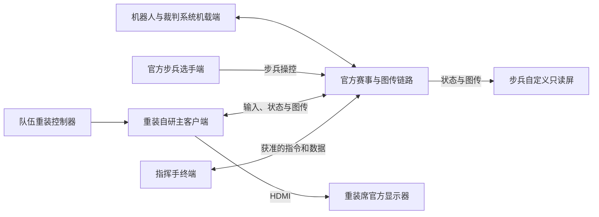

# 2027 自定义客户端规则解读与赛季产品规划

规则与开源调研日期为 2026-11-05，席位方案按 2026-11-07 的队伍决定更新。本文保留固定规则、两赛季对照及开源实例，记录本队客户端的内部开发范围。实际完成情况见 [13 进度记录](13_Progress_Log.md)。

## 核心结论

2027 规则将原来的自定义控制器和自定义客户端统称为“自定义终端”。队伍可以使用官方选手端，也可以自研操作工作台、图传显示或战术终端。软件负责把官方数据、机器人画面和允许的操作交给对应选手。

**本队已确定三种工作台。重装由自研客户端主操作，使用队伍控制器，把界面输出到重装席官方 HDMI 显示器。两名步兵全程由官方选手端操控，自定义端只接收比赛数据和图传。指挥手延续已有的战术地图、哨兵干预和飞镖交互方案。** 共用程序按实际席位配置身份和能力。切换显示布局不改变控制源或发布权限。

| 当前理解 | 结论 | 关键依据 |
| --- | --- | --- |
| 不强制每队开发自定义客户端，可继续用官方端 | 正确。规则列的是终端最多配备数量，同时保留官方电脑、显示器和输入设备 | 27规则表3-1、§3.3.1、§4.5.3 |
| 飞镖遮挡官方画面，但自定义终端还能接图传 | 有明确支持。原文写“自定义终端仍可以正常接受图传画面等数据”；保持自定义图传显示是有依据的产品方向，不应凭旧规划自行加同等黑屏 | 27规则§5.7.3，PDF112（印111） |
| 所以自定义终端不受所有限制影响 | 不成立。飞镖伤害、增益失效仍发生；黄牌、过热、基地受损后的画质下降是另外的机制 | 27规则§5.1.3、§5.6.1、§7.1.2 |
| 指挥手操控的机器人都没有图传 | 不能这样概括。哨兵干预适合地图交互，但机库和哨兵配置了相机图传发送端；这些配置也不能反向证明指挥席一定获准观看对应视频 | 27制作表2-10、表3-3；27通信§2.2.13 |
| 同一个客户端能按兵种切换界面 | 可以作为软件设计；不是官方身份切换机制。指挥页还需要按真实接入权限决定可用按钮和图源 | 27规则§3；27通信第2章；P-007 |

## 资料与证据范围

本文所有“27规则”“27制作”“27通信”“27参赛”均指下面的固定本地文件。页码写作 **PDF阅读器页号（正文印刷页号）**；参赛手册两种页号相同。没有使用网上后续版本替换依据。

| 简称 | 文件 | 本文主要使用范围 |
| --- | --- | --- |
| 27规则 | [比赛规则 V1.0.0](../rules/RoboMaster%202027%20机甲大师超级对抗赛比赛规则手册V1.0.0（20261015）.pdf) | §3角色/终端，§4.5.3操作间，§5机制，§6准备与比赛，§7限制 |
| 27制作 | [制作规范 V1.0.0](../rules/RoboMaster%202027%20机甲大师高校系列赛机器人制作规范手册V1.0.0（20261015）.pdf) | S42、S46-S50，表2-10、表3-3，图传模块安装与使用 |
| 27通信 | [通信协议 V1.0.0](../rules/RoboMaster%202027%20机甲大师高校系列赛通信协议%20V1.0.0（20261029）.pdf) | 第2章全部32种终端消息、UDP视频、相关地图接口及ID附录 |
| 27参赛 | [参赛手册 V1.0.0](../rules/RoboMaster%202027%20机甲大师超级对抗赛参赛手册V1.0.0（20261015）.pdf) | 软件方向职责、赛季规划与技术评审，PDF14-19 |

2026 对照来源为用户指定目录内的[比赛规则 V2.2.0（20260807）](<D:/Competition/RM/RM26/赛规/26赛规/26赛规/新/RoboMaster 2026 机甲大师超级对抗赛比赛规则手册V2.2.0（20260807）.pdf>)、[制作规范 V2.0.0（20260626）](<D:/Competition/RM/RM26/赛规/26赛规/26赛规/新/RoboMaster 2026 机甲大师高校系列赛机器人制作规范手册V2.0.0（20260626）.pdf>)、[通信协议 V2.0.0（20260626）](<D:/Competition/RM/RM26/赛规/26赛规/26赛规/新/RoboMaster 2026 机甲大师高校系列赛通信协议 V2.0.0（20260626）.pdf>)。目录内另有串口协议附录，本次产品定位比较不以它替代终端协议，也未开展其逐字段审计。该目录未提供2026参赛手册。

公开项目用于证明产品形态和借鉴实现。仓库中的功能、作者的比赛使用说明、经过官方设备验证的能力是不同证据，不能相互替代。检索与仓库阅读截止2026-11-05；文章“抓取时间”不作为发布日期。

## 自定义客户端和官方设备的关系

### 可以替代哪些部分

27规则§3.3.1，PDF29（印28），将终端的用途写得很完整：接收比赛信息和机器人图传、监测机器人、控制动作、发送赛事交互指令。随后给出的例子明确允许队伍通过自制显示器、界面和配套控制器完成比赛，无需使用官方选手端与遥控器。

这意味着“完整自定义操作端”具有规则依据。它可以承担选手日常看到和使用的界面，包括图传、准星、状态、小地图、键鼠输入、兑换、复活和角色专属操作。是否真的能完全替代某个操作席，要看这些动作有没有全部实现并完成接入验证；只接了视频或血量当然还不够。

“完全替代选手操作界面”不等于自行替代赛事引擎、裁判系统、计分判罚或官方无线图传设备。服务器继续提供权威状态并处理赛事动作，机器人和图传链路继续按官方体系接入。客户端也不负责把地图点击自动变成机器人导航算法：导航、避障和底层动作执行由机器人端完成。

此图表示本队席位分工。实际接线以操作间配置及终端整机联调记录为准。

### 能否官方操控加自定义显示

27通信§2.2.1，PDF51（印50），要求赛前在官方选手端和自定义终端中选择键鼠指令来源，**同一时刻只有一个来源生成给机器人的键鼠指令**。本队的三种席位据此分工。

| 席位 | 操作与显示 | 自定义软件的业务上行 | 待现场验证 |
| --- | --- | --- | --- |
| 两名步兵 | 官方选手端负责全部操控。自定义端接收、显示比赛数据和图传 | 全程禁止业务发布，包括键鼠、清键、自定义控制、快捷键触发的指令、性能选择、补给、复活和地图标记。建立 MQTT 连接、订阅和必要的协议应答照常进行 | 官方操控与自定义显示并用，飞镖命中时仍正常接收的合法图传，步兵席的屏幕摆放 |
| 重装 | 自研客户端是主操作端，读取队伍控制器，并将操作画面输出至官方 HDMI 屏 | 控制器输入通过 `CustomControl` 发给机器人；界面上的装配、补给等赛事操作通过适用的官方消息发送 | 控制源、HDMI 显示、输入停止、指令执行结果和设备故障后的恢复 |
| 指挥手 | 地图为主，保留哨兵、飞镖交互和获准的视频展示 | 只发送该席位权限允许的标记、哨兵干预和飞镖指令等操作 | 依据 P-007 核实接入身份、图源和操作权限 |

步兵所有赛事操作也由官方端承担。重装与指挥手按各自职责发送操作，客户端应显示权威结果，并验证超时、拒绝和恢复过程。

### 操作间实际提供什么

27规则§4.5.3，PDF62-64（印61-63）规定，每个操作手桌面为120×75cm，配置相应电脑、显示器、鼠标、键盘、图传接收端及支架、1个1GbE RJ45网口、有线耳机等。

**重装操作手和指挥手额外各有一台只接收HDMI输入的1920×1080官方显示设备，并提供一根HDMI公头线，可显示自定义终端画面。** 这不等于官方额外提供运行自研程序的电脑。步兵席没有在该条款中获得同样的额外显示器承诺，规划时需考虑自己的合规显示设备。

本队重装由队伍计算设备运行自研客户端，经规定的 RJ45 接口接入赛事网络，再经 HDMI 将整个操作界面送到重装席额外显示器。步兵使用合规的只读显示设备，显示条件需单独核实。

27规则R31-R33，PDF130（印129）：普通自带电脑/耳机不能任意带入使用，自定义终端属于电脑条款的例外；每台操作设备至多提供一个RJ45口，仅用于连接自定义终端；比赛中不得与操作间外通信。显示器、摄像头和接口等固定位置也不能随意移动。R15，PDF128（印127），还禁止除雷达外的自备设备使用官方电源，应规划自备供电；PDF64（印63）规定官方图传接收端不可从支架取出，自带接收端在场内无法使用。

### 重装和指挥手是否必须配终端（2026-11-06复核）

**两个席位都可以使用官方选手端参加比赛。** 27规则表3-1列的是终端数量上限，表3-3对重装明确写“最多配置1个遥控器和1个自定义终端”。R29按对应机器人的控制方式配置设备，并允许指挥手同时配置机库遥控器、飞镖遥控器和终端。§4.5.3把额外HDMI屏写为队伍可用于终端画面显示。RJ45承担赛事数据接入，HDMI只把本队设备的画面送到显示器。依据见27规则PDF21-23、62、130（印20-22、61、129）。

官方端提供重装和指挥席对应的关键操作。重装在装配区激活后可在裁判系统选手端选难度，实际移动机械臂放入能量单元，再按键确认装配。指挥手可通过官方端标记和干预哨兵，也可选飞镖目标、用官方键鼠开闸。这是 11 月 6 日复核的规则能力。本队 11 月 7 日确定了重装使用自研主操作端和队伍控制器。依据见27规则§5.4.3 PDF86、89（印85、88）和§5.7.2-3 PDF109-111（印108-110）。

| 队伍需要的操作              | 2026 的路径                                               | 2027 的路径                                                                              |
| -------------------- | ------------------------------------------------------ | ------------------------------------------------------------------------------------- |
| 自制控制器经官方电脑发送队内自定义字节  | 主操作间列有RS232口，控制器经官方选手端、图传链路向机器人发送 `0x0302`，30字节、最高30Hz | 操作间设备表未列RS232，现行协议未定义 `0x0302`，赛季方案不能依赖这条旧路径                                          |
| 本队设备经赛事网络向机器人发送自定义字节 | 已有独立的 `CustomControl` 通道，机器人侧对应 `0x0311`，最多30字节、最高75Hz | 自定义终端通过RJ45发布 `CustomControl`，经图传链路在机器人侧对应 `0x0311`，最多60字节、最高75Hz。反向的机器人数据另走 `0x0310` |

本队重装按第二条路径开发。客户端从队伍控制器读取输入，将约定的载荷放入 Protobuf `CustomControl.data`，由自定义终端经 RJ45 向赛事网络发布 `CustomControl`。官方图传链路以命令字 `0x0311` 将该数据送达己方重装机器人，机载端按队内约定解释和执行。客户端不在载荷内再封装旧赛季 `0x0302` 串口帧。官方定义了方向、消息、容量和频率，控制器的具体接入方式、输入字段、字节布局及失联处置须由控制器、客户端和机载端共同确定并联调。

来源为26规则§4.6.3 PDF66（印65）、26通信§1.4.1-2 PDF38-39（印37-38）及§2.2.2 PDF51（印50），27通信§1.4.1 PDF39（印38）、表2-1及§2.2.2 PDF53（印52）。指挥席的实际接入身份和权限见[问题记录P-007](09_Open_Questions.md#p-0072027操作端身份与通信旧称映射)。

## 2027 规则如何转化为产品要求

### 飞镖图传优势必须准确表述

27规则§5.7.3，PDF111-112（印110-111），描述飞镖命中后的遮挡、增益失效、经验和伤害等效果，并在末尾明确自定义终端仍可正常接收图传等数据。

| 情况         | 原文的核心要求                                                           | 对自定义软件的含义                                             |
| ---------- | ----------------------------------------------------------------- | ----------------------------------------------------- |
| 飞镖命中       | 固定/随机固定等目标按次数产生10/5/3/2秒遮挡，移动目标有10秒遮挡，连续命中可叠加；末尾明确自定义终端仍正常接收图传等数据 | 持续显示自定义图传是有依据的目标；原文没有要求终端收到命中事件就自行叠加黑屏。仍须显示真实伤害、失效等状态 |
| 官方界面被飞镖遮挡后 | 可主动选择半自动大地图，发送指令间隔至少3秒 | 此操作留在官方步兵端。自定义步兵端继续只读，显示仍获准接收的画面和数据 |
| 超热量        | §5.1.3，PDF67-68（印66-67）：对应条件锁发射机构并断图传，小地图、自定义UI仍可用                | 不能承诺自定义端始终保留第一视角；视频状态与地图状态分开                          |
| 黄牌         | §7.1.2，PDF125（印124）：图传、小地图、自定义UI均不可使用；其时长规则与比赛机制分开                | 不得把飞镖条款推广为黄牌豁免；具体官方已处理什么、终端补什么按P-005取得接入证据            |
| 基地受损       | §5.6.1，PDF95-96（印94-95）：后勤系数影响多项能力；图传清晰度变化明确包括官方选手端和自定义终端         | 自定义端也受画质影响；先确认源画面是否已处理，不能重复降质或承诺保留原清晰度                |
| 赛前5秒倒计时    | §6.5，PDF122（印121）：不响应机器人控制指令，明确包括自定义终端                            | 自定义端不能规避赛前控制禁用；须分清显示正常与允许操控                           |
| 红牌罚下       | §7.1.2，PDF125-126（印124-125）：按角色产生断电、图传中断、不可复活等后果                  | 正确禁用不再可用的动作；不能把断流都显示为普通网络故障                           |

规则明确自定义终端仍可正常接收图传等数据。本队步兵遇到飞镖遮挡时，继续显示合法且实际收到的画面，选手仍在官方端操作机器人。客户端按实际数据提示画面断流或其他效果，不能把最后一帧当成实时画面。原文同时描述操作界面、地图机器人位置和自定义 UI 的遮挡。飞镖以外的限制及显示范围仍按 P-005 核实。11 月 5 日已纠正原 R-26 要求自定义图传一律黑屏的解读，现场效果仍待验证。

### 指挥手应以地图为主，但不能凭身份断言无视频

27规则表3-2，PDF22（印21），规定重装操作手1人、步兵操作手2人、指挥手1人，哨兵没有独立操作手，另有安全员。即使空中系统和飞镖不上场，指挥手仍可使用对应官方选手端并配置自定义终端。

表3-1，PDF21（印20）的合并单元格很容易误读：重装最多1台终端，两台步兵各最多1台，空中系统与飞镖系统合并列示最多1台，哨兵与雷达各为0；后备数量另列。因此可以围绕“3个地面操作席＋1个指挥席”设计部署，不能因为软件支持多个兵种就任意多摆终端，也不能为哨兵另设独立操作席。

指挥手对哨兵的职责是**发战术意图、管理资源与姿态**，不是默认获得哨兵第一视角并以WASD直接驾驶：

- 选择自动/半自动控制方式的窗口在准备阶段到15秒自检开始前；未选择有默认方式。
- 可以转发地图标记，以及补弹、回血、复活、切换姿态等规则列明的干预。
- 半自动哨兵的这些干预不收额外干预费；自动哨兵每次干预收50金币。购买弹量、回血、立即复活本身的费用仍按表5-7，PDF77（印76）等相应规则核对，不能把“免费干预”显示成所有购买都免费。
- 发送哨兵指令应显示反馈；“已发送”不能直接显示为“已执行”。

依据为27规则§5.7.2，PDF109-111（印108-110）及27通信§2.2.23、§2.2.28、§2.2.31-32。

关于图传，27制作表2-10，PDF36（印35），为机库列出相机图传发送端；表3-3，PDF47（印46），空中系统和哨兵对应数量均为1，飞镖和雷达为0。27规则§3.2.1又规定空中机器人本体全自动，并须有急停遥控。因此不能把2026云台手界面照搬为2027手动空中驾驶，也不能断言整个指挥席没有任何可能的视频来源。**地图作为主界面是合理设计，具体有哪些图源则是待接入确认的能力。**

本队指挥页保留阵地与控制度、双方已获知位置、队友状态与资源、哨兵路径/姿态/干预反馈、飞镖目标/闸门/发射确认，以及获准视频的可选显示区。旧位置应标识过期，未获知的敌方位置保留未知。

### 2027 地图要突出控制度和阵地

27规则§5.6.2，PDF97-98（印96-97），把临时控制、完全控制、争夺和控制度作为独立机制；§5.8，PDF115-116（印114-115），在双方基地未被击毁且比赛时间耗尽时，先比较累计控制度，随后比较全队攻击伤害、总剩余血量。

因此2027地图的核心不能只是“背景图＋几个机器人图标”。它应该帮助选手判断：哪块阵地属于谁、目前正在争夺哪里、控制度差距如何、还剩多少时间、队友能否支援、哨兵将去哪里。客户端展示官方数据；需要做趋势提示时，应清楚标为推算，不能替代官方判胜结果。

定位来源也必须分开：自己的位置、指挥席获准接收的哨兵位置、雷达上报的敌我位置、人工标记、规划路径，含义并不相同。27通信对部分坐标基准没有完整定义，P-004仍待确认；雷达结构按P-001用户指定范围推进，不能将模拟器正常显示直接当作赛场落点正确。

### 重装页同时服务作业和战斗

2027的重装承接装配任务，并可在满足条件后安装模块化42mm发射机构。客户端需要体现这两种工作阶段，而不是把旧英雄或工程名称替换一下。

重装页优先显示当前图传、机器人健康状态、装配可选难度、科技核心到位和步骤状态、确认/取消、装配结果及42mm权限。规则中的装配失败、离区、战亡缓冲和撤离例外都需要纳入操作逻辑，不能简单按“血量为0”禁用所有输入。后续进入战斗状态时，突出允许发弹量、热量、瞄准与补给信息。来源：27规则§5.4.3，PDF78-90（印77-89）、§5.7.1，PDF109（印108）；27通信§2.2.21-22。

### 终端还受设备与赛前使用约束

27制作S42，PDF17（印16），禁止在终端硬件或软件UI展示赞助商品牌、标识、广告语等；这会影响最终开机画面、主题和素材选择。S46-S50，PDF18-19（印17-18），明确最大工作电压30V、收纳尺寸600×600×600mm，不得有裸露带电线材、不得用粘性或尖锐物接触桌面、不得使用无线收发装置，使用前须接操作间接口测试。

这些是终端整机要求，不是仅检查软件就能证明合格。团队需要有人负责计算设备、供电、屏幕、网线、输入设备和收纳；软件负责人提供发行包、配置说明、连接自检与故障证据。终端之间的通信也应使用有线方案，不能把允许互通理解成允许场外网络或任意无线扩展。

27参赛手册PDF14将客户端、上位机和调试工具列入软件方向；PDF17-19要求按技术评审阶段展示规划与成果。这不意味着客户端必须一次实现全部官方功能，也不意味着必须开发队员管理等旁支系统。赛季规划应明确选定产品、支持席位、验收场景和协作依赖。

## 通信协议对应的软件能力

27通信第2章，PDF47-75（印46-74），共32类消息，按方向为9类上行、23类下行，另有UDP图传。下表列共用协议能力，实际发布权限取决于席位。步兵模式可以订阅状态并接收图传，禁止发布全部业务消息。完整字段见 [03 协议矩阵](03_Protocol_Coverage.md)。

| 功能组 | 应做成什么用户功能 | 主要消息或链路 |
| --- | --- | --- |
| 比赛总览 | 阶段、时间、结果、双方血量、阵地/控制度、经济、事件 | GameStatus、GlobalUnitStatus、GlobalLogisticsStatus、GlobalSpecialMechanism、Event |
| 当前机器人 | 血量、热量、允许发弹量、性能、模块状态、复活、受伤、增益、判罚 | RobotStaticStatus、RobotDynamicStatus、RobotModuleStatus、RobotRespawnStatus、RobotInjuryStat、Buff、PenaltyInfo |
| 视频 | 合规接收、解码、显示，断流提示与恢复 | UDP3334、HEVC/H.265 |
| 输入与队伍数据 | 重装用CustomControl发送控制器载荷，按约定接收机载数据；通用键鼠消息保留协议测试，席位控车以自定义控制器为准 | CustomControl、CustomByteBlock、KeyboardMouseControl |
| 地图 | 位置、雷达、路径、标记及发送对象选择 | RobotPosition、RadarInfoToClient、RobotPathPlanInfo、MapClickInfo、MapClickCmd |
| 通用操作 | 性能选择、兑换、复活、远程补给/回血 | RobotPerformanceSelectionCommand/Sync、CommonCommand |
| 重装 | 装配流程与结果提示 | AssemblyCommand、TechCoreMotionStateSync、相关Event |
| 能量机关 | 激活请求、状态与结果显示 | RuneActivateCommand、RuneStatusSync |
| 哨兵 | 控制方式、姿态、干预、执行结果 | SentryStatusSync、SentryCtrlCommand、SentryCtrlResult及性能同步 |
| 飞镖 | 目标、开闸、发射确认及同步 | DartCommand、DartSelectTargetStatusSync |

正式网络使用固定地址约定：服务器192.168.12.1:3333，自定义终端192.168.12.2；MQTT传输Protobuf，clientID按所连机器人ID填写。多席位和指挥权限不能据此自行推导，见P-007。

视频标称1920×1080、60帧/秒、HEVC，无重传；每个UDP包不超过1400字节，含8字节大端头，视频负载不超过1392字节。**支持这个格式不等于本队程序已经达到相应帧率、延迟或稳定性**，需要目标机和官方码流验证。编码、渲染、队列积压和断流恢复都属于图传产品本身的工作。

键鼠与60字节上行通道频率为75Hz；机器人向终端的CustomByteBlock每包最大2.4kbit，即300字节，表中频率50Hz。按每包均满计算约15kB/s、120kbit/s，这是未扣开销和其他影响的算术上限，不是额外高清视频的保证。开源通过它传辅助视频，须有机器人端编码和双方约定的私有分片格式，不能当成官方默认第二路视频；本项目当前也没有授权自动引入这类私有业务。

完整操作端的门槛不只是覆盖32类消息及相应收发。还包括：身份正确、输入失焦清理、重复点击防护、指令成功/失败/未知的区别、异常断线后不重放旧购买请求、每条数据的新鲜度、赛前自检与现场发行。官方曾说明2026地图指令同Topic回环导致重复扣费；这是必须验证实际结果而不只验证“按钮能发送”的现实例子。[官方异常说明](https://www.robomaster.com/zh-CN/resource/pages/announcement/1918)

## 2026 到 2027 的关键变化

下面均以用户指定的2026最终本地版本作比较，不把2026早期协议的差异误认为2027新增。

| 方面 | 2026 本地依据 | 2027 固定依据 | 产品规划影响 |
| --- | --- | --- | --- |
| 产品名称 | 自定义控制器、自定义客户端分列 | 统一为自定义终端 | 软件、输入设备和算力设备要一起考虑；不必全部从零制作硬件 |
| 完整替代操作界面 | 规则§5.7，PDF123（印122）已允许 | 规则§3.3.1，PDF29（印28）继续明确允许 | 不是2027才允许，也不是只能做地图 |
| 不同终端直接通信 | 制作S63，PDF24（印23）禁止 | 规则§3.3.1明确允许操作间内终端互相有线连接通信 | 可规划全队共享战术标记/告警；具体接线、地址隔离及设备接入须验证，不将多席赛事网口随意桥接 |
| 飞镖与自定义视频 | 规则PDF118（印117）已写仍可正常接收图传等数据 | 规则PDF112（印111）保留 | 图传延续优势并非27新机制；不误套黄牌限制 |
| 主体角色 | 英雄、工程、步兵；旧空中操作分工 | 重装、两步兵、哨兵；指挥手和安全员；空中本体全自动 | 重装工作台重做，移除旧英雄部署和工程身份；指挥页不能只换名字 |
| 操作间额外屏幕 | 26规则§4.6.3，PDF66-67（印65-66）列常规电脑/显示器及接口，本条未承诺27所述额外HDMI屏 | 27规则§4.5.3，PDF62（印61）明确面向重装操作手/指挥手提供额外1080p HDMI显示设备 | 设备采购和席位部署须按27重新安排，不假定步兵有相同额外屏 |
| 时间耗尽时的比较 | 26规则§5.8，PDF123（印122）先比基地血量，再前哨等 | 27规则§5.8，PDF115-116（印114-115）先比累计控制度，再总伤害、总剩余血量 | 战术地图和控制度的价值上升，不能照搬旧血量优先总览 |
| 通信基础 | 26通信V2已经MQTT+Protobuf、UDP HEVC1080p60 | 27沿用同类基础链路 | 可参考架构与解码经验，逐消息重核业务 |
| 消息数量 | 26通信第2章36类，含英雄部署/同步及空中支援/同步 | 27为32类，移除上述4类 | 不把旧英雄部署和空中支援按钮带入27；消息减少不等于业务工作量减少 |
| 自定义上行容量 | 26通信§2.2.2，PDF51（印50）：30字节 | 27通信§2.2.2，PDF53（印52）：60字节 | 更新数据通道长度校验；私有业务内容仍须另行定义 |
| 地图上下行 | 26通信V2的§2.2.17-18已分为MapClickInfo/MapClickCmd | 27延续分离 | 不能把更早版本同Topic回环问题或接口拆分当成27新增 |
| 键鼠源选择 | 26通信PDF49（印48）已规定二选一 | 27通信PDF51（印50）相同原则 | 并用不等于双源同时控车 |
| 机器人编号 | 1/101英雄、2/102工程 | 1/101重装、2/102保留；比赛阵容步兵3/4 | 协议仍保留的5号不等于当前比赛阵容增加第三步兵；按附录解析，按比赛规则展示可用席位 |

结构未变的消息也要检查字段含义、数量、数组顺序、适用角色和回执，不能因为旧客户端和旧模拟器互通就判定27合规。P-001至P-003仅在用户明确的范围内采用旧项目依据。

## 开源客户端的产品形态与使用证据

### 综合主操作端

| 项目 | 已公开的能力 | 比赛使用证据 | 值得参考与迁移边界 |
| --- | --- | --- | --- |
| 复旦大学星云EGA [RM26_Client](https://github.com/ClearWei/RM26_Client) | Qt6/C++/QML；战术地图、角色布局、状态/告警、主图传与辅助视频、赛事交互、独立模拟器 | [队伍开源帖](https://bbs.robomaster.com/article/1943329?source=11)及README自述训练/比赛使用，帖展示比赛综合指挥界面 | 与本项目路线最接近，可参考地图、分角色界面、诊断和模拟器；私有辅助视频、旧角色业务不能直接照搬 |
| 东莞理工ACE [ACE_RM26_CustomClient](https://github.com/ACE-Algorithm/ACE_RM26_CustomClient) | C++/Dear ImGui/FFmpeg；图传、HUD、地图、资源/复活等交互；实际源码有键鼠发送 | [队伍开源帖](https://bbs.robomaster.com/article/1969512?source=1)自述从区域赛开始上场并多次实战 | 说明完整主操作台是实际方向；可学视频与输入结合，仍须按27迁移每个动作 |
| 江南大学霞客湾校区Shark [SharkClient](https://github.com/JNU-SHARK/SharkClient) | Tauri/Vue/Rust；H.265视频、可编辑HUD、MQTT收发、键鼠输入、解码回退和可选AI | [队伍开源帖](https://bbs.robomaster.com/article/1882895?source=8)与仓库提供功能证据；本次未取得具体比赛席位及替代范围记录 | 可参考界面配置与部署；不能把“有发布版本”写成“全部比赛功能已验证” |

ACE的[键鼠发送源码](https://github.com/ACE-Algorithm/ACE_RM26_CustomClient/blob/8625389/src/keyboard_mouse_state_manager.cpp)实际构造并发布KeyboardMouseControl；[操作面板源码](https://github.com/ACE-Algorithm/ACE_RM26_CustomClient/blob/8625389/src/panel/start_panel.cpp)含赛事命令。这比只有截图更能说明它具备主操作端能力，但仍不能证明每个比赛席位都停用了官方软件。

### 专项辅助工具和开发基础

| 项目 | 实际用途 | 能否当完整比赛客户端 | 2027可以怎样借鉴 |
| --- | --- | --- | --- |
| PFA [rm-native-viewer](https://github.com/dkjsiogu/rm-native-viewer) | Rust/FFmpeg辅助视频观看器；默认接CustomByteBlock内的私有H.264分片；[原帖](https://bbs.robomaster.com/article/1884164?source=1)用于英雄吊射落点观察 | 不能。没有完整控车和赛事工作台；默认也不是官方UDP主视频播放器 | 证明窄功能图传工具也有价值；重装是否需要类似观察视角，应与机载端另立需求 |
| 东南大学 [rm_compress](https://github.com/ElainaXD/rm_compress) | 神经网络低码率压缩/接收重建，服务吊射观察；[队伍原帖](https://bbs.robomaster.com/article/1884179?source=8)有实战使用叙述 | 属于专项图传方案，不能据此认定接管所有操控 | 借鉴围绕具体操作难点确定功能；算力、画质和恢复效果须重新测量 |
| [rmuc-custom-client-ui](https://github.com/JFCY2718/rmuc-custom-client-ui) | React/TypeScript/Tauri，视频/地图视图、MQTT、UDP和诊断 | 当前README明确尚未通过比赛设备验收，正式比赛网络锁定；连续键鼠、标定和角色能力仍有缺口 | 学实现边界和联调工具，不列为正式比赛完全替代案例 |
| 北航Transistor [RM2027通信后端](https://github.com/BUAA-Transistor-alg/RM2027-CustomTerminal-CommunicationBackend) | C++通信接口，C/Python绑定及PyQt调试界面，按27 V1.0.0；[原帖](https://bbs.robomaster.com/article/1972652?source=1)说明新增/修改协议尚未验证 | 不能。作者明确只做通信接口，不实现实际比赛业务 | 可学接口封装和调试；它已经是2027开源，故“开源全是2026”不再准确；其协议补解不覆盖本项目P-001约定 |

可追溯仓库快照：复旦`e291f2f`、ACE`8625389`、Shark`e3be0ee`、PFA`540bec8`、rmuc-custom-client-ui`7aa722f`、北航`d9f72e5`。未在本轮构建这些仓库，也未复测作者报告的性能。

对“其他队伍到底用哪一个操控”的可靠回答是：**有队伍将自定义程序做成主操作终端并报告实战，也有只做辅助显示的方案。公开证据不足以给出全赛场使用比例，或断言这些队伍在所有席位彻底停用官方软件。** 官方设备仍存在，与选手主要看自定义界面、由自定义端发输入并不矛盾。

## 本队内部规划要点（2026-11-07 确定）

三种席位共用数据接收、图传解码、状态显示和诊断。启动时按实际席位建立会话，发布能力随会话确定。重装、指挥的可用操作仍需满足赛事条件和官方权限，步兵会话始终只读。

| 工作台 | 操作手的工作方式 | 软件需要交付 |
| --- | --- | --- |
| 重装主操作端 | 使用自研客户端操作重装，看重装席官方 HDMI 屏，使用队伍控制器操纵机器人 | 图传、机器人状态、控制器输入、资源/复活、装配难度与步骤、确认/取消和结果、42mm权限。控制器输入走 `CustomControl`，装配等赛事请求使用各自的协议指令 |
| 步兵只读辅助端（两席） | 使用官方选手端控车、执行赛事动作。自定义屏帮助步兵及时看到当前画面、血量、热量、允许发弹量等状态 | 订阅比赛数据、接收图传、显示可用状态及过期/断流提示。发生飞镖遮挡时继续显示获准接收的图传。两席的自定义软件均不发送任何业务消息 |
| 指挥手战术终端 | 以战术地图掌握控制度、阵地、己方与已知敌方位置，向获准对象发令 | 地图标记、哨兵路径与姿态、资源/复活干预和指令回执、飞镖目标/开闸/发射确认与状态同步。按官方授权显示可获取的视频，各项角色业务按原计划验收 |

步兵模式的只读约束覆盖界面、快捷键、后台定时器、失焦/退出、断线重连和布局切换。抓包应能看到维持 MQTT 连接与订阅所需的协议报文，步兵客户端发出的**业务 PUBLISH 数应为零**，包括内容全零的清键消息。模拟器仍可提供步兵性能、复活、机关等下行状态，步兵工作台只展示这些状态。

### 项目交付与验收依据

1. **共享接收先完成恢复验证。** 下一小步仍是 T-013，对已有五类消息检查断线后的取消、重连、重新订阅、核对身份和过期值清理。后续接入视频时单独验证断流恢复。实施顺序见 [06 开发路线](06_Development_Roadmap.md) 和 [13 进度记录](13_Progress_Log.md)。
2. **按既定席位形成可用工作台。** 步兵验证只读显示与零业务发布。重装验证控制器采集、官方 HDMI 输出、控车和装配等动作能在同一操作端完成。指挥验证地图、哨兵、飞镖交互以及每项指令的执行结果。
3. **分别记录队内联调与官方现场验证。** 控制器、电控和客户端共同确定重装载荷与失联行为，核对同一输入在客户端发送、机器人侧接收和执行的结果。官方现场验证记录实际席位身份、控制源、合法图源、HDMI 显示、赛事限制和整局恢复。现场通过情况决定对应功能的比赛就绪状态。

| 交付对象 | 以后验收时需要的证据 |
| --- | --- |
| 步兵两席 | 官方端操作可用，自定义端持续接收实际状态和 UDP 视频。飞镖命中时按当时规则和画面来源显示，断流可识别。点击、快捷键、失焦、重连、退出等操作全程无业务上行 |
| 重装操作手 | 官方 HDMI 屏能显示自研操作界面，控制源正确。队伍控制器输入经 `CustomControl.data` 到己方机器人 `0x0311`，载荷不超过 60 字节，频率不超过 75 Hz。记录机载执行和故障处置，以及补给、复活、装配等赛事动作的权威结果 |
| 指挥手 | 地图坐标/阵营正确，使用实际授权身份完成标记、哨兵和飞镖操作。费用、限频、失败、结果未知和可用图源均有记录 |
| 比赛整机 | 按 S49 接口测试，验证干净目标机发行、供电和显示、官方码流、比赛限制、整局稳定性、故障恢复与官方端应急操作流程 |

## 当前项目落点与未决问题

截至 2026-11-04 的程序进度为五类 MQTT 消息本地接收闭环。11 月 7 日确定的是席位分工，重装主操作、步兵只读图传、指挥手工作台和现场使用仍须按任务表实施和验证。

- P-001 至 P-003 继续按用户说明处理雷达、全局弹量映射和类型解释。
- P-004 影响地图基准和部分单位。P-005 记录飞镖图传与黄牌、过热、后勤等其他限制的不同适用范围，以及重连恢复的权威来源。
- P-006 跟踪部分 `CommonCommand` 参数，未明确的动作按原范围待确认。P-007 跟踪指挥席、多终端身份与权限、图源及控制源的实际接入。
- 重装控制器输入格式、队内载荷及失联处置由本队设备联调确认。官方接口、HDMI 显示、图传连续性和赛事动作效果另记为现场未验证。

问题及后续证据维护在 [09 问题记录](09_Open_Questions.md)。
