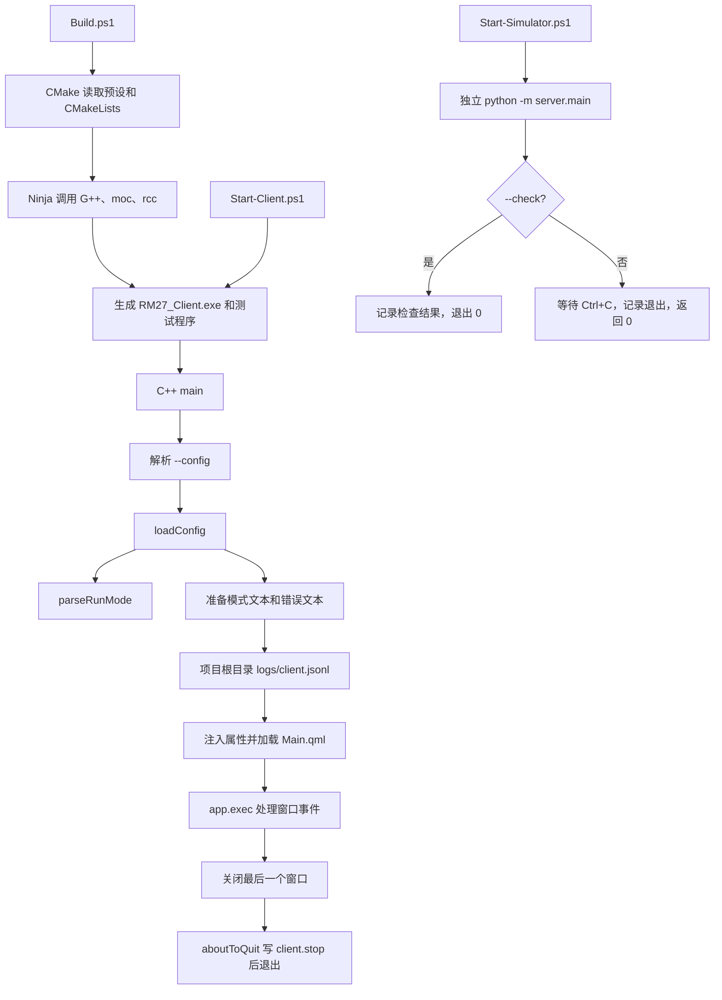

# RM27_Client 骨架：结构、文件、函数与逐行解读

> 入口迁移说明（2026-10-22）：四个独立启动脚本已经删除，构建、运行和测试指令改由 `.vscode/tasks.json` 直接执行。本文保留 2026-10-19 骨架的历史逐行讲解，涉及 `scripts` 的内容仅供学习旧实现，不再是当前操作步骤。当前入口请看 [README](../README.md) 和 [tasks.json](../.vscode/tasks.json)。

对应 2026-10-19 的 T06 骨架及本次日志路径调整。本文从整体结构讲到实际源码的每一行；源码以后有变化时，应以源码为准，并同步修订本文的行号。

## 1. 先确定你正在运行哪个项目

真正的 CMake 项目根目录是：

```text
D:/Competition/RM/RM27/code/RM27_Client/RM27_Client
```

上一级同名目录保存需求、规则审阅和参考项目。本项目根目录下的 `apps`、`libs`、`simulator` 才是刚建立的骨架；`research/reference/RM26_Client` 是参考资料，不会参与本工程的构建或运行。

这里有两个独立程序。客户端是编译后的 `RM27_Client.exe`，负责打开窗口；模拟器是 Python 执行的 `server.main` 模块，当前只记录日志并等待退出。它们没有互相启动，也没有互相通信。

“模拟”目前只是运行模式标签：加载 `simulation` 配置后显示“模拟”，不会生成机器人状态。“正式”也只是标签及默认选择。两个模式都始终显示“未连接”。回放按钮是禁用的占位入口。

## 2. 从结构看每个部分负责什么

```text
RM27_Client/                         ← 内层项目根目录
├─ CMakeLists.txt                    ← 声明工程、依赖、子目录与测试开关
├─ CMakePresets.json                 ← 固定本机 Debug/Release 工具与构建目录
├─ .gitignore                        ← 排除构建产物、日志、本地配置、Python 缓存
├─ .editorconfig                     ← 文本编码、换行与缩进约定
├─ apps/client/
│  ├─ CMakeLists.txt                 ← 定义客户端 exe、依赖和项目根路径宏
│  ├─ main.cpp                       ← 客户端程序入口，组装已有基础模块
│  ├─ client.qrc                     ← 将 QML 和默认 JSON 嵌入 exe
│  └─ qml/Main.qml                   ← 声明窗口、模式、错误、日志路径与回放按钮
├─ libs/
│  ├─ domain/                        ← 运行模式及文本到模式的严格转换
│  ├─ config/                        ← 读取 JSON、验证格式、返回错误
│  └─ diagnostics/                   ← 创建日志文件、追加 JSONL、报告写入错误
├─ configs/
│  ├─ defaults.json                  ← 默认正式模式，构建时嵌入资源
│  └─ simulation.example.json        ← 外部模拟配置示例
├─ simulator/
│  ├─ server/__init__.py             ← 标记 Python 包
│  ├─ server/main.py                 ← 模拟器独立入口
│  └─ tests/test_entrypoint.py        ← 模拟器入口、参数和中断退出测试
├─ tests/
│  ├─ CMakeLists.txt                 ← 定义、登记两个 C++ 测试程序
│  └─ unit/
│     ├─ test_startup.cpp            ← 配置和日志检查
│     └─ test_client_ui.cpp          ← 无屏幕模式下检查 QML 窗口
├─ scripts/
│  ├─ Build.ps1                      ← 配置并编译客户端和测试
│  ├─ Start-Client.ps1               ← 准备 DLL 搜索路径并启动客户端
│  ├─ Start-Simulator.ps1            ← 切到模块目录并启动独立 Python 进程
│  └─ Test.ps1                       ← 依次执行 CTest 和 Python unittest
├─ docs/                            ← 验收记录与本文，不参与编译
├─ README.md                        ← 最短启动说明
├─ 开发环境.md                      ← 工具版本和安装路径记录
├─ build/                           ← 构建生成物，Git 忽略
└─ logs/client.jsonl                ← 实际运行后产生的客户端日志，Git 忽略
```

`libs` 中的三个库是静态库：编译时生成 `.a`，链接时由客户端使用；它们没有独立窗口或进程。头文件 `.h` 告诉调用者“有哪些类型、函数”；实现文件 `.cpp` 写出“这些函数具体怎样执行”。

QML 和 Python 也不同：QML 由客户端内的 Qt 引擎加载，用来建立界面；Python 模拟器由独立解释器启动。CMake 和 PowerShell 则分别负责构建准备和启动准备，不是比赛业务模块。

## 3. 函数与调用关系

| 入口或函数 | 接收什么 | 做什么 | 输出/谁接着使用 |
| --- | --- | --- | --- |
| C++ `main(argc, argv)` | 操作系统传来的命令行参数 | 建立 Qt 应用，处理配置参数，组装配置、日志、QML | 进入事件循环，最后返回退出码 |
| `loadConfig(path)` | JSON 的磁盘路径或 Qt 资源路径 | 读文件、解析 JSON、检查字段、检查模式 | `ConfigResult`，交回 `main` |
| `parseRunMode(value)` | `official` / `simulation` 字符串 | 转成 C++ 的枚举；其他文本返回空值 | `loadConfig` 决定成功或报错 |
| `JsonlLogger::open(path)` | 日志完整路径 | 创建父目录并以追加方式打开文件 | `bool` 表示是否成功 |
| `JsonlLogger::write(level,event,detail)` | 日志级别、事件名、细节 | 生成一行 JSON，加换行，写入并刷新 | `bool` 表示是否成功 |
| `JsonlLogger::errorString()` | 无 | 读取最近保存的错误说明 | `main` 显示到窗口或输出警告 |
| `aboutToQuit` 的 lambda | Qt 退出信号 | 记录 `client.stop` | 写入日志；失败则输出警告 |
| `QML ApplicationWindow` | C++ 注入的三个属性 | 声明显示内容、布局和属性绑定 | Qt 自动建立、绘制窗口 |
| Python `main(argv=None)` | 显式参数列表或解释器命令行 | 解析 `--check`，初始化日志，检查后退出或等待 | 返回整数退出码 |
| C++ 测试的 `private slots` 方法 | QtTest 的测试数据 | 验证行为，不参与正式客户端启动 | 测试通过/失败报告 |
| Python `test_*` 方法 | unittest 调用 | 启动检查进程或模拟中断，核对退出行为 | unittest 报告 |

QML 文件没有自定义业务函数，四个 PowerShell 脚本也没有定义函数；它们按文件中的语句顺序执行。CMake 中的 `project`、`add_subdirectory`、`target_link_libraries` 等是构建命令，不是运行时由客户端调用的函数。



## 4. 客户端从启动到关闭的实际顺序

1. 启动脚本找到已有的 exe，把 Qt 和 MinGW 的 `bin` 目录临时放到 PATH 前面，让系统能找到配套 DLL。脚本不会替你编译，也不会启动模拟器。
2. 操作系统加载 exe，进入 `main`。`QGuiApplication` 管理窗口环境、参数和事件分发；设置应用名称、版本及 `Basic` 控件样式。
3. `QCommandLineParser` 接受 `--config`。没有传入时，使用 exe 内的默认资源 `:/RM27/Client/defaults.json`。帮助/版本参数由解析器处理，不进入普通窗口启动流程。
4. `loadConfig` 返回“有配置”或“没有配置且附错误”。它不会在失败时偷偷改用另一个文件。只有严格匹配 `official` 或 `simulation` 才能得到有效模式。
5. `main` 将结果转成“正式”“模拟”或“未确定（配置错误）”，准备项目根目录下的日志，记录 `client.start`。日志不能写入时，错误也会加入窗口错误文本。
6. `setInitialProperties` 把模式、启动错误、日志路径送入 QML 根对象；这发生在加载 QML 前，所以 `required property string modeText` 能在创建窗口时得到值。
7. `engine.load` 读取资源中的 QML，建立窗口和控件。如果根对象没有建立成功，记下 `client.qml_failed` 并返回退出码 1。正常情况下开始 `app.exec()`。
8. `app.exec()` 运行事件循环：等待和处理鼠标、键盘、窗口重绘、关闭等事件。它不代表一个反复执行比赛逻辑的 `while` 循环，也不会自动联网。
9. 关闭最后一个窗口时，Qt 默认请求应用退出，发出 `aboutToQuit`，回调写入 `client.stop`，事件循环结束。`main` 返回 Qt 的退出码，局部对象随后依逆序销毁，文件随 `QFile` 析构关闭。

错误配置目前允许窗口打开，目的是显示具体错误供定位；此时仍为“未连接”。该设计不会把“坏配置”解释成“成功连接”。

## 5. 构建与运行要实际输入什么

PowerShell 窗口一：

```powershell
Set-Location 'D:/Competition/RM/RM27/code/RM27_Client/RM27_Client'
./scripts/Build.ps1
./scripts/Start-Client.ps1
```

`Build.ps1` 先运行配置命令，生成 Ninja 构建规则；再运行构建命令，编译和链接。Debug 的客户端生成到 `build/windows-mingw-debug/bin/RM27_Client.exe`。构建成功后，第二条启动命令才负责打开窗口。

若要切换为模拟标签，先关掉窗口，再执行：

```powershell
./scripts/Start-Client.ps1 -Config ./configs/simulation.example.json
```

PowerShell 窗口二，独立启动模拟器：

```powershell
Set-Location 'D:/Competition/RM/RM27/code/RM27_Client/RM27_Client'
./scripts/Start-Simulator.ps1
```

模拟器显示启动日志后停留等待，不会弹出窗口或发送消息。按 Ctrl+C 触发 Python 的 `KeyboardInterrupt`，入口捕获后正常返回 0；`finally` 保证记录停止日志。只检查入口时执行 `./scripts/Start-Simulator.ps1 -Check`，它不会常驻。

完成构建后，用一个命令运行现有检查：

```powershell
./scripts/Test.ps1
```

CTest 运行两个 C++ 测试程序；其中 UI 测试使用 offscreen 后端，不要求桌面上出现窗口。随后脚本进入模拟器目录，调用 Python unittest。脚本中每个外部命令的非零退出码都会转成 PowerShell 错误，避免某一步失败后仍显示成功。

Release 仅需给上述三个客户端脚本传入 `-Configuration Release`。这是另一套构建输出，还未完成 T07 的 DLL 收集和干净机部署，不能将本机可运行直接理解为可以把 exe 单独拷走。

## 6. 这几种路径务必分清

| 写法 | 含义 | 当前用途 |
| --- | --- | --- |
| `configs/simulation.example.json` | 磁盘上的相对路径 | 启动脚本先按调用者工作目录转成绝对路径 |
| `:/RM27/Client/defaults.json` | Qt 文件接口使用的内嵌资源路径 | `QFile` 读取默认配置 |
| `qrc:/RM27/Client/Main.qml` | QML 引擎接受的资源 URL | 从 exe 的资源中加载界面 |
| `${CMAKE_SOURCE_DIR}` | CMake 配置时的项目根目录 | 写入编译宏 `RM27_PROJECT_ROOT` |
| `RM27_PROJECT_ROOT` | C++ 预处理宏，值是上述目录的字符串 | 拼接开发阶段日志绝对路径 |
| `logs/client.jsonl` | 项目内实际生成的文件 | 追加客户端日志，由 Git 忽略 |

本次日志改为：

```text
D:/Competition/RM/RM27/code/RM27_Client/RM27_Client/logs/client.jsonl
```

这是编译时记录的源码根目录，不依赖 `Get-Location`，也不依赖 exe 所在目录。已从系统临时目录启动真实 exe，确认新日志仍追加到项目内。移动整个源码目录后需重新配置并编译；将来做正式可搬运发行包时，应在 T07/T29 明确部署后的日志位置。

日志采用 JSONL：每个事件占一行 JSON，而非把所有事件包在一个 JSON 数组里。例如：

```json
{"detail":"正式 ","event":"client.start","level":"info","timestamp":"2026-10-19T09:39:50.803Z"}
```

`timestamp` 是 UTC，尾部 `Z` 表示 UTC；北京时间需要加八小时。`event` 是事件类型，`level` 是级别，`detail` 是附加说明。`Append` 保留已有记录，`flush` 把缓冲提交给文件系统；强制终止进程不保证执行退出回调，所以没有 `client.stop` 不一定意味着启动失败。

`.gitignore` 的 `/logs/` 排除根目录日志文件夹，`/*.log`、`/*.jsonl` 额外排除项目根目录散落的日志文件。其他目录中的协议样本不会因为这个规则被一并忽略。

旧文件 `C:/Users/15269/AppData/Local/RM27/RM27_Client/logs/client.jsonl` 的删除请求两次被自动审批拒绝，返回 `blocked by policy`，没有提供更具体原因；旧文件目前保留。新程序已不再使用该路径。

## 7. 怎样阅读下面的逐行表

下面覆盖项目中的全部手写 C++、QML、Python、CMake、JSON、PowerShell 及 Git/编辑器配置。Markdown 说明文档不是执行代码，不再逐行解释说明文档本身；`build/` 内的生成文件、Python 缓存、运行日志也不属于手写骨架。

每个表的行号对应当前源文件的物理行，包括空行、括号和注释。空行主要用于分隔阅读；结束括号用于关闭所属代码块，不表示单独的业务动作。代码列对特殊字符做了 HTML 转义，显示的内容仍对应源代码。

建议先读“构建/脚本”的文件作用，再顺着运行时的 `main → loadConfig → parseRunMode → logger → QML` 读详细表，最后读测试。每个文件都先解释职责和函数，再解释每行，避免把局部语法与整个启动流程混在一起。

历史逐行覆盖于 2026-10-19 核对：共 29 个手写文件、768 个物理行。以下是当时源码的快照，后续源码和启动入口已经变化，不再代表当前全部文件的逐行内容。

## 8. 构建、配置与启动脚本逐行说明

本节按文件原始物理行编号；空行和结束括号均单独列出。行末换行符本身不另算一行。CMake 文件用于生成构建规则，JSON/XML 用于保存数据，PowerShell 脚本负责调用工具；它们都不是客户端的 C++ 主循环。

### CMakeLists.txt

文件：[CMakeLists.txt](D:/Competition/RM/RM27/code/RM27_Client/RM27_Client/CMakeLists.txt)。整个 C++/Qt 工程的总装配表：规定语言、查找 Qt、进入三个基础库与客户端目录，并可选启用测试。

这不是程序运行入口；CMake 在“配置”阶段执行这些命令，随后生成 Ninja 构建规则。

| 行号 | 代码 | 说明 |
| ---: | --- | --- |
| 1 | <code>cmake_minimum_required(VERSION 3.21)</code> | 要求执行此文件的 CMake 版本至少为 3.21；版本过低会在配置阶段报错。 |
| 2 | <code>project(RM27Client VERSION 0.1.0 LANGUAGES CXX)</code> | 声明工程名 RM27Client、版本 0.1.0，并只启用 CXX（C++）语言。 |
| 3 | （空行） | 空行，分隔工程声明与编译选项。 |
| 4 | <code>set(CMAKE_CXX_STANDARD 17)</code> | 把所有随后创建的 C++ 目标默认语言标准设为 C++17。 |
| 5 | <code>set(CMAKE_CXX_STANDARD_REQUIRED ON)</code> | 要求编译器真正支持指定标准；不允许悄悄退回更旧的标准。 |
| 6 | <code>set(CMAKE_CXX_EXTENSIONS OFF)</code> | 关闭编译器私有的语言扩展，尽量按标准 C++17 编译。 |
| 7 | <code>set(CMAKE_AUTOMOC ON)</code> | 启用 Qt 的自动 moc 步骤；使用 Q_OBJECT 的类可自动生成元对象代码。 |
| 8 | <code>set(CMAKE_AUTORCC ON)</code> | 启用 Qt 的自动 rcc 步骤；目标中的 .qrc 会自动转成可编译资源代码。 |
| 9 | <code>set(CMAKE_EXPORT_COMPILE_COMMANDS ON)</code> | 让支持它的生成器输出 compile_commands.json，供编辑器等工具读取每个源文件的编译命令。 |
| 10 | （空行） | 空行，分隔编译选项与依赖查找。 |
| 11 | <code>find_package(Qt6 6.8 REQUIRED COMPONENTS Core Gui Qml Quick QuickControls2)</code> | 查找至少 6.8 版的 Qt6，并要求 Core、Gui、Qml、Quick、QuickControls2 都存在；REQUIRED 表示缺少依赖就停止配置。 |
| 12 | <code>include(CTest)</code> | 加载 CTest 支持，提供 BUILD_TESTING 开关并在启用时设置测试基础设施。 |
| 13 | （空行） | 空行，分隔依赖准备与子目录装配。 |
| 14 | <code>add_subdirectory(libs/domain)</code> | 执行 libs/domain/CMakeLists.txt，创建运行模式基础库。 |
| 15 | <code>add_subdirectory(libs/config)</code> | 执行 libs/config/CMakeLists.txt，创建配置读取库；它在 domain 之后声明。 |
| 16 | <code>add_subdirectory(libs/diagnostics)</code> | 执行 libs/diagnostics/CMakeLists.txt，创建 JSONL 日志库。 |
| 17 | <code>add_subdirectory(apps/client)</code> | 执行 apps/client/CMakeLists.txt，创建最终客户端程序。 |
| 18 | （空行） | 空行，分隔生产目标与测试目标。 |
| 19 | <code>if(BUILD_TESTING)</code> | 只有 BUILD_TESTING 为真时，才执行下面的测试配置。 |
| 20 | <code>    find_package(Qt6 REQUIRED COMPONENTS Test)</code> | 额外查找 Qt Test 组件；没有它时测试配置失败。 |
| 21 | <code>    add_subdirectory(tests)</code> | 执行 tests/CMakeLists.txt，声明测试程序并注册测试。 |
| 22 | <code>endif()</code> | 结束 BUILD_TESTING 条件块。 |
| 23 | （空行） | 空行，文件尾部的视觉分隔。 |

### CMakePresets.json

文件：[CMakePresets.json](D:/Competition/RM/RM27/code/RM27_Client/RM27_Client/CMakePresets.json)。保存本机可重复使用的配置、构建和测试方案；Debug 与 Release 分别使用自己的 build 子目录。

JSON 是数据，不定义业务函数。CMake 读取 configurePresets，cmake --build 读取 buildPresets，ctest 读取 testPresets。这里的 Qt、MinGW 与 Ninja 路径是当前电脑约定。

| 行号 | 代码 | 说明 |
| ---: | --- | --- |
| 1 | <code>{</code> | 开始整个 JSON 对象。 |
| 2 | <code>  &quot;version&quot;: 3,</code> | 采用 CMake Presets 第 3 版数据格式。 |
| 3 | <code>  &quot;cmakeMinimumRequired&quot;: { &quot;major&quot;: 3, &quot;minor&quot;: 21, &quot;patch&quot;: 0 },</code> | 声明使用该预设所需的最低 CMake 版本为 3.21.0。 |
| 4 | <code>  &quot;configurePresets&quot;: [</code> | 开始配置预设数组；配置阶段决定编译器、依赖和生成器。 |
| 5 | <code>    {</code> | 开始公共配置预设对象。 |
| 6 | <code>      &quot;name&quot;: &quot;windows-mingw&quot;,</code> | 把公共预设命名为 windows-mingw，供下方两种构建配置继承。 |
| 7 | <code>      &quot;hidden&quot;: true,</code> | hidden 为 true，表示这是供继承的隐藏基础预设，不直接作为日常可选方案使用。 |
| 8 | <code>      &quot;generator&quot;: &quot;Ninja&quot;,</code> | 指定 Ninja 作为构建系统生成器。 |
| 9 | <code>      &quot;binaryDir&quot;: &quot;${sourceDir}/build/${presetName}&quot;,</code> | 指定构建目录；${sourceDir} 是源码根目录，${presetName} 是最终使用的预设名，因此 Debug/Release 产物隔离。 |
| 10 | <code>      &quot;environment&quot;: {</code> | 开始这一预设提供的环境变量对象。 |
| 11 | <code>        &quot;RM27_QT_ROOT&quot;: &quot;D:/Qt6/6.11.2/mingw_64&quot;,</code> | 把 RM27_QT_ROOT 设为本机 Qt MinGW 版本的安装目录。 |
| 12 | <code>        &quot;RM27_QT_TOOLS&quot;: &quot;D:/Qt6/Tools&quot;,</code> | 把 RM27_QT_TOOLS 设为本机 Qt 工具目录。 |
| 13 | <code>        &quot;PATH&quot;: &quot;$env{RM27_QT_ROOT}/bin;$env{RM27_QT_TOOLS}/mingw1310_64/bin;$penv{PATH}&quot;</code> | 组合 PATH：$env{...} 读取当前预设环境，$penv{PATH} 读取启动 CMake 前的父进程 PATH；分号是 Windows 路径分隔符。 |
| 14 | <code>      },</code> | 结束环境变量对象，逗号表示后面还有字段。 |
| 15 | <code>      &quot;cacheVariables&quot;: {</code> | 开始 CMake 缓存变量对象；这些值会进入构建目录中的 CMakeCache.txt。 |
| 16 | <code>        &quot;CMAKE_PREFIX_PATH&quot;: &quot;$env{RM27_QT_ROOT}&quot;,</code> | 向 find_package 提供 Qt 安装前缀，$env{RM27_QT_ROOT} 展开上一节的环境变量。 |
| 17 | <code>        &quot;CMAKE_CXX_COMPILER&quot;: &quot;$env{RM27_QT_TOOLS}/mingw1310_64/bin/g++.exe&quot;,</code> | 指定实际使用的 MinGW g++.exe，而非依赖系统碰巧找到的编译器。 |
| 18 | <code>        &quot;CMAKE_MAKE_PROGRAM&quot;: &quot;$env{RM27_QT_TOOLS}/Ninja/ninja.exe&quot;,</code> | 指定 Ninja 可执行文件的完整路径。 |
| 19 | <code>        &quot;BUILD_TESTING&quot;: &quot;ON&quot;</code> | 把 BUILD_TESTING 设为 ON，让根 CMake 文件配置测试目标。 |
| 20 | <code>      }</code> | 结束缓存变量对象。 |
| 21 | <code>    },</code> | 结束公共预设对象，逗号表示数组后面还有预设。 |
| 22 | <code>    {</code> | 开始 Debug 配置对象。 |
| 23 | <code>      &quot;name&quot;: &quot;windows-mingw-debug&quot;,</code> | 定义可以传给 --preset 的 Debug 预设名。 |
| 24 | <code>      &quot;displayName&quot;: &quot;Windows / Qt MinGW / Debug&quot;,</code> | 提供供工具界面显示的可读名称。 |
| 25 | <code>      &quot;inherits&quot;: &quot;windows-mingw&quot;,</code> | 继承 windows-mingw 的生成器、目录规则、环境和缓存默认值。 |
| 26 | <code>      &quot;cacheVariables&quot;: { &quot;CMAKE_BUILD_TYPE&quot;: &quot;Debug&quot; }</code> | 在继承内容上指定 CMAKE_BUILD_TYPE=Debug；此单配置 Ninja 目录生成调试构建。 |
| 27 | <code>    },</code> | 结束 Debug 配置对象，逗号表示后面还有 Release 配置。 |
| 28 | <code>    {</code> | 开始 Release 配置对象。 |
| 29 | <code>      &quot;name&quot;: &quot;windows-mingw-release&quot;,</code> | 定义可以传给 --preset 的 Release 预设名。 |
| 30 | <code>      &quot;displayName&quot;: &quot;Windows / Qt MinGW / Release&quot;,</code> | 提供 Release 预设的界面名称。 |
| 31 | <code>      &quot;inherits&quot;: &quot;windows-mingw&quot;,</code> | 继续继承同一个公共 MinGW 配置。 |
| 32 | <code>      &quot;cacheVariables&quot;: { &quot;CMAKE_BUILD_TYPE&quot;: &quot;Release&quot; }</code> | 把 CMAKE_BUILD_TYPE 覆盖为 Release，生成发布优化构建配置；这本身不等于打包部署。 |
| 33 | <code>    }</code> | 结束 Release 配置对象。 |
| 34 | <code>  ],</code> | 结束 configurePresets 数组。 |
| 35 | <code>  &quot;buildPresets&quot;: [</code> | 开始构建预设数组；这里只关联已配置好的构建目录。 |
| 36 | <code>    { &quot;name&quot;: &quot;windows-mingw-debug&quot;, &quot;configurePreset&quot;: &quot;windows-mingw-debug&quot; },</code> | 定义 Debug 构建预设，并绑定同名配置预设。 |
| 37 | <code>    { &quot;name&quot;: &quot;windows-mingw-release&quot;, &quot;configurePreset&quot;: &quot;windows-mingw-release&quot; }</code> | 定义 Release 构建预设，并绑定同名配置预设。 |
| 38 | <code>  ],</code> | 结束 buildPresets 数组。 |
| 39 | <code>  &quot;testPresets&quot;: [</code> | 开始测试预设数组；CTest 用它确定应测试哪个构建目录。 |
| 40 | <code>    {</code> | 开始 Debug 测试预设对象。 |
| 41 | <code>      &quot;name&quot;: &quot;windows-mingw-debug&quot;,</code> | 定义 Debug 测试预设名。 |
| 42 | <code>      &quot;configurePreset&quot;: &quot;windows-mingw-debug&quot;,</code> | 将 Debug 测试绑定至 Debug 配置目录。 |
| 43 | <code>      &quot;output&quot;: { &quot;outputOnFailure&quot;: true }</code> | 设置 outputOnFailure：失败时输出测试程序的详细输出。 |
| 44 | <code>    },</code> | 结束 Debug 测试预设，逗号表示后面还有 Release 测试预设。 |
| 45 | <code>    {</code> | 开始 Release 测试预设对象。 |
| 46 | <code>      &quot;name&quot;: &quot;windows-mingw-release&quot;,</code> | 定义 Release 测试预设名。 |
| 47 | <code>      &quot;configurePreset&quot;: &quot;windows-mingw-release&quot;,</code> | 将 Release 测试绑定至 Release 配置目录。 |
| 48 | <code>      &quot;output&quot;: { &quot;outputOnFailure&quot;: true }</code> | 同样在测试失败时显示详细输出。 |
| 49 | <code>    }</code> | 结束 Release 测试预设对象。 |
| 50 | <code>  ]</code> | 结束 testPresets 数组。 |
| 51 | <code>}</code> | 结束整个 JSON 对象。 |
| 52 | （空行） | 空行，文件尾部的视觉分隔。 |

### .gitignore

文件：[.gitignore](D:/Competition/RM/RM27/code/RM27_Client/RM27_Client/.gitignore)。告诉 Git 哪些本地产物不应作为新文件加入版本管理，包括构建产物、个人配置、日志与 Python 缓存。

这些是匹配规则，不执行程序，也不会删除已有文件；已被 Git 跟踪的文件不会因为新增规则自动取消跟踪。

| 行号 | 代码 | 说明 |
| ---: | --- | --- |
| 1 | <code>/build/</code> | 忽略项目根目录的 build 文件夹及其全部内容；开头 / 把匹配锚定到本 .gitignore 所在目录。 |
| 2 | <code>/CMakeUserPresets.json</code> | 忽略根目录的 CMakeUserPresets.json，允许个人机器使用自己的预设。 |
| 3 | <code>/configs/local*.json</code> | 忽略 configs 下以 local 开头、以 .json 结尾的个人配置文件。 |
| 4 | <code># Runtime logs, including loose log files in the project root.</code> | 英文注释：下一组规则忽略运行日志，也包括根目录中单独生成的日志文件。 |
| 5 | <code>/logs/</code> | 忽略根目录 logs 文件夹，客户端和模拟器日志可以放在这里。 |
| 6 | <code>/*.log</code> | 忽略根目录下扩展名为 .log 的文件；* 匹配文件名。 |
| 7 | <code>/*.jsonl</code> | 忽略根目录下扩展名为 .jsonl 的文件，一行一个 JSON 的日志属于此类。 |
| 8 | <code>/.venv/</code> | 忽略根目录的 Python 虚拟环境 .venv。 |
| 9 | <code>__pycache__/</code> | 忽略任意层级的 __pycache__ 目录；这里没有开头 /，因此也涵盖 simulator 内部缓存。 |
| 10 | <code>*.py[cod]</code> | 忽略任意层级 .pyc、.pyo、.pyd 文件；[cod] 表示末尾字符可以是 c、o 或 d。 |
| 11 | <code>/.pytest_cache/</code> | 忽略根目录 pytest 的缓存目录。 |
| 12 | （空行） | 空行，文件尾部的视觉分隔。 |

### .editorconfig

文件：[.editorconfig](D:/Competition/RM/RM27/code/RM27_Client/RM27_Client/.editorconfig)。统一支持 EditorConfig 的编辑器保存文件时采用的字符集、换行和缩进。

这不是构建配置，也不自动改写已有文件；是否应用由编辑器的 EditorConfig 支持决定。

| 行号 | 代码 | 说明 |
| ---: | --- | --- |
| 1 | <code>root = true</code> | 声明这是本工程的顶层 EditorConfig，编辑器不再继续向父目录查找规则。 |
| 2 | （空行） | 空行，分隔全局声明与匹配段。 |
| 3 | <code>[*]</code> | 对本目录下所有匹配文件应用下面的默认规则。 |
| 4 | <code>charset = utf-8</code> | 指定文件字符编码为 UTF-8。 |
| 5 | <code>end_of_line = lf</code> | 指定保存时使用 LF 换行符。 |
| 6 | <code>insert_final_newline = true</code> | 要求文件末尾保留一个换行符。 |
| 7 | <code>indent_style = space</code> | 使用空格缩进，而非制表符。 |
| 8 | <code>indent_size = 4</code> | 默认缩进宽度为 4 个空格。 |
| 9 | （空行） | 空行，分隔通用规则与特殊文件规则。 |
| 10 | <code>[*.{json,qml}]</code> | 仅对扩展名为 json 或 qml 的文件应用接下来的覆盖规则。 |
| 11 | <code>indent_size = 2</code> | 把 JSON 和 QML 的缩进宽度覆盖为 2 个空格。 |
| 12 | （空行） | 空行，文件尾部的视觉分隔。 |

### libs/domain/CMakeLists.txt

文件：[libs/domain/CMakeLists.txt](D:/Competition/RM/RM27/code/RM27_Client/RM27_Client/libs/domain/CMakeLists.txt)。将纯 C++ 运行模式定义编译成可被其他模块使用的静态库 rm27_domain。

add_library 创建目标；target_include_directories 的 PUBLIC 同时影响本库和链接本库的使用方。静态库代码最终进入链接它的程序。

| 行号 | 代码 | 说明 |
| ---: | --- | --- |
| 1 | <code>add_library(rm27_domain STATIC RunMode.cpp RunMode.h)</code> | 创建 rm27_domain 静态库，并将 RunMode.cpp 与头文件 RunMode.h 归入目标。 |
| 2 | <code>set_target_properties(rm27_domain PROPERTIES AUTOMOC OFF)</code> | 仅为这个目标关闭 AUTOMOC；运行模式代码没有 Qt 元对象需求。 |
| 3 | <code>target_include_directories(rm27_domain PUBLIC &quot;${CMAKE_CURRENT_SOURCE_DIR}/..&quot;)</code> | 公开头文件搜索目录：${CMAKE_CURRENT_SOURCE_DIR} 是当前 libs/domain，/.. 得到 libs，让使用方可以写 domain/RunMode.h。 |
| 4 | （空行） | 空行，文件尾部的视觉分隔。 |

### libs/config/CMakeLists.txt

文件：[libs/config/CMakeLists.txt](D:/Competition/RM/RM27/code/RM27_Client/RM27_Client/libs/config/CMakeLists.txt)。把配置数据结构与配置加载实现编译成静态库 rm27_config。

配置库公开依赖 domain 和 Qt Core，因此链接配置库的客户端也继承对应的头文件路径与链接要求。

| 行号 | 代码 | 说明 |
| ---: | --- | --- |
| 1 | <code>add_library(rm27_config STATIC AppConfig.cpp AppConfig.h)</code> | 创建 rm27_config 静态库，源文件为 AppConfig.cpp 和 AppConfig.h。 |
| 2 | <code>target_include_directories(rm27_config PUBLIC &quot;${CMAKE_CURRENT_SOURCE_DIR}/..&quot;)</code> | 把当前目录的父目录 libs 作为 PUBLIC 头文件搜索路径，使 config/AppConfig.h 形式的包含可用。 |
| 3 | <code>target_link_libraries(rm27_config PUBLIC rm27_domain Qt6::Core)</code> | 声明本库公开链接 rm27_domain 与 Qt6::Core；PUBLIC 会把所需使用要求继续传给消费者。 |
| 4 | （空行） | 空行，文件尾部的视觉分隔。 |

### libs/diagnostics/CMakeLists.txt

文件：[libs/diagnostics/CMakeLists.txt](D:/Competition/RM/RM27/code/RM27_Client/RM27_Client/libs/diagnostics/CMakeLists.txt)。将 JSONL 文件日志实现编译成静态库 rm27_diagnostics。

此库使用 Qt Core 的文件、时间、JSON 等类型；PUBLIC 用于传递使用这份公开头文件所需的 Qt 依赖。

| 行号 | 代码 | 说明 |
| ---: | --- | --- |
| 1 | <code>add_library(rm27_diagnostics STATIC JsonlLogger.cpp JsonlLogger.h)</code> | 创建 rm27_diagnostics 静态库，包含 JsonlLogger.cpp 与 JsonlLogger.h。 |
| 2 | <code>target_include_directories(rm27_diagnostics PUBLIC &quot;${CMAKE_CURRENT_SOURCE_DIR}/..&quot;)</code> | 公开 libs 头文件搜索路径，允许调用方包含 diagnostics/JsonlLogger.h。 |
| 3 | <code>target_link_libraries(rm27_diagnostics PUBLIC Qt6::Core)</code> | 声明日志库公开依赖 Qt6::Core，并将其使用要求传给链接者。 |
| 4 | （空行） | 空行，文件尾部的视觉分隔。 |

### apps/client/CMakeLists.txt

文件：[apps/client/CMakeLists.txt](D:/Competition/RM/RM27/code/RM27_Client/RM27_Client/apps/client/CMakeLists.txt)。创建客户端 exe，链接基础库与 Qt，并把源码根目录编译进客户端供默认日志路径使用。

qt_add_executable 是 Qt 提供的 CMake 命令。PRIVATE 表示这些编译定义和直接使用要求属于客户端本身；RM27_PROJECT_ROOT 是编译期字符串宏，不是启动时读取的环境变量。

| 行号 | 代码 | 说明 |
| ---: | --- | --- |
| 1 | <code>qt_add_executable(RM27_Client WIN32 main.cpp client.qrc)</code> | 创建名为 RM27_Client 的 Qt 可执行目标，编译 main.cpp 并打包 client.qrc；WIN32 在 Windows 上使用图形应用子系统。 |
| 2 | <code>target_link_libraries(RM27_Client PRIVATE</code> | 开始声明仅属于客户端目标的链接依赖列表；PRIVATE 不向下游消费者传播直接使用要求。 |
| 3 | <code>    rm27_config rm27_diagnostics Qt6::Gui Qt6::Qml Qt6::Quick Qt6::QuickControls2</code> | 链接配置库、日志库，以及 Qt GUI、QML、Qt Quick 和 Quick Controls 2 组件。 |
| 4 | <code>)</code> | 结束 target_link_libraries 命令。 |
| 5 | <code>target_compile_definitions(RM27_Client PRIVATE</code> | 开始为客户端目标添加私有的编译期宏定义。 |
| 6 | <code>    RM27_PROJECT_ROOT=&quot;${CMAKE_SOURCE_DIR}&quot;</code> | 将 RM27_PROJECT_ROOT 定义为带双引号的源码根目录字符串；${CMAKE_SOURCE_DIR} 在 CMake 配置时展开，供 C++ 计算项目内日志路径。 |
| 7 | <code>)</code> | 结束 target_compile_definitions 命令。 |
| 8 | <code>set_target_properties(RM27_Client PROPERTIES</code> | 开始设置客户端目标的属性。 |
| 9 | <code>    RUNTIME_OUTPUT_DIRECTORY &quot;${CMAKE_BINARY_DIR}/bin&quot;</code> | 将 exe 输出目录设为当前构建根目录下的 bin；例如 build/windows-mingw-debug/bin。 |
| 10 | <code>)</code> | 结束 set_target_properties 命令。 |
| 11 | （空行） | 空行，文件尾部的视觉分隔。 |

### apps/client/client.qrc

文件：[apps/client/client.qrc](D:/Competition/RM/RM27/code/RM27_Client/RM27_Client/apps/client/client.qrc)。把 QML 页面和默认配置嵌入客户端二进制，让启动时可以通过 Qt 资源路径读取。

这是 Qt Resource Collection XML。资源被 rcc 打包后，不依赖启动工作目录寻找这两个文件；文件内容变化后需要重新构建。

| 行号 | 代码 | 说明 |
| ---: | --- | --- |
| 1 | <code>&lt;RCC&gt;</code> | 开始 Qt 资源集合的根元素。 |
| 2 | <code>  &lt;qresource prefix=&quot;/RM27/Client&quot;&gt;</code> | 开始一个资源组，其虚拟路径前缀为 /RM27/Client。 |
| 3 | <code>    &lt;file alias=&quot;Main.qml&quot;&gt;qml/Main.qml&lt;/file&gt;</code> | 把实际文件 qml/Main.qml 打包成名为 Main.qml 的资源；QML URL 是 qrc:/RM27/Client/Main.qml。 |
| 4 | <code>    &lt;file alias=&quot;defaults.json&quot;&gt;../../configs/defaults.json&lt;/file&gt;</code> | 把相对于此 .qrc 的 ../../configs/defaults.json 打包为 defaults.json；Qt 文件路径是 :/RM27/Client/defaults.json。 |
| 5 | <code>  &lt;/qresource&gt;</code> | 结束资源组。 |
| 6 | <code>&lt;/RCC&gt;</code> | 结束资源集合。 |
| 7 | （空行） | 空行，文件尾部的视觉分隔。 |

### configs/defaults.json

文件：[configs/defaults.json](D:/Competition/RM/RM27/code/RM27_Client/RM27_Client/configs/defaults.json)。定义客户端内置默认运行模式；由 client.qrc 打包后，未指定外部配置时读取。

这是 JSON 对象，只有 mode 字段；这里没有函数或通信地址。official 会在配置模块中映射为正式模式。

| 行号 | 代码 | 说明 |
| ---: | --- | --- |
| 1 | <code>{</code> | 开始默认配置 JSON 对象。 |
| 2 | <code>  &quot;mode&quot;: &quot;official&quot;</code> | 将 mode 字段设为 official，即正式模式。 |
| 3 | <code>}</code> | 结束 JSON 对象。 |
| 4 | （空行） | 空行，文件尾部的视觉分隔。 |

### configs/simulation.example.json

文件：[configs/simulation.example.json](D:/Competition/RM/RM27/code/RM27_Client/RM27_Client/configs/simulation.example.json)。提供可以通过 --config 读取的模拟模式配置示例。

这是外部配置示例，没有嵌入 qrc；脚本需要把文件路径传给客户端。simulation 仅选择运行模式，不自动建立模拟器通信。

| 行号 | 代码 | 说明 |
| ---: | --- | --- |
| 1 | <code>{</code> | 开始模拟配置 JSON 对象。 |
| 2 | <code>  &quot;mode&quot;: &quot;simulation&quot;</code> | 将 mode 字段设为 simulation，即模拟模式。 |
| 3 | <code>}</code> | 结束 JSON 对象。 |
| 4 | （空行） | 空行，文件尾部的视觉分隔。 |

### scripts/Build.ps1

历史文件：`scripts/Build.ps1`（已删除）。原职责是从项目目录调用 CMake 配置，再构建指定的 Debug 或 Release 方案；当前由 tasks 中的 Configure/Build 任务承担。

脚本没有自定义函数，整个脚本本身是命令入口。& 是 PowerShell 调用运算符；$LASTEXITCODE 是最近原生程序的退出码，0 表示成功。finally 即使发生异常也会执行。

| 行号 | 代码 | 说明 |
| ---: | --- | --- |
| 1 | <code>param(</code> | 开始脚本参数声明。 |
| 2 | <code>    [ValidateSet(&#x27;Debug&#x27;, &#x27;Release&#x27;)]</code> | 限制下一项 Configuration 参数只能取 Debug 或 Release。 |
| 3 | <code>    [string]$Configuration = &#x27;Debug&#x27;,</code> | 声明字符串参数 Configuration，默认 Debug；逗号表示还有下一参数。 |
| 4 | <code>    [string]$CMake = &#x27;D:/Qt6/Tools/CMake_64/bin/cmake.exe&#x27;</code> | 声明 CMake 可执行文件路径参数，并给出本机默认位置。 |
| 5 | <code>)</code> | 结束参数声明。 |
| 6 | <code>$ErrorActionPreference = &#x27;Stop&#x27;</code> | 把 PowerShell 通常可继续执行的错误提升为停止错误；外部程序非零退出码仍由后面显式检查。 |
| 7 | <code>$projectRoot = Split-Path -Parent $PSScriptRoot</code> | $PSScriptRoot 是脚本所在 scripts 目录，取其父目录作为项目根目录。 |
| 8 | <code>$preset = &#x27;windows-mingw-&#x27; + $Configuration.ToLowerInvariant()</code> | 将配置名转为不受地区影响的小写，再拼成 windows-mingw-debug 或 windows-mingw-release。 |
| 9 | <code>Push-Location -LiteralPath $projectRoot</code> | 把调用者当前工作目录压入栈，并切换至项目根目录；-LiteralPath 按字面解释路径。 |
| 10 | <code>try {</code> | 开始需要最终清理工作目录的 try 块。 |
| 11 | <code>    &amp; $CMake --preset $preset</code> | 通过 & 执行 $CMake 指向的程序，--preset 选择配置预设并生成构建规则。 |
| 12 | <code>    if ($LASTEXITCODE -ne 0) { throw &quot;CMake configure failed: $LASTEXITCODE&quot; }</code> | 若配置进程退出码不为 0，则抛出带退出码的异常，后续构建不会执行。 |
| 13 | <code>    &amp; $CMake --build --preset $preset</code> | 通过 cmake --build --preset 调用生成器，编译并链接对应构建目录。 |
| 14 | <code>    if ($LASTEXITCODE -ne 0) { throw &quot;CMake build failed: $LASTEXITCODE&quot; }</code> | 若构建失败，则抛出含退出码的异常。 |
| 15 | <code>} finally {</code> | 结束 try，并开始无论成功失败都会执行的 finally。 |
| 16 | <code>    Pop-Location</code> | 弹出此前保存的目录，恢复脚本调用者的工作目录。 |
| 17 | <code>}</code> | 结束 finally 块。 |
| 18 | （空行） | 空行，文件尾部的视觉分隔。 |

### scripts/Start-Client.ps1

历史文件：`scripts/Start-Client.ps1`（已删除）。原职责是找到已构建的客户端 exe，临时补充 Qt/MinGW 运行时 DLL 搜索路径，再同步启动客户端；当前由 tasks 的 Run 任务及其进程环境承担。

-Config 可选。@clientArguments 在调用位置是数组展开：数组中每项各自成为一个命令行参数；这与创建数组时使用 @() 是不同语法。脚本会等客户端退出后再继续。

| 行号 | 代码 | 说明 |
| ---: | --- | --- |
| 1 | <code>param(</code> | 开始脚本参数声明。 |
| 2 | <code>    [ValidateSet(&#x27;Debug&#x27;, &#x27;Release&#x27;)]</code> | 限制 Configuration 参数只能为 Debug 或 Release。 |
| 3 | <code>    [string]$Configuration = &#x27;Debug&#x27;,</code> | 定义构建配置字符串参数，默认 Debug。 |
| 4 | <code>    [string]$Config,</code> | 定义可选外部配置文件路径参数 Config，未传入时为空。 |
| 5 | <code>    [string]$QtRoot = &#x27;D:/Qt6/6.11.2/mingw_64&#x27;,</code> | 定义 Qt 安装根目录参数，用于运行时寻找 Qt DLL。 |
| 6 | <code>    [string]$MinGWBin = &#x27;D:/Qt6/Tools/mingw1310_64/bin&#x27;</code> | 定义 MinGW bin 目录参数，用于运行时寻找编译器运行库 DLL。 |
| 7 | <code>)</code> | 结束参数声明。 |
| 8 | <code>$ErrorActionPreference = &#x27;Stop&#x27;</code> | 让 PowerShell 错误停止执行，避免在无效路径等条件下继续运行。 |
| 9 | <code>$projectRoot = Split-Path -Parent $PSScriptRoot</code> | 从脚本路径取父目录，得到项目根目录。 |
| 10 | <code>$preset = &#x27;windows-mingw-&#x27; + $Configuration.ToLowerInvariant()</code> | 将构建配置名转小写并拼成对应预设名称。 |
| 11 | <code>$executable = Join-Path $projectRoot &quot;build/$preset/bin/RM27_Client.exe&quot;</code> | 拼出已构建 exe 的完整路径；双引号中的 $preset 会展开为变量值。 |
| 12 | <code>if (-not (Test-Path -LiteralPath $executable)) {</code> | 用 Test-Path 判断 exe 是否存在，-not 表示“不存在时执行下面的块”。 |
| 13 | <code>    throw &quot;Client not built. Run scripts/Build.ps1 -Configuration $Configuration first.&quot;</code> | 缺少 exe 时抛出异常，错误提示给出应先执行的构建命令。 |
| 14 | <code>}</code> | 结束 exe 存在性判断。 |
| 15 | <code># Resolve an explicit path in the caller&#x27;s working directory.</code> | 注释说明：显式传入的配置路径按调用者的当前工作目录解析。 |
| 16 | <code>$clientArguments = @()</code> | 创建空参数数组；未提供 Config 时保持为空。 |
| 17 | <code>if ($Config) {</code> | 只有 Config 非空时，才构造外部配置命令行参数。 |
| 18 | <code>    $clientArguments = @(&#x27;--config&#x27;, $ExecutionContext.SessionState.Path.GetUnresolvedProviderPathFromPSPath($Config))</code> | 创建两项参数数组：--config 与解析后的绝对路径；GetUnresolvedProviderPathFromPSPath 转换路径但不要求文件已存在，实际读取由客户端验证。 |
| 19 | <code>}</code> | 结束 Config 条件块。 |
| 20 | <code>$previousPath = $env:PATH</code> | 保存启动前的 PATH 环境变量，以便程序退出后恢复。 |
| 21 | <code>try {</code> | 开始带 finally 清理的 try 块。 |
| 22 | <code>    $env:PATH = &quot;$QtRoot/bin;$MinGWBin;$previousPath&quot;</code> | 在 PATH 前加入 Qt bin 与 MinGW bin，后面保留旧 PATH；Windows 使用分号分隔目录。 |
| 23 | <code>    &amp; $executable @clientArguments</code> | 执行 exe，并把数组中每个元素展开为独立参数；调用同步等待程序结束。 |
| 24 | <code>    if ($LASTEXITCODE -ne 0) { throw &quot;Client failed: $LASTEXITCODE&quot; }</code> | 如果客户端以非零码退出，抛出带实际退出码的异常。 |
| 25 | <code>} finally {</code> | 结束 try，开始总会执行的 finally。 |
| 26 | <code>    $env:PATH = $previousPath</code> | 恢复此前保存的 PATH，使当前 PowerShell 会话不长期保留本次临时修改。 |
| 27 | <code>}</code> | 结束 finally 块。 |
| 28 | （空行） | 空行，文件尾部的视觉分隔。 |

### scripts/Start-Simulator.ps1

历史文件：`scripts/Start-Simulator.ps1`（已删除）。原职责是切换至 simulator 目录，以模块方式启动独立 Python 模拟器；当前由 tasks 的 Start/Check Simulator 任务承担。

-Check 是开关参数，传入即为真；Python -m server.main 让 Python 按包模块规则运行 server/main.py。

| 行号 | 代码 | 说明 |
| ---: | --- | --- |
| 1 | <code>param(</code> | 开始脚本参数声明。 |
| 2 | <code>    [switch]$Check,</code> | 声明 Check 开关参数，不需要额外写 true；写 -Check 即启用。 |
| 3 | <code>    [string]$Python = &#x27;E:/miniconda3/python.exe&#x27;</code> | 声明 Python 解释器路径参数，默认采用本机 Miniconda 的 Python。 |
| 4 | <code>)</code> | 结束参数声明。 |
| 5 | <code>$ErrorActionPreference = &#x27;Stop&#x27;</code> | 让 PowerShell 错误停止脚本执行。 |
| 6 | <code>$simulatorRoot = Join-Path (Split-Path -Parent $PSScriptRoot) &#x27;simulator&#x27;</code> | 先取得项目根目录，再拼接 simulator，得到模拟器工作目录。 |
| 7 | <code>Push-Location -LiteralPath $simulatorRoot</code> | 保存当前工作目录并切换到 simulator，使 server 包与默认相对路径可以被找到。 |
| 8 | <code>try {</code> | 开始 try 块，保证后面恢复工作目录。 |
| 9 | <code>    $simulatorArguments = @(&#x27;-m&#x27;, &#x27;server.main&#x27;)</code> | 创建 Python 参数数组：-m 表示按模块运行，模块名为 server.main。 |
| 10 | <code>    if ($Check) { $simulatorArguments += &#x27;--check&#x27; }</code> | 启用 Check 时，在数组末尾追加 --check，模拟器据此执行启动检查后退出。 |
| 11 | <code>    &amp; $Python @simulatorArguments</code> | 调用指定 Python，并把参数数组展开为独立命令行参数。 |
| 12 | <code>    if ($LASTEXITCODE -ne 0) { throw &quot;Simulator failed: $LASTEXITCODE&quot; }</code> | 若 Python 返回非零退出码，抛出包含退出码的异常。 |
| 13 | <code>} finally {</code> | 结束 try，进入总会执行的 finally。 |
| 14 | <code>    Pop-Location</code> | 恢复启动脚本前的工作目录。 |
| 15 | <code>}</code> | 结束 finally 块。 |
| 16 | （空行） | 空行，文件尾部的视觉分隔。 |

### scripts/Test.ps1

历史文件：`scripts/Test.ps1`（已删除）。原职责是先运行对应构建目录内注册的 C++ 测试，再进入模拟器目录运行 Python unittest；当前由 tasks 的 Test 组合任务承担。

这是顺序验证入口：前一阶段失败就抛出异常，避免后续步骤掩盖失败。CTest 负责运行已构建的测试，不替代 Build.ps1 编译。

| 行号 | 代码 | 说明 |
| ---: | --- | --- |
| 1 | <code>param(</code> | 开始脚本参数声明。 |
| 2 | <code>    [ValidateSet(&#x27;Debug&#x27;, &#x27;Release&#x27;)]</code> | 约束 Configuration 参数只允许 Debug 或 Release。 |
| 3 | <code>    [string]$Configuration = &#x27;Debug&#x27;,</code> | 定义配置参数，默认测试 Debug 构建。 |
| 4 | <code>    [string]$CTest = &#x27;D:/Qt6/Tools/CMake_64/bin/ctest.exe&#x27;,</code> | 定义 CTest 程序路径参数，默认使用本机 Qt 工具包里的版本。 |
| 5 | <code>    [string]$Python = &#x27;E:/miniconda3/python.exe&#x27;</code> | 定义 Python 解释器路径参数。 |
| 6 | <code>)</code> | 结束参数声明。 |
| 7 | <code>$ErrorActionPreference = &#x27;Stop&#x27;</code> | 将 PowerShell 错误设为停止执行。 |
| 8 | <code>$projectRoot = Split-Path -Parent $PSScriptRoot</code> | 根据脚本目录得到项目根目录。 |
| 9 | <code>$preset = &#x27;windows-mingw-&#x27; + $Configuration.ToLowerInvariant()</code> | 把配置名转换为对应的小写 CMake 预设名。 |
| 10 | <code>if (-not (Test-Path -LiteralPath (Join-Path $projectRoot &quot;build/$preset/CTestTestfile.cmake&quot;))) {</code> | 检查对应 build 目录是否存在 CTestTestfile.cmake；该文件是配置测试后生成的测试描述。 |
| 11 | <code>    throw &#x27;Configure and build the project with scripts/Build.ps1 first.&#x27;</code> | 若测试描述不存在，抛出异常，要求先配置并构建工程。 |
| 12 | <code>}</code> | 结束测试准备检查。 |
| 13 | <code>Push-Location -LiteralPath $projectRoot</code> | 保存调用者目录并切换至项目根目录，便于 CTest 找到 CMakePresets.json。 |
| 14 | <code>try {</code> | 开始 try 块。 |
| 15 | <code>    &amp; $CTest --preset $preset --no-tests=error</code> | 调用 CTest 的指定预设；--no-tests=error 规定“没有任何测试”也要作为错误。 |
| 16 | <code>    if ($LASTEXITCODE -ne 0) { throw &quot;Client tests failed: $LASTEXITCODE&quot; }</code> | 如果 C++ 测试退出码非零，立即抛出异常，不继续运行 Python 测试。 |
| 17 | <code>    Set-Location -LiteralPath (Join-Path $projectRoot &#x27;simulator&#x27;)</code> | 切换到 simulator 目录；此前 Push-Location 保存的调用者目录仍在栈内。 |
| 18 | <code>    &amp; $Python -m unittest discover -s tests -p &#x27;test_*.py&#x27; -v</code> | 用 unittest discover 自动发现并运行 tests 下匹配 test_*.py 的测试；-s 指起始目录，-p 指文件匹配模式，-v 输出详细测试名。 |
| 19 | <code>    if ($LASTEXITCODE -ne 0) { throw &quot;Simulator tests failed: $LASTEXITCODE&quot; }</code> | 若 Python 测试失败，抛出包含退出码的异常。 |
| 20 | <code>} finally {</code> | 结束 try，进入无论成功失败都会执行的 finally。 |
| 21 | <code>    Pop-Location</code> | 弹出之前保存的目录，恢复到运行整个脚本前的位置。 |
| 22 | <code>}</code> | 结束 finally 块。 |

### 这些文件如何串成一次运行

1. `Build.ps1` 进入项目根目录，选择 Debug 或 Release 预设；CMake 查找 Qt，创建三个静态库、客户端和测试目标，Ninja 实际执行编译与链接。
2. `client.qrc` 在构建时把 `Main.qml` 和默认 JSON 打进 exe；客户端无需用启动目录查找这两份资源。`RM27_PROJECT_ROOT` 同时把本次源码根路径写入客户端，供默认日志目录计算使用。
3. `Start-Client.ps1` 找到 `build/<预设>/bin/RM27_Client.exe`，临时设置 DLL 搜索目录，并可把 `--config <绝对路径>` 传给 `main.cpp`。从这里开始，运行权转交给客户端主函数与 Qt 事件循环。
4. `Start-Simulator.ps1` 单独执行 `python -m server.main`；它和客户端是两个独立进程。当前骨架的模式配置没有建立两者的通信关系。
5. `Test.ps1` 通过 CTest 运行 C++ 测试，然后通过 unittest 运行 Python 测试；`.gitignore` 让运行产生的 build、logs 和缓存保持为本地产物。

逐行覆盖统计：15 个文件，221 个物理行。

## 9. 客户端运行时代码逐行解读

客户端的主线是：操作系统进入 `main()` → 建立 Qt 应用 → 解释命令行 → 读取并校验 JSON 配置 → 确定界面显示的模式 → 打开项目内日志并记录启动 → 建立 QML 界面 → 进入 Qt 事件循环 → 关闭窗口时记录退出 → 局部对象依次销毁。

这里的“启动入口”只把配置、日志和静态界面串起来。`Official`/`Simulation` 只是枚举值与显示文字，目前不触发通信或比赛业务。配置失败也会建立窗口，让用户能看到文件位置和原因；只有 QML 根对象创建失败，程序才在进入事件循环前返回 `1`。

先认识几个会反复出现的写法：

- `.h` 是给其他源文件看的声明，`.cpp` 提供实现；`#include` 在编译前引入声明，不是运行时打开文件。`#pragma once` 防止同一头文件在一次编译中被重复展开。
- `namespace rm27::config` 等命名空间把同类名字放在一起；`rm27::config::loadConfig` 表示去这个命名空间找函数。它不创建线程、目录或对象。
- `QString` 是 Qt 的 Unicode 字符串；`QStringLiteral("文字")` 把字符串字面量构造成适合 Qt 的形式，适合这些编译时已经确定的常量，中文也能作为界面文字使用。
- `std::optional<T>` 同时表达“有一个 T”和“没有结果”；`!value` 检查有没有值，`*value` 或 `value->成员` 只能在确认有值后使用。这里用“没有值”表达配置或模式解析失败，避免伪造一个有效配置。
- `const` 表示这个变量或引用不能经由当前写法被修改；`auto` 让编译器从右侧推断类型。`&` 在参数中表示引用，避免为传入函数复制完整字符串；在 lambda 捕获中表示引用已有对象。
- QML 以“对象 { 属性: 值; 子对象 }”描述界面。`text: "运行模式：" + root.modeText` 是属性绑定，依赖值变化时会重新求值；本骨架只在创建窗口前从 C++ 注入这些值，没有实现后续模式切换。
- C++ 的 `:/RM27/Client/defaults.json` 和 QML 加载 URL `qrc:/RM27/Client/Main.qml` 都指向构建时嵌入程序的 Qt 资源，不要求在可执行文件旁再放一份同名文件。`:/` 是 Qt 文件资源路径，`qrc:/` 是对应的 URL 形式。

### `apps/client/main.cpp`

**用途与调用关系。** 这是客户端唯一的 C++ 程序入口，操作系统把参数个数 `argc` 和参数数组 `argv` 交给 `main()`。它先调用 `loadConfig()`，间接调用领域层的 `parseRunMode()`；再使用 `JsonlLogger::open()/write()`，最后通过 `QQmlApplicationEngine` 创建 `Main.qml`。

**生命周期。** `app`、`parser`、配置结果、`logger`、`engine` 都是 `main()` 作用域里的局部对象，执行到作用域结尾会按构造顺序的反方向销毁。因此 `engine` 在 `logger` 之前销毁，`logger` 在 `app` 之前销毁；退出信号发出时 `logger` 仍然存在。`app.exec()` 并不立即退出，而是持续分派窗口、鼠标和键盘事件，直到 Qt 请求结束事件循环。退出信号连接采用捕获 `logger` 引用的 lambda；lambda 是可以像函数一样被调用的一小段代码，信号触发时才执行它的函数体。

**错误路径。** 配置读取失败时显示“未确定（配置错误）”，把具体原因传给界面并以 `error` 记录启动；日志目录创建、文件打开或写入失败会把日志错误追加到 `startupError`。QML 根对象为空时记录 `client.qml_failed` 并返回 `1`。正常退出日志写失败会输出 Qt 警告。

**日志路径。** `RM27_PROJECT_ROOT` 由 CMake 在编译时定义为当前源码项目根目录的字符串；`QDir(...).filePath(...)` 拼出 `<项目根>/logs/client.jsonl`，不依赖运行时工作目录。它适合当前开发骨架；已经编译的程序移动到其他机器后仍保留编译时这个根路径，重新配置构建才会更新宏。

| 行号 | 代码 | 说明 |
| ---: | --- | --- |
| 1 | <code>#include &quot;config/AppConfig.h&quot;</code> | 引入配置模块接口，让 main 能调用 loadConfig 并读取其返回的配置或错误。 |
| 2 | <code>#include &quot;diagnostics/JsonlLogger.h&quot;</code> | 引入日志类接口，让 main 能创建日志对象并写启动、退出事件。 |
| 3 | （空行） | 空行：把项目自身接口和 Qt 库接口分组，运行时不产生操作。 |
| 4 | <code>#include &lt;QCommandLineParser&gt;</code> | 引入命令行解析器，用于处理 --config、--help 和 --version。 |
| 5 | <code>#include &lt;QDebug&gt;</code> | 引入 Qt 调试输出接口，后面的 qWarning 用它报告退出日志写入失败。 |
| 6 | <code>#include &lt;QDir&gt;</code> | 引入目录类，用于组合项目日志文件路径。 |
| 7 | <code>#include &lt;QGuiApplication&gt;</code> | 引入 GUI 应用类，它负责初始化图形应用环境和后续事件循环。 |
| 8 | <code>#include &lt;QQmlApplicationEngine&gt;</code> | 引入 QML 引擎类，用于加载声明式界面并持有创建出来的根对象。 |
| 9 | <code>#include &lt;QQuickStyle&gt;</code> | 引入 Qt Quick Controls 样式接口，以便在创建控件前选定 Basic 样式。 |
| 10 | （空行） | 空行：把引入依赖和程序入口分开。 |
| 11 | <code>int main(int argc, char *argv[])</code> | 定义进程入口；argc 是参数数量，argv 是参数字符串数组，返回的整数会成为进程退出码。 |
| 12 | <code>{</code> | 开始 main 的作用域；这里创建的局部对象会在离开此作用域时自动销毁。 |
| 13 | <code>    QGuiApplication app(argc, argv);</code> | 建立 GUI 应用对象并交入原始参数；后续命令行解析、界面和事件循环都依赖它。 |
| 14 | <code>    app.setOrganizationName(QStringLiteral(&quot;RM27&quot;));</code> | 设置组织名，作为 Qt 应用身份信息；它不再用于决定当前日志目录。 |
| 15 | <code>    app.setApplicationName(QStringLiteral(&quot;RM27_Client&quot;));</code> | 设置应用名，供 Qt 应用元信息及版本、帮助输出等使用。 |
| 16 | <code>    app.setApplicationVersion(QStringLiteral(&quot;0.1.0&quot;));</code> | 设置应用版本，后面的 --version 使用这个值。 |
| 17 | <code>    QQuickStyle::setStyle(QStringLiteral(&quot;Basic&quot;));</code> | 在 QML 创建控件前选定 Basic 控件风格，使骨架界面使用明确的样式。 |
| 18 | （空行） | 空行：分隔应用初始化和命令行定义。 |
| 19 | <code>    QCommandLineParser parser;</code> | 创建命令行解析器，暂时只保存选项定义，尚未处理输入参数。 |
| 20 | <code>    parser.setApplicationDescription(QStringLiteral(&quot;RM27 Client / T06 skeleton&quot;));</code> | 设置帮助中的应用描述，明确这是 T06 骨架。 |
| 21 | <code>    parser.addHelpOption();</code> | 注册 Qt 提供的帮助选项；用户请求帮助时解析器会输出帮助并结束程序。 |
| 22 | <code>    parser.addVersionOption();</code> | 注册版本选项；用户请求版本时使用第 16 行设置的版本并结束程序。 |
| 23 | <code>    const QCommandLineOption configOption(QStringLiteral(&quot;config&quot;),</code> | 开始定义名为 config 的命令行选项；const 表示定义之后不修改该选项对象。 |
| 24 | <code>        QStringLiteral(&quot;JSON configuration file&quot;), QStringLiteral(&quot;path&quot;),</code> | 填写选项说明与参数占位名 path，因此帮助中会提示 --config 后面需要文件路径。 |
| 25 | <code>        QStringLiteral(&quot;:/RM27/Client/defaults.json&quot;));</code> | 设置未提供 --config 时采用的默认值；它是程序内嵌的 defaults.json 资源路径。 |
| 26 | <code>    parser.addOption(configOption);</code> | 把 config 选项交给解析器，否则解析器还不认识这个自定义选项。 |
| 27 | <code>    parser.process(app);</code> | 真正解释 app 保存的进程参数；未知选项或缺失参数由 Qt 的解析器处理。 |
| 28 | （空行） | 空行：命令行处理结束，下面开始业务无关的启动配置装配。 |
| 29 | <code>    const auto result = rm27::config::loadConfig(parser.value(configOption));</code> | 取出 --config 的实际值并调用配置加载器；auto 在此推断为 ConfigResult，结果只读。 |
| 30 | <code>    QString startupError = result.error;</code> | 复制配置错误到可追加的 startupError；后面若日志也失败，会把第二个错误并入同一段界面提示。 |
| 31 | <code>    const QString modeText = !result.config ? QStringLiteral(&quot;未确定（配置错误）&quot;)</code> | 开始用三元条件表达式生成模式文字；没有有效配置时选择“未确定”，不会把失败默认为正式模式。 |
| 32 | <code>        : result.config-&gt;mode == rm27::domain::RunMode::Official</code> | 配置存在时才读取 mode 成员，并比较它是否为 Official，避免访问空 optional。 |
| 33 | <code>            ? QStringLiteral(&quot;正式&quot;) : QStringLiteral(&quot;模拟&quot;);</code> | 结束条件表达式：Official 显示“正式”，另一合法枚举值显示“模拟”，供界面与启动日志共用。 |
| 34 | （空行） | 空行：分隔配置结果处理与日志初始化。 |
| 35 | <code>    const QString logPath = QDir(QStringLiteral(RM27_PROJECT_ROOT))</code> | 以 CMake 注入的源码项目根目录构造 QDir；此常量在编译时确定，不读取当前启动目录。 |
| 36 | <code>                                .filePath(QStringLiteral(&quot;logs/client.jsonl&quot;));</code> | 向根目录拼接 logs/client.jsonl，得到项目目录内的日志文件路径，之后也会显示在窗口底部。 |
| 37 | <code>    rm27::diagnostics::JsonlLogger logger;</code> | 创建日志对象；此时仅有 QFile 成员，还没有打开文件。 |
| 38 | <code>    if (!logger.open(logPath)</code> | 先尝试打开日志；逻辑或运算符会短路，打开失败时不会再执行后面的 write。 |
| 39 | <code>        &#124;&#124; !logger.write(result.config ? QStringLiteral(&quot;info&quot;) : QStringLiteral(&quot;error&quot;),</code> | 打开成功后记录启动事件；配置有效选 info，否则选 error，并把模式及错误作为记录详情。 |
| 40 | <code>                         QStringLiteral(&quot;client.start&quot;), modeText + &quot; &quot; + result.error)) {</code> | 补齐事件名与详情并结束判断；任一步失败都会进入下面的错误合并分支。 |
| 41 | <code>        if (!startupError.isEmpty()) {</code> | 若配置错误已有内容，准备在其后追加另一行，避免两个错误粘在一起。 |
| 42 | <code>            startupError += &#x27;\n&#x27;;</code> | 向已有配置错误追加换行符，使日志错误在界面中另起一行。 |
| 43 | <code>        }</code> | 结束“已有错误则换行”的内层判断。 |
| 44 | <code>        startupError += logger.errorString();</code> | 读取日志对象保存的具体失败原因，追加到传给 QML 的启动错误文本。 |
| 45 | <code>    }</code> | 结束日志初始化失败的处理分支；失败仍会继续创建窗口，以便显示原因。 |
| 46 | （空行） | 空行：分隔启动基础设施和界面创建。 |
| 47 | <code>    QQmlApplicationEngine engine;</code> | 创建 QML 应用引擎；引擎负责解析 QML 并管理它创建的对象树。 |
| 48 | <code>    engine.setInitialProperties({{&quot;modeText&quot;, modeText}, {&quot;startupError&quot;, startupError},</code> | 设置根对象创建时的初始属性，将模式文字与合并后的启动错误从 C++ 交给 QML。 |
| 49 | <code>                                 {&quot;logPath&quot;, logPath}});</code> | 补充日志路径属性并结束属性集合；对应 Main.qml 的 logPath，让用户知道文件写到哪里。 |
| 50 | <code>    engine.load(QUrl(QStringLiteral(&quot;qrc:/RM27/Client/Main.qml&quot;)));</code> | 从嵌入资源加载 Main.qml；qrc 是 Qt 资源 URL 方案，不是网络地址。 |
| 51 | <code>    if (engine.rootObjects().isEmpty()) {</code> | 检查 QML 是否成功创建至少一个根对象；本项目期望得到 ApplicationWindow。 |
| 52 | <code>        logger.write(QStringLiteral(&quot;error&quot;), QStringLiteral(&quot;client.qml_failed&quot;));</code> | 根对象创建失败时尝试写入 client.qml_failed，便于从日志定位界面加载失败；这里没有再检查该次写入结果。 |
| 53 | <code>        return 1;</code> | 以非零退出码 1 终止启动；此时不进入事件循环，也没有连接正常退出日志回调。 |
| 54 | <code>    }</code> | 结束 QML 根对象创建失败的分支。 |
| 55 | <code>    QObject::connect(&amp;app, &amp;QCoreApplication::aboutToQuit, [&amp;logger] {</code> | 连接 app 的 aboutToQuit 信号与 lambda；&logger 捕获现有日志对象的引用，退出前发信号时执行花括号内代码。 |
| 56 | <code>        if (!logger.write(QStringLiteral(&quot;info&quot;), QStringLiteral(&quot;client.stop&quot;))) {</code> | 退出回调尝试写 client.stop；只有写入失败才进入警告分支。 |
| 57 | <code>            qWarning().noquote() &lt;&lt; logger.errorString();</code> | 把日志类保存的失败原因交给 Qt 警告输出；noquote 避免给 QString 额外加引号。 |
| 58 | <code>        }</code> | 结束退出日志失败的处理分支。 |
| 59 | <code>    });</code> | 结束 lambda 并完成信号槽连接；信号是事件通知，槽在这里就是接收通知的 lambda。 |
| 60 | <code>    return app.exec();</code> | 进入 Qt 事件循环并等待用户操作；关闭最后一个窗口通常导致退出，exec 返回的值作为 main 的退出码。 |
| 61 | <code>}</code> | 结束 main；局部对象按相反构造顺序析构，QFile 成员也会随日志对象析构关闭。 |
| 62 | （空行） | 文件末尾空行：只改善文件排版，不参与运行。 |

### `apps/client/qml/Main.qml`

**用途与调用关系。** 这个文件描述窗口及控件树，由 `main.cpp` 的 `engine.load()` 读取。根窗口通过初始属性接收 `modeText`、`startupError`、`logPath`，没有自行读取配置、打开文件或启动网络。`required` 要求创建根对象时必须提供模式文字；C++ 的 `setInitialProperties()` 正好满足它。

`ColumnLayout` 垂直排列子对象，`anchors` 决定整个布局在父对象中的位置，`Layout.fillWidth/fillHeight` 告诉布局如何分配空间。`id` 是 QML 内部引用标识；`objectName` 是 QObject 对外名称，便于测试查找控件，两者用途不同。按钮只有禁用外观，没有 `onClicked` 处理函数；“未连接”也是固定文本。

| 行号 | 代码 | 说明 |
| ---: | --- | --- |
| 1 | <code>import QtQuick</code> | 导入 Qt Quick 的基础视觉对象，例如 Item 和 Text 的相关枚举。 |
| 2 | <code>import QtQuick.Controls</code> | 导入控件模块，下面的 ApplicationWindow、Label 和 Button 来自这里。 |
| 3 | <code>import QtQuick.Layouts</code> | 导入布局模块，使 ColumnLayout 与 Layout 附加属性可用。 |
| 4 | （空行） | 空行：把模块导入和窗口声明分隔。 |
| 5 | <code>ApplicationWindow {</code> | 创建根窗口对象并开始它的属性与子对象定义；C++ 引擎的根对象列表会包含它。 |
| 6 | <code>  id: root</code> | 给窗口一个 QML 内部标识 root，子控件用 root.modeText 等形式读取窗口属性。 |
| 7 | <code>  width: 960</code> | 设置初始窗口宽度为 960 个逻辑像素，影响第一次显示的尺寸。 |
| 8 | <code>  height: 600</code> | 设置初始窗口高度为 600 个逻辑像素。 |
| 9 | <code>  minimumWidth: 640</code> | 限制最小宽度为 640，避免窗口缩得过窄而破坏基础可读性。 |
| 10 | <code>  minimumHeight: 480</code> | 限制最小高度为 480，给基本提示与按钮保留空间。 |
| 11 | <code>  visible: true</code> | 令窗口在创建后显示；若为 false，即使进入事件循环也不会自动显示这个窗口。 |
| 12 | <code>  title: &quot;RM27 Client&quot;</code> | 设置操作系统窗口标题栏中的标题。 |
| 13 | （空行） | 空行：分隔窗口外观和 C++ 注入的数据接口。 |
| 14 | <code>  required property string modeText</code> | 声明创建时必需的字符串属性 modeText；main 在 load 之前提供它，下面的模式标签绑定到它。 |
| 15 | <code>  property string startupError: &quot;&quot;</code> | 声明启动错误字符串，默认空串；main 可提供配置和日志错误，空串意味着错误标签隐藏。 |
| 16 | <code>  property string logPath: &quot;&quot;</code> | 声明日志路径字符串，默认空串；main 传来的项目内日志地址会显示在窗口底部。 |
| 17 | （空行） | 空行：分隔根属性声明和实际内容布局。 |
| 18 | <code>  ColumnLayout {</code> | 创建垂直布局容器，依声明顺序摆放下方标题、状态、错误、按钮与日志标签。 |
| 19 | <code>    anchors.fill: parent</code> | 令布局填满父窗口的可用内容区域，随窗口尺寸变化一起调整。 |
| 20 | <code>    anchors.margins: 32</code> | 在布局四周保留 32 个逻辑像素边距，让内容不紧贴窗口边缘。 |
| 21 | <code>    spacing: 16</code> | 设置相邻可见布局项之间的间隔为 16。 |
| 22 | （空行） | 空行：分隔布局参数和第一个控件。 |
| 23 | <code>    Label {</code> | 开始标题标签对象。 |
| 24 | <code>      text: &quot;RM27 Client&quot;</code> | 设置页面正文中的标题文字，与窗口标题栏是不同显示位置。 |
| 25 | <code>      font.pixelSize: 28</code> | 设置标题字号为 28 个像素，使标题比状态文字突出。 |
| 26 | <code>    }</code> | 结束标题标签对象。 |
| 27 | <code>    Label {</code> | 开始运行模式标签对象。 |
| 28 | <code>      objectName: &quot;modeLabel&quot;</code> | 设置可供 C++/测试查找的对象名称 modeLabel；它不是 QML 内部 id。 |
| 29 | <code>      text: &quot;运行模式：&quot; + root.modeText</code> | 绑定到根属性 modeText，并添加中文前缀，显示配置计算出的正式、模拟或配置错误状态。 |
| 30 | <code>      font.pixelSize: 18</code> | 设置模式标签字号为 18，便于阅读当前启动状态。 |
| 31 | <code>    }</code> | 结束模式标签对象。 |
| 32 | <code>    Label {</code> | 开始连接状态标签对象。 |
| 33 | <code>      objectName: &quot;connectionLabel&quot;</code> | 赋予可从 QObject 对象树中查找的名称 connectionLabel，便于测试固定状态。 |
| 34 | <code>      text: &quot;未连接&quot;</code> | 显示固定“未连接”；骨架没有连接逻辑，也不会自动变成已连接。 |
| 35 | <code>      font.pixelSize: 18</code> | 设置连接状态字号为 18，与模式状态保持同级。 |
| 36 | <code>    }</code> | 结束连接状态标签对象。 |
| 37 | <code>    Label {</code> | 开始启动错误标签对象。 |
| 38 | <code>      objectName: &quot;startupErrorLabel&quot;</code> | 设置名称 startupErrorLabel，测试可据此查找并检查错误提示。 |
| 39 | <code>      Layout.fillWidth: true</code> | 请求布局给此标签分配可用宽度，下面的长错误文字才能在窗口宽度内换行。 |
| 40 | <code>      visible: root.startupError.length &gt; 0</code> | 把可见性绑定到错误字符串长度；没有错误时此标签隐藏并由布局重新分配空间。 |
| 41 | <code>      text: &quot;启动配置或日志错误：\n&quot; + root.startupError</code> | 把提示前缀和具体错误合并，字符串中的反斜杠 n 在显示时成为换行。 |
| 42 | <code>      color: &quot;#b42318&quot;</code> | 以深红色显示错误，让启动失败原因与普通状态区分。 |
| 43 | <code>      wrapMode: Text.WrapAnywhere</code> | 允许在任意位置换行，文件路径等没有空格的长文本也能装进窗口。 |
| 44 | <code>    }</code> | 结束启动错误标签对象。 |
| 45 | <code>    Item { Layout.fillHeight: true }</code> | 创建没有可见内容的 Item 并让它占用剩余高度，使下方按钮和日志标签靠近窗口底部。 |
| 46 | <code>    Button {</code> | 开始回放按钮对象。 |
| 47 | <code>      objectName: &quot;replayButton&quot;</code> | 设置对象名称 replayButton，测试可验证这个按钮确实处于禁用状态。 |
| 48 | <code>      text: &quot;回放（未实现）&quot;</code> | 设置按钮文字，明确当前只有占位界面，回放尚未实现。 |
| 49 | <code>      enabled: false</code> | 禁用按钮交互；骨架也没有点击事件处理函数，因此没有回放执行路径。 |
| 50 | <code>    }</code> | 结束回放按钮对象。 |
| 51 | <code>    Label {</code> | 开始日志路径标签对象。 |
| 52 | <code>      Layout.fillWidth: true</code> | 让路径标签占用布局可用宽度，以便显示或换行长路径。 |
| 53 | <code>      text: &quot;日志：&quot; + root.logPath</code> | 绑定到根窗口 logPath，并加上“日志”前缀，显示 C++ 实际选定的文件地址。 |
| 54 | <code>      wrapMode: Text.WrapAnywhere</code> | 长路径允许任意位置换行，避免超出窗口边界。 |
| 55 | <code>      font.pixelSize: 12</code> | 设置较小的 12 像素字号，把路径作为辅助信息显示。 |
| 56 | <code>    }</code> | 结束日志路径标签对象。 |
| 57 | <code>  }</code> | 结束垂直布局；其内部所有控件都是它的子对象。 |
| 58 | <code>}</code> | 结束根窗口对象定义；引擎成功创建它后，C++ 才继续进入事件循环。 |

### `libs/domain/RunMode.h`

**用途与接口。** 定义全项目共同理解的两种合法运行模式，以及从文本转换为模式的函数声明。领域层只使用 C++ 标准库，不依赖 Qt、文件系统或界面。`enum class` 让模式是有名字的类型，调用方要写 `RunMode::Official`，避免和普通整数或其他枚举混用。

`std::string_view` 是不拥有字符串内容的轻量视图，调用期间读取现有文字，不额外保存其副本。`parseRunMode()` 在 `.cpp` 实现；配置模块调用它，再由 `main()` 决定中文显示文字。

| 行号 | 代码 | 说明 |
| ---: | --- | --- |
| 1 | <code>#pragma once</code> | 让编译器在同一次编译中只展开此头文件一次，避免重复定义枚举。 |
| 2 | （空行） | 空行：分隔头文件保护与依赖。 |
| 3 | <code>#include &lt;optional&gt;</code> | 引入 std::optional，用它表达“可能没有合法模式”的解析结果。 |
| 4 | <code>#include &lt;string_view&gt;</code> | 引入 std::string_view，解析函数可读取文字而无需拥有一份字符串副本。 |
| 5 | （空行） | 空行：分隔标准库依赖与本项目声明。 |
| 6 | <code>namespace rm27::domain {</code> | 进入 rm27 下的 domain 命名空间，把领域概念与配置、日志等名字隔离。 |
| 7 | （空行） | 空行：为领域声明留出视觉间隔。 |
| 8 | <code>enum class RunMode { Official, Simulation };</code> | 定义强类型枚举，只有 Official 和 Simulation 两个具名选项；这里没有 Replay。 |
| 9 | （空行） | 空行：分隔数据类型定义与解析接口。 |
| 10 | <code>std::optional&lt;RunMode&gt; parseRunMode(std::string_view value);</code> | 声明文本解析函数：传入待判断文本，成功返回包含 RunMode 的 optional，失败返回空 optional。 |
| 11 | （空行） | 空行：分隔最后一个声明与命名空间收尾。 |
| 12 | <code>} // namespace rm27::domain</code> | 结束 domain 命名空间；注释帮助读者认出这一对花括号的范围。 |
| 13 | （空行） | 文件末尾空行：无运行行为。 |

### `libs/domain/RunMode.cpp`

**用途与函数。** `parseRunMode()` 是纯粹的文字判断：精确识别小写 `official` 或 `simulation`，返回对应枚举；其他任何值都返回 `std::nullopt`。没有自动去空格、忽略大小写或兜底模式，因此错误输入会被配置层明确拒绝。这个函数没有修改文件或全局状态。

| 行号 | 代码 | 说明 |
| ---: | --- | --- |
| 1 | <code>#include &quot;RunMode.h&quot;</code> | 引入自己的声明，确保实现的签名与对外接口一致，并取得 RunMode 类型。 |
| 2 | （空行） | 空行：分隔引入声明和实现所在命名空间。 |
| 3 | <code>namespace rm27::domain {</code> | 进入与头文件相同的命名空间，使下面实现对应 rm27::domain::parseRunMode。 |
| 4 | （空行） | 空行：分隔命名空间开头与函数。 |
| 5 | <code>std::optional&lt;RunMode&gt; parseRunMode(std::string_view value)</code> | 给出 parseRunMode 的实现签名；value 只在这次调用期间作为文本视图使用。 |
| 6 | <code>{</code> | 开始函数体。 |
| 7 | <code>    if (value == &quot;official&quot;) {</code> | 精确比较输入是否为小写 official；只有完全一致才进入此分支。 |
| 8 | <code>        return RunMode::Official;</code> | 返回正式模式枚举；返回值会自动包成有值的 std::optional，函数在此结束。 |
| 9 | <code>    }</code> | 结束 official 匹配分支。 |
| 10 | <code>    if (value == &quot;simulation&quot;) {</code> | 第一种未匹配时，再精确比较输入是否为小写 simulation。 |
| 11 | <code>        return RunMode::Simulation;</code> | 返回模拟模式枚举，并自动包成有值的 optional。 |
| 12 | <code>    }</code> | 结束 simulation 匹配分支。 |
| 13 | <code>    return std::nullopt;</code> | 两种文本都未匹配时返回空 optional，配置层据此构造可读错误，而不会默默采用正式模式。 |
| 14 | <code>}</code> | 结束解析函数体。 |
| 15 | （空行） | 空行：分隔函数与命名空间收尾。 |
| 16 | <code>} // namespace rm27::domain</code> | 结束 rm27::domain 命名空间。 |
| 17 | （空行） | 文件末尾空行：无运行行为。 |

### `libs/config/AppConfig.h`

**用途与接口。** `AppConfig` 是通过校验的配置数据；当前只有 `mode`，后续是否增加字段应由其他任务决定。`ConfigResult` 把“有效配置”和“错误文字”一起返回，调用方不必依赖异常或全局变量。

`loadConfig(const QString &path)` 是模块入口：成功时 `config` 有值、`error` 为空；失败时 `config` 为空、`error` 包含配置来源与失败原因。`AppConfig` 中的默认 Official 只影响直接默认构造该结构体；本项目加载器依然要求 JSON 中有合法 `mode`，不会在字段缺失时使用默认值掩盖错误。

| 行号 | 代码 | 说明 |
| ---: | --- | --- |
| 1 | <code>#pragma once</code> | 防止同一次编译重复展开配置头文件及其结构体定义。 |
| 2 | （空行） | 空行：分隔保护指令与依赖。 |
| 3 | <code>#include &quot;domain/RunMode.h&quot;</code> | 引入领域层运行模式类型，让配置成员使用统一的 RunMode 枚举。 |
| 4 | <code>#include &lt;QString&gt;</code> | 引入 QString，供配置文件路径参数和面向用户的错误文字使用。 |
| 5 | <code>#include &lt;optional&gt;</code> | 引入 optional，供配置结果表达“校验失败、没有可用配置”。 |
| 6 | （空行） | 空行：分隔依赖与本模块声明。 |
| 7 | <code>namespace rm27::config {</code> | 进入 rm27::config 命名空间，区分配置接口和领域、日志接口。 |
| 8 | （空行） | 空行：为结构体定义留出视觉间隔。 |
| 9 | <code>struct AppConfig {</code> | 定义配置数据结构 AppConfig；struct 成员默认公开，main 可读取它。 |
| 10 | <code>    domain::RunMode mode = domain::RunMode::Official;</code> | 声明 mode 成员并给默认构造值 Official；加载器成功时会用真正解析出的模式覆盖此初始化值。 |
| 11 | <code>};</code> | 结束 AppConfig 结构体定义；结构体声明结尾需要分号。 |
| 12 | （空行） | 空行：分隔有效配置数据与加载结果容器。 |
| 13 | <code>struct ConfigResult {</code> | 定义 ConfigResult，将成功结果与错误信息放在一次函数返回中。 |
| 14 | <code>    std::optional&lt;AppConfig&gt; config;</code> | 可选配置：有值说明通过校验，空值表示失败；main 先检查它再访问 mode。 |
| 15 | <code>    QString error;</code> | 保存可读错误信息；失败时加载器写入来源路径和原因，main 再交给 QML 显示。 |
| 16 | <code>};</code> | 结束 ConfigResult 结构体定义。 |
| 17 | （空行） | 空行：分隔数据结构和公开加载接口。 |
| 18 | <code>ConfigResult loadConfig(const QString &amp;path);</code> | 声明加载函数；path 用只读引用传入，避免复制完整 QString，函数返回独立的 ConfigResult。 |
| 19 | （空行） | 空行：分隔接口声明与命名空间结尾。 |
| 20 | <code>} // namespace rm27::config</code> | 结束 rm27::config 命名空间。 |
| 21 | （空行） | 文件末尾空行：无运行行为。 |

### `libs/config/AppConfig.cpp`

**用途与调用关系。** `loadConfig()` 把路径变成可读来源，按顺序完成打开、读取、JSON 语法检查、根对象类型检查、字段白名单检查、`mode` 类型检查与领域值检查。每一步失败都立即返回，所以后面的代码只处理前面已证实成立的条件；最后才构造 `AppConfig`。

函数内部的 `failure` 是局部 lambda：`[&source]` 引用捕获配置来源，参数 `reason` 是本次错误原因，`-> ConfigResult` 指定返回类型。调用 `failure(...)` 就统一产生“空配置＋路径换行原因”的结果，避免各个错误分支漏写路径。lambda 不会被保存到函数外部，因此不会在 `source` 销毁后继续访问它。

资源路径 `:/...` 必须原样交给 Qt；普通文件路径则转成绝对路径，相对路径以运行时当前工作目录解析。这与日志固定在编译时项目根是两回事。局部 `QFile` 在返回时自动销毁并关闭，即使是中途失败返回也一样。

| 行号 | 代码 | 说明 |
| ---: | --- | --- |
| 1 | <code>#include &quot;AppConfig.h&quot;</code> | 引入配置接口声明和结果结构，下面提供 loadConfig 的函数体。 |
| 2 | （空行） | 空行：分隔本模块头文件和 Qt 依赖。 |
| 3 | <code>#include &lt;QFile&gt;</code> | 引入 QFile，以统一方式读取磁盘文件或 Qt 内嵌资源。 |
| 4 | <code>#include &lt;QFileInfo&gt;</code> | 引入 QFileInfo，用它把普通路径展开为绝对文件路径以便报错定位。 |
| 5 | <code>#include &lt;QJsonDocument&gt;</code> | 引入 QJsonDocument，用它把读出的字节解析成 JSON 文档。 |
| 6 | <code>#include &lt;QJsonObject&gt;</code> | 引入 QJsonObject，以检查和遍历 JSON 根对象中的字段。 |
| 7 | <code>#include &lt;QJsonParseError&gt;</code> | 引入 JSON 解析错误结构，用于获得具体语法原因和字节偏移。 |
| 8 | （空行） | 空行：分隔依赖和实现区域。 |
| 9 | <code>namespace rm27::config {</code> | 进入配置命名空间，使实现匹配头文件中的声明。 |
| 10 | （空行） | 空行：分隔命名空间与函数。 |
| 11 | <code>ConfigResult loadConfig(const QString &amp;path)</code> | 实现 loadConfig，接收由命令行决定的路径，返回有效配置或带来源的错误。 |
| 12 | <code>{</code> | 开始加载函数体；所有局部资源均受此作用域管理。 |
| 13 | <code>    const QString source = path.startsWith(&quot;:/&quot;) ? path : QFileInfo(path).absoluteFilePath();</code> | 资源路径保持原样，普通路径转绝对路径；source 同时用于实际读取与每条失败提示。 |
| 14 | <code>    const auto failure = [&amp;source](const QString &amp;reason) -&gt; ConfigResult {</code> | 定义统一失败结果的 lambda，按引用读取 source，并接收当前检查的具体原因。 |
| 15 | <code>        return {std::nullopt, QStringLiteral(&quot;%1\n%2&quot;).arg(source, reason)};</code> | 构造“无配置、路径换行原因”的 ConfigResult；%1 和 %2 由 arg 替换，所有错误都带同一个来源。 |
| 16 | <code>    };</code> | 结束 lambda 定义；分号表示这个可调用的局部变量初始化完成。 |
| 17 | （空行） | 空行：分隔错误构造工具和文件读取阶段。 |
| 18 | <code>    QFile file(source);</code> | 让 QFile 关联 source；这里只设置路径，还未真正打开文件。 |
| 19 | <code>    if (!file.open(QIODevice::ReadOnly)) {</code> | 尝试以只读方式打开；文件不存在、权限不足等情况使 open 返回 false。 |
| 20 | <code>        return failure(QStringLiteral(&quot;无法读取配置：%1&quot;).arg(file.errorString()));</code> | 打开失败时立即返回统一错误，Qt 的 errorString 补充底层原因；不继续解析未读数据。 |
| 21 | <code>    }</code> | 结束打开失败的分支。 |
| 22 | <code>    const QByteArray contents = file.readAll();</code> | 读取全部内容到字节数组；JSON 解析器后面直接接收这份原始字节。 |
| 23 | <code>    if (file.error() != QFileDevice::NoError) {</code> | 检查读取过程本身是否出现 I/O 错误，区分“读到空文件”和“读取失败”。 |
| 24 | <code>        return failure(QStringLiteral(&quot;读取配置失败：%1&quot;).arg(file.errorString()));</code> | 读取出错则返回来源与具体原因，不把 I/O 错误误报成 JSON 语法问题。 |
| 25 | <code>    }</code> | 结束读取失败分支。 |
| 26 | （空行） | 空行：文件字节已经取得，下面开始语法与结构检查。 |
| 27 | <code>    QJsonParseError parseError;</code> | 创建解析错误接收对象，由 fromJson 填写成功或错误详情。 |
| 28 | <code>    const QJsonDocument document = QJsonDocument::fromJson(contents, &amp;parseError);</code> | 解析全部字节并把解析状态写到 parseError；document 保存解析得到的 JSON 值。 |
| 29 | <code>    if (parseError.error != QJsonParseError::NoError) {</code> | 判断 JSON 解析器是否报告语法错误。 |
| 30 | <code>        return failure(QStringLiteral(&quot;JSON 字节偏移 %1：%2&quot;)</code> | 开始构造语法错误提示，明确指出接下来展示的是字节偏移位置。 |
| 31 | <code>                           .arg(parseError.offset).arg(parseError.errorString()));</code> | 填入错误偏移和解析器说明，再由 failure 加上路径并返回；偏移按字节计，不等同于字符或行号。 |
| 32 | <code>    }</code> | 结束 JSON 语法错误分支。 |
| 33 | <code>    if (!document.isObject()) {</code> | 检查根节点是否为对象；即便合法 JSON 是数组，也不符合当前配置结构。 |
| 34 | <code>        return failure(QStringLiteral(&quot;配置根节点必须是 JSON 对象。&quot;));</code> | 根节点不是对象时立即返回结构要求，下面不再读取对象字段。 |
| 35 | <code>    }</code> | 结束根节点类型检查。 |
| 36 | （空行） | 空行：分隔 JSON 外层结构检查与字段内容检查。 |
| 37 | <code>    const QJsonObject object = document.object();</code> | 提取已确认存在的根对象，供后面的白名单与 mode 检查复用。 |
| 38 | <code>    for (auto it = object.constBegin(); it != object.constEnd(); ++it) {</code> | 用只读迭代器逐个访问根对象字段，从第一个开始，每轮递增直到尾后位置。 |
| 39 | <code>        if (it.key() != QStringLiteral(&quot;mode&quot;)) {</code> | 检查每个键是否为唯一允许的 mode；这个骨架不接受未定义配置字段。 |
| 40 | <code>            return failure(QStringLiteral(&quot;未知配置字段：%1&quot;).arg(it.key()));</code> | 发现陌生键就返回其名字，避免拼写错误或多余字段被悄悄忽略。 |
| 41 | <code>        }</code> | 结束未知字段判断。 |
| 42 | <code>    }</code> | 结束所有字段的遍历。 |
| 43 | <code>    if (!object.value(&quot;mode&quot;).isString()) {</code> | 检查 mode 值是否为 JSON 字符串；缺少该键也会使 isString 返回 false。 |
| 44 | <code>        return failure(QStringLiteral(&quot;字段 mode 必须是字符串：official 或 simulation。&quot;));</code> | 字段缺失或类型不对时返回明确要求，而不是套用 AppConfig 成员的默认值。 |
| 45 | <code>    }</code> | 结束 mode 字符串类型检查。 |
| 46 | <code>    const auto mode = domain::parseRunMode(object.value(&quot;mode&quot;).toString().toStdString());</code> | 取 mode 字符串、转为标准字符串，再交给领域层 parseRunMode；临时字符串在此次调用完成前保持有效。 |
| 47 | <code>    if (!mode) {</code> | 检查领域解析是否返回空 optional，只有 official/simulation 精确匹配才有值。 |
| 48 | <code>        return failure(QStringLiteral(&quot;字段 mode 仅支持 official 或 simulation；回放尚未实现。&quot;));</code> | 非法模式返回取值范围与回放未实现说明；回放不会被转换成某个合法模式。 |
| 49 | <code>    }</code> | 结束非法模式分支。 |
| 50 | <code>    return {AppConfig{*mode}, {}};</code> | 从已经确认有值的 optional 取出枚举，构造 AppConfig；结果中的错误字符串用空初始化表示成功。 |
| 51 | <code>}</code> | 结束 loadConfig；局部 QFile 自动关闭，返回的配置或错误由调用方继续持有。 |
| 52 | （空行） | 空行：分隔函数和命名空间结尾。 |
| 53 | <code>} // namespace rm27::config</code> | 结束 rm27::config 命名空间。 |
| 54 | （空行） | 文件末尾空行：无运行行为。 |

### `libs/diagnostics/JsonlLogger.h`

**用途与接口。** 日志类负责把一个事件写成一行 JSON，只有打开文件、追加记录和读取错误三个公开操作。`file_` 与 `error_` 是每个日志实例自己的私有状态，末尾下划线只是成员命名习惯。没有显式析构函数时，编译器生成的析构函数会销毁 `QFile` 成员并关闭文件。

`write()` 的 `detail = {}` 是默认参数：调用方省略第三个参数时自动传入空 `QString`，例如退出事件只需级别与事件名。`errorString() const` 承诺读取错误不会经这个方法修改日志实例。当前范围仅为启动/退出日志，轮转与导出留在 T26。

| 行号 | 代码 | 说明 |
| ---: | --- | --- |
| 1 | <code>#pragma once</code> | 防止同一次编译重复展开日志类定义。 |
| 2 | （空行） | 空行：分隔保护指令与 Qt 依赖。 |
| 3 | <code>#include &lt;QFile&gt;</code> | 引入 QFile，因为日志类直接保存一个文件对象作为私有成员。 |
| 4 | <code>#include &lt;QString&gt;</code> | 引入 QString，用于路径、级别、事件、详情和错误文字。 |
| 5 | （空行） | 空行：分隔依赖和模块命名空间。 |
| 6 | <code>namespace rm27::diagnostics {</code> | 进入 diagnostics 命名空间，把诊断基础设施与配置及领域概念分开。 |
| 7 | （空行） | 空行：分隔命名空间开头和类说明。 |
| 8 | <code>// Startup/shutdown only. Rotation and diagnostic export belong to T26.</code> | 范围说明注释：当前只服务启动与退出；日志轮转和诊断导出归后续 T26，不包含可执行代码。 |
| 9 | <code>class JsonlLogger {</code> | 定义 JsonlLogger 类，封装日志文件和最近保存的错误信息。 |
| 10 | <code>public:</code> | 公开访问区开始，下面的方法可由 main 和测试直接调用。 |
| 11 | <code>    bool open(const QString &amp;path);</code> | 声明打开方法：传入目标路径，成功返回 true，失败返回 false 并保存错误。 |
| 12 | <code>    bool write(const QString &amp;level, const QString &amp;event, const QString &amp;detail = {});</code> | 声明写入方法：级别、事件必填，详情默认空字符串；返回值让调用方知道是否真正完成写入。 |
| 13 | <code>    QString errorString() const;</code> | 声明错误查询方法；const 表示只读取对象状态，按值返回 QString 给调用方使用。 |
| 14 | （空行） | 空行：分隔公开接口和内部状态。 |
| 15 | <code>private:</code> | 私有访问区开始，外部代码不能直接操作下面的成员。 |
| 16 | <code>    QFile file_;</code> | 保存实际文件对象，open 设置它的路径，write 通过它追加字节。 |
| 17 | <code>    QString error_;</code> | 保存本类生成的错误文字，errorString 把这份内容返回给 main 显示或输出。 |
| 18 | <code>};</code> | 结束类定义；分号是 C++ 类声明的必要结束符。 |
| 19 | （空行） | 空行：分隔类定义与命名空间收尾。 |
| 20 | <code>} // namespace rm27::diagnostics</code> | 结束 rm27::diagnostics 命名空间。 |
| 21 | （空行） | 文件末尾空行：无运行行为。 |

### `libs/diagnostics/JsonlLogger.cpp`

**用途与函数关系。** `open(path)` 先递归创建父目录，再以追加方式打开文件；每个阶段失败都会设置 `error_` 并返回 `false`。`write(level,event,detail)` 组装 UTC 时间、级别、事件、详情，转换成紧凑 JSON 并附加换行，然后检查“文件已打开、写入字节完整、刷新成功”。`errorString()` 只返回保存的错误，不再次访问文件系统。

JSONL 的含义是一行一个完整 JSON 对象，和把整个文件写成 JSON 数组不同；这样每次事件都可直接追加。UTC 时间与毫秒便于不同进程对齐，显示时可能与中国标准时间相差 8 小时。`flush()` 把 Qt 缓冲的数据提交给底层文件接口，但这里没有做断电级持久化保证。此类没有线程同步、大小限制、轮转或导出，目前调用方也只在主线程的启动与退出阶段使用它。

`write()` 中连续的逻辑或运算符按从左到右短路：文件未开就不写，写入字节不完整就不刷新；任一步失败都统一返回错误。成功写入不会主动清空先前的 `error_`，因此调用方应先看当前操作返回值，再在失败时读 `errorString()`；`open()` 成功时会清空错误。

| 行号 | 代码 | 说明 |
| ---: | --- | --- |
| 1 | <code>#include &quot;JsonlLogger.h&quot;</code> | 引入日志类定义，使下面能实现它的三个成员方法并访问 file_、error_。 |
| 2 | （空行） | 空行：分隔本类声明和 Qt 依赖。 |
| 3 | <code>#include &lt;QDateTime&gt;</code> | 引入日期时间类，为每条记录生成 UTC 时间戳。 |
| 4 | <code>#include &lt;QDir&gt;</code> | 引入目录类，open 会调用 mkpath 创建日志父目录。 |
| 5 | <code>#include &lt;QFileInfo&gt;</code> | 引入文件信息类，用于从日志文件路径提取绝对父目录。 |
| 6 | <code>#include &lt;QJsonDocument&gt;</code> | 引入 JSON 文档类，把一条记录转换为紧凑 JSON 字节。 |
| 7 | <code>#include &lt;QJsonObject&gt;</code> | 引入 JSON 对象类，以键值字段构造一条日志事件。 |
| 8 | （空行） | 空行：分隔依赖和方法实现。 |
| 9 | <code>namespace rm27::diagnostics {</code> | 进入 diagnostics 命名空间，让成员实现匹配头文件中的类。 |
| 10 | （空行） | 空行：分隔命名空间开头与 open 方法。 |
| 11 | <code>bool JsonlLogger::open(const QString &amp;path)</code> | 实现打开方法；JsonlLogger:: 表示它属于这个类，可访问当前实例的成员。 |
| 12 | <code>{</code> | 开始 open 方法体。 |
| 13 | <code>    file_.setFileName(path);</code> | 把传入路径设置给内部 QFile，后续打开和错误信息都使用这个文件名。 |
| 14 | <code>    if (!QDir().mkpath(QFileInfo(path).absolutePath())) {</code> | 取出文件的绝对父目录并递归创建；目录已经存在也算成功，失败时进入分支。 |
| 15 | <code>        error_ = QStringLiteral(&quot;无法创建日志目录：%1&quot;).arg(QFileInfo(path).absolutePath());</code> | 保存包含父目录的错误文字，让 main 能报告目录创建失败的位置。 |
| 16 | <code>        return false;</code> | 返回 false，阻止调用方把文件未打开当成可继续正常写入。 |
| 17 | <code>    }</code> | 结束目录创建失败分支。 |
| 18 | <code>    if (!file_.open(QIODevice::WriteOnly &#124; QIODevice::Append)) {</code> | 以只写加追加模式打开文件；按位或组合两个标志，已有日志保留，新记录写到末尾。 |
| 19 | <code>        error_ = QStringLiteral(&quot;无法打开日志 %1：%2&quot;).arg(path, file_.errorString());</code> | 打开失败时保存目标路径和 QFile 的底层原因，例如权限不足。 |
| 20 | <code>        return false;</code> | 返回 false，通知 main 追加界面错误而非假装日志可用。 |
| 21 | <code>    }</code> | 结束文件打开失败分支。 |
| 22 | <code>    error_.clear();</code> | 打开成功后清除之前保存的错误信息，表示这次 open 没有错误。 |
| 23 | <code>    return true;</code> | 返回 true，调用方随后可以尝试 write。 |
| 24 | <code>}</code> | 结束 open 方法体。 |
| 25 | （空行） | 空行：分隔打开文件和写入事件的方法。 |
| 26 | <code>bool JsonlLogger::write(const QString &amp;level, const QString &amp;event, const QString &amp;detail)</code> | 实现写入方法；默认 detail 只在头文件声明一次，这里接收实际传入的三个字符串引用。 |
| 27 | <code>{</code> | 开始 write 方法体。 |
| 28 | <code>    const QJsonObject record{</code> | 开始创建一条 JSON 对象记录，接下来列出固定字段。 |
| 29 | <code>        {&quot;timestamp&quot;, QDateTime::currentDateTimeUtc().toString(Qt::ISODateWithMs)},</code> | 生成当前 UTC 时间并以带毫秒的 ISO 格式保存为 timestamp，便于按时间查看启动和退出事件。 |
| 30 | <code>        {&quot;level&quot;, level}, {&quot;event&quot;, event}, {&quot;detail&quot;, detail}</code> | 把调用方传来的级别、事件名和详情放入相应字段，类本身不解释业务含义。 |
| 31 | <code>    };</code> | 结束记录对象初始化，此时数据仍在内存中。 |
| 32 | <code>    const QByteArray line = QJsonDocument(record).toJson(QJsonDocument::Compact) + &#x27;\n&#x27;;</code> | 将记录编码为没有缩进换行的紧凑 JSON，再加一个换行符，得到 JSONL 中的一条完整记录。 |
| 33 | <code>    if (!file_.isOpen() &#124;&#124; file_.write(line) != line.size() &#124;&#124; !file_.flush()) {</code> | 按顺序检查文件是否打开、写入字节数是否完整、刷新是否成功；任一失败即进入分支，逻辑或会短路。 |
| 34 | <code>        error_ = QStringLiteral(&quot;写入日志失败 %1：%2&quot;).arg(file_.fileName(), file_.errorString());</code> | 保存文件名和底层文件错误，供 main 的启动错误提示或退出警告使用。 |
| 35 | <code>        return false;</code> | 返回 false，表示本次记录没有得到完整成功确认。 |
| 36 | <code>    }</code> | 结束写入或刷新失败的分支。 |
| 37 | <code>    return true;</code> | 所有检查通过则返回 true，告知调用方本条记录已写入并刷新。 |
| 38 | <code>}</code> | 结束 write 方法体。 |
| 39 | （空行） | 空行：分隔写入逻辑和错误查询。 |
| 40 | <code>QString JsonlLogger::errorString() const</code> | 实现只读错误查询；const 约束此方法不修改当前日志对象的普通成员。 |
| 41 | <code>{</code> | 开始 errorString 方法体。 |
| 42 | <code>    return error_;</code> | 按值返回之前保存的错误文字，让调用方无需直接接触私有成员。 |
| 43 | <code>}</code> | 结束 errorString 方法体。 |
| 44 | （空行） | 空行：分隔最后一个成员方法与命名空间结尾。 |
| 45 | <code>} // namespace rm27::diagnostics</code> | 结束 rm27::diagnostics 命名空间。 |
| 46 | （空行） | 文件末尾空行：无运行行为。 |

## 10. 模拟器与测试逐行解读

这一部分对应两个彼此独立的程序入口：客户端是 C++/Qt 程序，模拟器是 Python 程序。`simulator/server/` 只有可启动并等待退出的 Python 骨架；`simulator/tests/` 检查该入口；`tests/` 构建并登记 C++ 测试。测试程序调用被测代码，测试的代码本身不属于客户端正常启动流程。

```text
simulator/
├─ server/
│  ├─ __init__.py            # 把 server 明确标记为 Python 包
│  └─ main.py                # 模拟器入口，支持 --check、等待和 Ctrl+C
└─ tests/
   └─ test_entrypoint.py     # 3 个 Python 入口测试

tests/
├─ CMakeLists.txt            # 构建 2 个测试程序并交给 CTest
└─ unit/
   ├─ test_startup.cpp       # 配置校验和 JSONL 日志测试
   └─ test_client_ui.cpp     # QML 窗口最小状态测试
```

运行顺序：在项目根目录执行 `./scripts/Start-Simulator.ps1`，脚本把工作目录切到 `simulator` 并启动 Python 的 `server.main` 模块；模块末尾调用 `main()`；解析参数并配置终端日志；普通启动进入休眠循环，Ctrl+C 触发 `KeyboardInterrupt`，最后写退出日志并以状态码 0 退出；传 `-Check` 时只走检查分支，马上退出。模拟器与客户端没有调用或连接关系。

测试顺序：先执行 `./scripts/Build.ps1` 构建 C++ 程序，再执行 `./scripts/Test.ps1`。CTest 运行 `test_startup` 和 `test_client_ui`；Python unittest 发现并执行三个 `test_` 方法。Qt 的 `_data` 方法提供多组数据，每组再执行一次同名测试方法。断言失败会使对应测试失败，测试程序返回非零状态码，方便脚本或后续持续集成判断是否通过。

边界：这些测试能证明所列配置、日志格式、入口与窗口状态满足当前断言；不能证明通信、赛事业务、图传、操控或部署能力，因为骨架没有实现这些功能。日志单测使用临时目录，不会向项目运行日志追加测试内容；Python 模拟器的日志写终端标准错误流，不创建日志文件。下列表格的空行与单独括号也逐一列出，代码列保留原代码的含义，缩进用于表示代码块。

### `simulator/server/__init__.py`

用途：声明 `server` 包并附上包说明。它没有函数、变量或执行逻辑。执行 `python -m server.main` 时，Python 先识别并加载这个包，再加载 `main.py`；这不是单独启动程序的入口。

| 行号 | 代码 | 说明 |
| ---: | --- | --- |
| 1 | <code>&quot;&quot;&quot;RM27 standalone simulator entry point package.&quot;&quot;&quot;</code> | 包的文档字符串：说明这是 RM27 独立模拟器入口包；字符串供阅读和 `__doc__` 使用，不启动服务。 |

### `simulator/server/main.py`

用途：提供独立模拟器的最小生命周期。唯一业务外入口函数 `main(argv)` 接收命令行参数序列，返回进程状态码；`None` 表示解析实际命令行，空列表 `[]` 表示不提供参数。`--check` 检查入口，普通运行每次休眠 60 秒等待 Ctrl+C。模块级 `LOGGER` 负责写 INFO 级终端日志；没有文件日志、网络监听或比赛逻辑。

直接运行：在 `simulator` 目录执行 `E:/miniconda3/python.exe -m server.main`，加 `--check` 立即完成检查。项目根目录可用 `./scripts/Start-Simulator.ps1` 或 `./scripts/Start-Simulator.ps1 -Check`。

| 行号 | 代码 | 说明 |
| ---: | --- | --- |
| 1 | <code>&quot;&quot;&quot;Standalone simulator skeleton. No network or match logic is implemented.&quot;&quot;&quot;</code> | 模块的文档字符串：明确模拟器是骨架，没有网络或比赛逻辑。 |
| 2 | （空行） | 空行，把模块说明和导入依赖分开，不执行操作。 |
| 3 | <code>import argparse</code> | 导入 Python 标准库 argparse，用于定义和解析 `--check` 等命令行选项。 |
| 4 | <code>import logging</code> | 导入标准库 logging，用于记录启动、等待、检查和退出消息。 |
| 5 | <code>import time</code> | 导入标准库 time，后续用 `sleep` 让进程等待而不忙循环。 |
| 6 | <code>from collections.abc import Sequence</code> | 导入 Sequence 类型，用于注明 `argv` 可以是字符串列表、元组等有序序列。 |
| 7 | （空行） | 空行，结束导入区域。 |
| 8 | （空行） | 空行，为顶层日志对象留出视觉间隔。 |
| 9 | <code>LOGGER = logging.getLogger(&quot;rm27.simulator&quot;)</code> | 取得名为 `rm27.simulator` 的日志器；名称会出现在日志中，便于区分消息来源；此行不打开文件。 |
| 10 | （空行） | 空行，分隔全局对象和函数。 |
| 11 | （空行） | 空行，符合 Python 顶层定义之间的排版惯例。 |
| 12 | <code>def main(argv: Sequence[str] &#124; None = None) -&gt; int:</code> | 定义主函数：参数 `argv` 可以是字符串序列或 None，默认 None；返回值 int 用作进程退出状态码。类型标注不自动执行参数校验。 |
| 13 | <code>    parser = argparse.ArgumentParser(description=&quot;RM27 standalone simulator skeleton&quot;)</code> | 创建参数解析器，并设置 `--help` 显示的模拟器简介。 |
| 14 | <code>    parser.add_argument(</code> | 开始声明一个命令行参数；后面几行共同组成一次 `add_argument` 调用。 |
| 15 | <code>        &quot;--check&quot;,</code> | 把这个选项命名为 `--check`，调用者通过它请求只检查入口。 |
| 16 | <code>        action=&quot;store_true&quot;,</code> | 指定 `store_true`：传入 `--check` 时 `args.check` 为 True，否则为 False，选项后面不需附加值。 |
| 17 | <code>        help=&quot;check the entry point and exit without waiting&quot;,</code> | 给 `--help` 添加说明：检查入口后退出，不进入等待。 |
| 18 | <code>    )</code> | 结束 `add_argument` 调用。 |
| 19 | <code>    args = parser.parse_args(argv)</code> | 解析 `argv`；为 None 时读取真正的命令行参数。合法结果保存到 args；未知选项会由 argparse 报错并以非零状态退出。 |
| 20 | （空行） | 空行，分隔参数解析和日志配置。 |
| 21 | <code>    logging.basicConfig(</code> | 开始配置 logging 的默认处理器；尚无默认处理器时会创建输出到标准错误流的处理器。 |
| 22 | <code>        level=logging.INFO,</code> | 把默认日志等级设置为 INFO，使 INFO、WARNING、ERROR 等消息可输出。 |
| 23 | <code>        format=&quot;%(asctime)s %(levelname)s %(name)s: %(message)s&quot;,</code> | 定义每条消息的文本格式：时间、级别、日志器名，冒号后为具体消息内容。 |
| 24 | <code>    )</code> | 结束日志配置调用；未提供 filename，因此不会创建文件日志。 |
| 25 | <code>    LOGGER.info(&quot;Simulator skeleton started; no network or match logic is enabled&quot;)</code> | 记录启动消息，并明确当前没有启用网络或比赛逻辑。 |
| 26 | <code>    try:</code> | 开始带 finally 的代码块；离开该块时，无论正常返回还是异常传播，都会尝试记录停止日志。 |
| 27 | <code>        if args.check:</code> | 检查命令行是否带 `--check`。 |
| 28 | <code>            LOGGER.info(&quot;Entry point check passed&quot;)</code> | 检查模式下记录入口检查已通过。 |
| 29 | <code>            return 0</code> | 返回成功状态 0；返回前仍然执行下面的 finally 块。 |
| 30 | （空行） | 空行，分隔立即检查分支和常驻等待分支。 |
| 31 | <code>        LOGGER.info(&quot;Waiting; press Ctrl+C to exit&quot;)</code> | 普通启动时提示正在等待，以及 Ctrl+C 可以退出。 |
| 32 | <code>        try:</code> | 开始只围绕等待循环的异常捕获块，用来处理用户中断。 |
| 33 | <code>            while True:</code> | 无限循环，维持进程存活；骨架没有其他工作。 |
| 34 | <code>                time.sleep(60)</code> | 每轮暂停 60 秒，把执行时间交还操作系统；Ctrl+C 可以中断休眠，不需要等满 60 秒。 |
| 35 | <code>        except KeyboardInterrupt:</code> | 捕获等待时收到的 KeyboardInterrupt，也就是常见的 Ctrl+C 中断。 |
| 36 | <code>            return 0</code> | 把用户主动中断视为正常结束，返回成功状态 0。 |
| 37 | <code>    finally:</code> | 进入 finally 块：即使检查分支或中断分支已经 return，此处也会执行。 |
| 38 | <code>        LOGGER.info(&quot;Simulator skeleton stopped&quot;)</code> | 记录模拟器已停止；之后完成 return，或让未处理异常继续向外传播。 |
| 39 | （空行） | 空行，分隔主函数与模块入口判断。 |
| 40 | （空行） | 空行，为顶层入口判断留出视觉间隔。 |
| 41 | <code>if __name__ == &quot;__main__&quot;:</code> | 只有作为程序运行（例如 `python -m server.main`）时条件才成立；被测试文件 import 时不自动启动。 |
| 42 | <code>    raise SystemExit(main())</code> | 调用 main 并以其返回值引发 SystemExit，使 0 成为操作系统可见的成功退出码。 |

### `simulator/tests/test_entrypoint.py`

用途：用 Python 自带 unittest 对模拟器入口做三个检查，不需要第三方测试框架。`run_entrypoint(*args)` 是辅助方法，启动独立 Python 子进程并返回退出状态及输出；`test_check_exits_successfully()` 验证检查模式和停止日志；`test_unknown_argument_is_rejected()` 验证错误选项被拒绝；`test_keyboard_interrupt_exits_cleanly()` 在当前测试进程中模拟 Ctrl+C，验证正常返回和停止日志。

单独运行：在 `simulator` 目录执行 `E:/miniconda3/python.exe -m unittest discover -s tests -v`。模块被发现后，unittest 调用三个 `test_` 方法；辅助方法不以 `test_` 开头，所以不会单独当作测试。前两个测试最多等子进程 10 秒；第三个通过替换 `sleep` 立即抛出中断，避免真的等 60 秒。

| 行号 | 代码 | 说明 |
| ---: | --- | --- |
| 1 | <code>&quot;&quot;&quot;Basic process-level checks for the standalone simulator entry point.&quot;&quot;&quot;</code> | 模块说明字符串：这些检查针对独立模拟器入口，其中包含真实子进程检查。 |
| 2 | （空行） | 空行，分隔说明与依赖。 |
| 3 | <code>import subprocess</code> | 导入 subprocess，用来启动并等待一个独立的模拟器进程。 |
| 4 | <code>import sys</code> | 导入 sys，以便取得当前测试所用 Python 解释器的路径。 |
| 5 | <code>import unittest</code> | 导入 unittest，提供测试类、断言与测试运行器。 |
| 6 | <code>from pathlib import Path</code> | 导入 Path，用跨平台路径对象定位模拟器根目录。 |
| 7 | <code>from unittest.mock import patch</code> | 导入 patch，用于在中断测试中临时替换 `time.sleep`。 |
| 8 | （空行） | 空行，分隔标准库与被测代码导入。 |
| 9 | <code>from server.main import main</code> | 导入真正的 main 函数，供第三个测试在当前进程中直接调用；模块入口判断会阻止导入时自动运行。 |
| 10 | （空行） | 空行，结束导入区域。 |
| 11 | （空行） | 空行，分隔导入与模块常量。 |
| 12 | <code>SIMULATOR_ROOT = Path(__file__).resolve().parents[1]</code> | 把本测试文件转为绝对路径，再向上取第 2 层目录得到 simulator；`parents[0]` 是 tests，`parents[1]` 是 simulator。 |
| 13 | （空行） | 空行，分隔路径常量与测试类。 |
| 14 | （空行） | 空行，为顶层类定义留出视觉间隔。 |
| 15 | <code>class EntrypointTests(unittest.TestCase):</code> | 定义 EntrypointTests 测试类，继承 TestCase，因而可使用 assertEqual 等断言。 |
| 16 | <code>    def run_entrypoint(self, *args: str) -&gt; subprocess.CompletedProcess[str]:</code> | 定义辅助方法：收集任意数量字符串参数为 args 元组，返回包含退出码、标准输出与标准错误的 CompletedProcess。 |
| 17 | <code>        return subprocess.run(</code> | 启动子进程并等待结束，随后将结果直接返回给调用的测试方法。 |
| 18 | <code>            [sys.executable, &quot;-m&quot;, &quot;server.main&quot;, *args],</code> | 命令列表使用当前 Python 解释器执行 `-m server.main`；`*args` 把附加选项逐个展开为独立参数。 |
| 19 | <code>            cwd=SIMULATOR_ROOT,</code> | 把子进程工作目录设为 simulator，使 Python 可以找到 server 包，与测试命令从哪里发起无关。 |
| 20 | <code>            capture_output=True,</code> | 捕获标准输出和标准错误，供断言检查，不直接把子进程输出混入测试输出。 |
| 21 | <code>            text=True,</code> | 让捕获结果以字符串返回，而非 bytes，便于搜索日志文本。 |
| 22 | <code>            timeout=10,</code> | 最多等待 10 秒；若入口卡住会抛出超时异常，使测试失败而不无限等待。 |
| 23 | <code>        )</code> | 结束 subprocess.run 调用。 |
| 24 | （空行） | 空行，分隔辅助方法与第一个测试。 |
| 25 | <code>    def test_check_exits_successfully(self) -&gt; None:</code> | 定义检查模式测试；返回 None 表示测试通过与否依靠断言，而非返回值。 |
| 26 | <code>        result = self.run_entrypoint(&quot;--check&quot;)</code> | 用子进程运行 `server.main --check`，取得退出码和捕获文本。 |
| 27 | <code>        self.assertEqual(result.returncode, 0, result.stderr)</code> | 要求退出码为 0；失败时附上标准错误内容，帮助看到 argparse 或日志中的原因。 |
| 28 | <code>        self.assertIn(&quot;Entry point check passed&quot;, result.stderr)</code> | 要求标准错误包含入口检查通过的日志，证明执行了 --check 分支。 |
| 29 | <code>        self.assertIn(&quot;Simulator skeleton stopped&quot;, result.stderr)</code> | 要求标准错误包含停止日志，证明立即返回时也执行了 finally。 |
| 30 | （空行） | 空行，分隔两个测试方法。 |
| 31 | <code>    def test_unknown_argument_is_rejected(self) -&gt; None:</code> | 定义未知参数测试。 |
| 32 | <code>        result = self.run_entrypoint(&quot;--unknown-option&quot;)</code> | 传入没有声明过的 `--unknown-option` 启动独立模拟器进程。 |
| 33 | <code>        self.assertNotEqual(result.returncode, 0)</code> | 要求退出码不为 0，证明错误参数不会被当作正常启动。 |
| 34 | <code>        self.assertIn(&quot;--unknown-option&quot;, result.stderr)</code> | 要求错误输出提到那个未知选项，证明失败信息能定位错误输入。 |
| 35 | （空行） | 空行，分隔错误参数与用户中断测试。 |
| 36 | <code>    def test_keyboard_interrupt_exits_cleanly(self) -&gt; None:</code> | 定义用户中断测试，无需真实键盘操作。 |
| 37 | <code>        with patch(&quot;server.main.time.sleep&quot;, side_effect=KeyboardInterrupt):</code> | 在 with 范围内把模拟器用的 sleep 替换为立即抛 KeyboardInterrupt 的替身；离开范围自动还原。 |
| 38 | <code>            with self.assertLogs(&quot;rm27.simulator&quot;, level=&quot;INFO&quot;) as logs:</code> | 捕获名为 rm27.simulator 的 INFO 及以上日志到 logs，供后面检查，并确保范围内确实产生日志。 |
| 39 | <code>                self.assertEqual(main([]), 0)</code> | 直接执行 main([])，表示普通启动且无任何命令行选项；sleep 替身立即触发中断，断言结果为成功状态 0。 |
| 40 | <code>        self.assertTrue(any(&quot;Simulator skeleton stopped&quot; in line for line in logs.output))</code> | 离开两个 with 后，检查捕获日志至少有一条包含停止消息，验证中断路径也经过 finally。 |
| 41 | （空行） | 空行，分隔测试类与直接执行入口。 |
| 42 | （空行） | 空行，为顶层入口判断留出视觉间隔。 |
| 43 | <code>if __name__ == &quot;__main__&quot;:</code> | 当本文件被当作程序直接执行时才调用下面的 unittest 入口；测试发现导入时不调用此分支。 |
| 44 | <code>    unittest.main()</code> | 由 unittest 发现当前模块中的 TestCase 并运行；测试失败会让测试程序返回失败状态。 |

### `tests/CMakeLists.txt`

用途：描述 C++ 测试怎样构建、依赖哪些库，以及 CTest 怎样执行。此文件在顶层 CMake 进入 `tests` 子目录时读取，不能当作 PowerShell 或 C++ 程序运行。没有 C++ 函数；每条语句都是构建阶段调用的 CMake 命令。`test_startup` 无窗口，`test_client_ui` 加载真实 QML 资源，但测试时使用屏外平台和软件渲染。

运行：先 `./scripts/Build.ps1`，再 `./scripts/Test.ps1`；也可在项目根目录执行 `D:/Qt6/Tools/CMake_64/bin/ctest.exe --preset windows-mingw-debug --no-tests=error`，使用项目自带的 Debug 测试预设。CTest 的两个测试名分别是 `startup` 和 `client_ui`，与可执行文件名略有不同。

| 行号 | 代码 | 说明 |
| ---: | --- | --- |
| 1 | <code>qt_add_executable(test_startup unit/test_startup.cpp)</code> | 创建名为 test_startup 的 Qt 可执行目标，以 unit/test_startup.cpp 为源码；Qt 构建辅助机制会配合自动元对象处理。 |
| 2 | <code>target_link_libraries(test_startup PRIVATE rm27_config rm27_diagnostics Qt6::Test)</code> | 给配置/日志测试链接 rm27_config、rm27_diagnostics 和 Qt Test；PRIVATE 表示这些依赖只服务此目标，不对其他目标传播接口。 |
| 3 | <code>add_test(NAME startup COMMAND test_startup)</code> | 向 CTest 注册名为 startup 的测试，执行前面创建的 test_startup 程序；CMake 会解析目标对应的可执行文件路径。 |
| 4 | （空行） | 空行，分隔两个测试目标。 |
| 5 | <code>qt_add_executable(test_client_ui unit/test_client_ui.cpp ../apps/client/client.qrc)</code> | 创建 test_client_ui，编译 UI 测试源码，并把客户端同一个 client.qrc 资源一起编入，使它能加载 Main.qml。 |
| 6 | <code>target_link_libraries(test_client_ui PRIVATE</code> | 开始声明 UI 测试的私有链接依赖。 |
| 7 | <code>    Qt6::Test Qt6::Gui Qt6::Qml Qt6::Quick Qt6::QuickControls2</code> | 链接 Qt 测试、GUI 应用、QML 引擎、Qt Quick 窗口和 Quick Controls 样式所需的库。 |
| 8 | <code>)</code> | 结束 target_link_libraries 命令。 |
| 9 | <code>add_test(NAME client_ui COMMAND test_client_ui)</code> | 向 CTest 注册名为 client_ui 的测试，运行 test_client_ui。 |
| 10 | <code>set_tests_properties(client_ui PROPERTIES</code> | 开始为 client_ui 设置测试属性，这些设置由 CTest 启动它时应用。 |
| 11 | <code>    ENVIRONMENT &quot;QT_QPA_PLATFORM=offscreen;QT_QUICK_BACKEND=software&quot;</code> | 设置两个环境变量：offscreen 避免测试窗口占用屏幕；software 让 Qt Quick 使用软件渲染，减少对显卡环境的依赖。分号分隔两项变量。 |
| 12 | <code>)</code> | 结束 set_tests_properties 命令。 |
| 13 | （空行） | 文件末尾空行，只有排版作用。 |

### `tests/unit/test_startup.cpp`

用途：测试底层配置读取和 JSONL 写入。`StartupTest` 的 private slots 是 Qt Test 能通过元对象发现的测试方法。`configuration_data()` 定义八组配置输入；`configuration()` 对每组写临时文件并调用真实 `loadConfig()`；`missingConfiguration()` 检查文件不存在；`logWritesJsonLines()` 检查两条日志和换行细节；`logOpenFailureIsVisible()` 检查把目录当文件打开时能给出含路径的错误。`QTEST_GUILESS_MAIN` 生成基于 QCoreApplication 的 main，不创建 GUI 窗口。

测试中 `QVERIFY(条件)` 要求条件为真；`QCOMPARE(实际值, 预期值)` 要求两者相等。失败会记录源文件/行号并结束当前测试调用。`QTemporaryDir` 离开方法时自动清理临时目录。`QStringLiteral` 创建 Qt 字符串字面量；`R"(...)"` 是 C++ 原始字符串，使 JSON 的双引号不需逐个转义。测试写的日志路径位于临时目录，不是客户端正常日志目录。

| 行号 | 代码 | 说明 |
| ---: | --- | --- |
| 1 | <code>#include &quot;config/AppConfig.h&quot;</code> | 引入项目配置模块的声明，使测试可以调用 loadConfig 并检查配置结果。 |
| 2 | <code>#include &quot;diagnostics/JsonlLogger.h&quot;</code> | 引入 JSONL 日志类声明，供日志写入和错误处理测试使用。 |
| 3 | （空行） | 空行，分隔项目头文件与 Qt 头文件。 |
| 4 | <code>#include &lt;QDir&gt;</code> | 引入 QDir，用来取得系统临时目录。 |
| 5 | <code>#include &lt;QFile&gt;</code> | 引入 QFile，用来把测试 JSON 写成文件并读取日志文件。 |
| 6 | <code>#include &lt;QJsonDocument&gt;</code> | 引入 QJsonDocument，用来把每条 JSONL 日志解析成 JSON 文档。 |
| 7 | <code>#include &lt;QJsonObject&gt;</code> | 引入 QJsonObject，用来按键读取 event、detail、timestamp。 |
| 8 | <code>#include &lt;QTemporaryDir&gt;</code> | 引入 QTemporaryDir，创建并自动清理每项测试专用的临时目录。 |
| 9 | <code>#include &lt;QtTest&gt;</code> | 引入 Qt Test 的断言、数据驱动测试与 main 生成宏。 |
| 10 | （空行） | 空行，分隔头文件与测试类。 |
| 11 | <code>class StartupTest : public QObject {</code> | 定义继承 QObject 的 StartupTest 类，并开始类体，Qt 测试机制以该对象查找测试方法。 |
| 12 | <code>    Q_OBJECT</code> | 启用 Qt 元对象信息，让 slots 可被测试运行器识别；构建时 moc 为它生成配套代码。 |
| 13 | （空行） | 空行，分隔元对象宏与方法区域。 |
| 14 | <code>private slots:</code> | 声明下面的方法为私有槽；Qt Test 可以通过元对象调用它们，普通外部 C++ 代码不能直接访问。 |
| 15 | <code>    void configuration_data()</code> | 定义 configuration 的配套数据函数，Qt Test 会先执行它准备测试表。 |
| 16 | <code>    {</code> | 开始 configuration_data 函数体。 |
| 17 | <code>        QTest::addColumn&lt;QByteArray&gt;(&quot;json&quot;);</code> | 新增 json 列，类型为 QByteArray，保存要写入配置文件的原始字节。 |
| 18 | <code>        QTest::addColumn&lt;bool&gt;(&quot;valid&quot;);</code> | 新增 valid 列，类型为 bool，说明该组配置预期成功还是失败。 |
| 19 | <code>        QTest::addColumn&lt;QString&gt;(&quot;expected&quot;);</code> | 新增 expected 列，类型为 QString；成功时保存模式名，失败时保存错误中应出现的关键词。 |
| 20 | <code>        QTest::newRow(&quot;official&quot;) &lt;&lt; QByteArray(R&quot;({&quot;mode&quot;:&quot;official&quot;})&quot;) &lt;&lt; true &lt;&lt; &quot;official&quot;;</code> | 加入 official 数据行：JSON 只含正式模式，预期成功，解析后的模式应为 official。 |
| 21 | <code>        QTest::newRow(&quot;simulation&quot;) &lt;&lt; QByteArray(R&quot;({&quot;mode&quot;:&quot;simulation&quot;})&quot;) &lt;&lt; true &lt;&lt; &quot;simulation&quot;;</code> | 加入 simulation 数据行：JSON 只含模拟模式，预期成功，解析后的模式应为 simulation。 |
| 22 | <code>        QTest::newRow(&quot;broken-json&quot;) &lt;&lt; QByteArray(&quot;{&quot;) &lt;&lt; false &lt;&lt; QStringLiteral(&quot;JSON&quot;);</code> | 加入损坏 JSON 数据行：只给一个左大括号，预期失败，错误信息应提到 JSON。 |
| 23 | <code>        QTest::newRow(&quot;root-array&quot;) &lt;&lt; QByteArray(&quot;[]&quot;) &lt;&lt; false &lt;&lt; QStringLiteral(&quot;根节点&quot;);</code> | 加入数组根节点数据行：[] 虽是合法 JSON，却不是要求的对象，预期失败且提到根节点。 |
| 24 | <code>        QTest::newRow(&quot;missing-mode&quot;) &lt;&lt; QByteArray(&quot;{}&quot;) &lt;&lt; false &lt;&lt; QStringLiteral(&quot;mode&quot;);</code> | 加入缺少 mode 数据行：空对象预期失败，错误应提到缺失字段 mode。 |
| 25 | <code>        QTest::newRow(&quot;wrong-type&quot;) &lt;&lt; QByteArray(R&quot;({&quot;mode&quot;:1})&quot;) &lt;&lt; false &lt;&lt; QStringLiteral(&quot;mode&quot;);</code> | 加入 mode 类型错误数据行：数字 1 不能作模式字符串，预期失败并指出 mode。 |
| 26 | <code>        QTest::newRow(&quot;unsupported-replay&quot;) &lt;&lt; QByteArray(R&quot;({&quot;mode&quot;:&quot;replay&quot;})&quot;) &lt;&lt; false &lt;&lt; QStringLiteral(&quot;mode&quot;);</code> | 加入未支持的 replay 模式，预期失败并指出 mode，防止骨架意外接受回放模式。 |
| 27 | <code>        QTest::newRow(&quot;unknown-field&quot;) &lt;&lt; QByteArray(R&quot;({&quot;mode&quot;:&quot;official&quot;,&quot;server&quot;:&quot;unused&quot;})&quot;)</code> | 开始加入未知字段数据行：official 之外又提供 server；本行只给出该行的 JSON 列。 |
| 28 | <code>                                      &lt;&lt; false &lt;&lt; QStringLiteral(&quot;server&quot;);</code> | 续上行补齐 valid=false 和 expected=server，要求严格拒绝未知字段而非默默忽略。 |
| 29 | <code>    }</code> | 结束 configuration_data，八组数据准备完成。 |
| 30 | （空行） | 空行，分隔准备数据与执行测试。 |
| 31 | <code>    void configuration()</code> | 定义配置读取测试，Qt Test 对上述八行数据各执行一次。 |
| 32 | <code>    {</code> | 开始 configuration 函数体。 |
| 33 | <code>        QFETCH(QByteArray, json);</code> | 从当前数据行取出名为 json 的 QByteArray，创建同名局部变量。 |
| 34 | <code>        QFETCH(bool, valid);</code> | 从当前数据行取出 valid，得到预期是否成功。 |
| 35 | <code>        QFETCH(QString, expected);</code> | 从当前数据行取出 expected，得到预期模式名或错误关键词。 |
| 36 | <code>        QTemporaryDir directory(QDir::tempPath() + QStringLiteral(&quot;/RM27 配置 测试-XXXXXX&quot;));</code> | 在系统临时目录创建名字含中文和空格的唯一目录；XXXXXX 被随机字符替换，同时检查配置读取能处理这种路径。 |
| 37 | <code>        QVERIFY(directory.isValid());</code> | 要求临时目录创建成功；否则后面的文件操作没有可靠前提，当前测试立即失败。 |
| 38 | <code>        const QString path = directory.filePath(QStringLiteral(&quot;config.json&quot;));</code> | 在临时目录下拼出 config.json 的完整路径，并保存为不可重新赋值的 QString。 |
| 39 | <code>        QFile file(path);</code> | 创建指向该路径的 QFile 对象，此刻还没有打开或写入文件。 |
| 40 | <code>        QVERIFY(file.open(QIODevice::WriteOnly));</code> | 以只写方式打开配置文件并要求成功；文件不存在时尝试创建。 |
| 41 | <code>        QCOMPARE(file.write(json), qint64(json.size()));</code> | 写入当前数据行 JSON，要求实际写入字节数等于输入长度；转为 qint64 以匹配 QFile::write 返回类型。 |
| 42 | <code>        file.close();</code> | 关闭文件，确保随后 loadConfig 能独立打开并读取完整测试内容。 |
| 43 | （空行） | 空行，分隔测试输入准备和调用被测模块。 |
| 44 | <code>        const auto result = rm27::config::loadConfig(path);</code> | 调用真实配置读取函数，保存成功配置或错误信息；auto 让编译器推导返回类型。 |
| 45 | <code>        QCOMPARE(result.config.has_value(), valid);</code> | 检查可选配置是否有值，与本组 valid 预期一致。 |
| 46 | <code>        if (valid) {</code> | 进入预期成功的分支。 |
| 47 | <code>            QVERIFY(result.error.isEmpty());</code> | 成功时要求错误字符串为空，避免既有配置又报错的矛盾结果。 |
| 48 | <code>            const auto expectedMode = expected == &quot;official&quot;</code> | 开始按 expected 是否等于 official 计算预期 RunMode 枚举。 |
| 49 | <code>                ? rm27::domain::RunMode::Official : rm27::domain::RunMode::Simulation;</code> | 三元运算：official 对应 Official，其他成功行即 simulation，对应 Simulation。 |
| 50 | <code>            QCOMPARE(result.config-&gt;mode, expectedMode);</code> | 比较实际配置的 mode 与计算出的预期枚举，验证字符串映射正确。 |
| 51 | <code>        } else {</code> | 切到预期失败的分支。 |
| 52 | <code>            QVERIFY(result.error.contains(path));</code> | 失败信息必须包含这次配置文件的完整路径，方便使用者定位出错文件。 |
| 53 | <code>            QVERIFY(result.error.contains(expected));</code> | 失败信息必须包含当前数据行的关键词，保证错误能指出 JSON、根节点、mode 或 server 等具体原因。 |
| 54 | <code>        }</code> | 结束成功/失败分支。 |
| 55 | <code>    }</code> | 结束 configuration；局部文件对象释放，临时目录随后自动清理。 |
| 56 | （空行） | 空行，分隔配置内容测试和文件缺失测试。 |
| 57 | <code>    void missingConfiguration()</code> | 定义缺失配置文件测试。 |
| 58 | <code>    {</code> | 开始 missingConfiguration 函数体。 |
| 59 | <code>        QTemporaryDir directory;</code> | 创建一个新的临时目录，其构造函数默认使用系统临时目录模板。 |
| 60 | <code>        const QString path = directory.filePath(&quot;missing.json&quot;);</code> | 得到目录中 missing.json 的路径，但故意不创建该文件。 |
| 61 | <code>        const auto result = rm27::config::loadConfig(path);</code> | 调用真实 loadConfig，触发无法读取文件的路径。 |
| 62 | <code>        QVERIFY(!result.config);</code> | 要求结果中没有配置值；optional 转 bool 表示是否有值，前面的 ! 反转结果。 |
| 63 | <code>        QVERIFY(result.error.contains(path));</code> | 要求错误中包含缺失文件的路径。 |
| 64 | <code>        QVERIFY(!result.error.isEmpty());</code> | 要求错误非空，不能静默失败。 |
| 65 | <code>    }</code> | 结束缺失文件测试并自动清理临时目录。 |
| 66 | （空行） | 空行，分隔配置测试与日志测试。 |
| 67 | <code>    void logWritesJsonLines()</code> | 定义 JSONL 日志内容测试。 |
| 68 | <code>    {</code> | 开始 logWritesJsonLines 函数体。 |
| 69 | <code>        QTemporaryDir directory;</code> | 创建日志测试的临时目录，与真实运行日志隔离，结束后自动清理。 |
| 70 | <code>        const QString path = directory.filePath(&quot;logs/client.jsonl&quot;);</code> | 构造临时目录中的 logs/client.jsonl 路径；logs 子目录此时尚未预建，顺带检验 logger.open 创建父目录的能力。 |
| 71 | <code>        rm27::diagnostics::JsonlLogger logger;</code> | 创建项目真正的 JsonlLogger 对象。 |
| 72 | <code>        QVERIFY(logger.open(path));</code> | 打开目标日志并要求成功；后续 write 才有可用文件。 |
| 73 | <code>        QVERIFY(logger.write(&quot;info&quot;, &quot;client.start&quot;, QStringLiteral(&quot;正式\n未连接&quot;)));</code> | 写入级别 info、事件 client.start 和含中文及实际换行符的 detail，要求成功；用换行检验 JSON 转义不会把一条事件拆成两条物理行。 |
| 74 | <code>        QVERIFY(logger.write(&quot;info&quot;, &quot;client.stop&quot;));</code> | 再写 info/client.stop，省略 detail 以使用默认参数，同时要求写入成功。 |
| 75 | <code>        QFile file(path);</code> | 另建 QFile 指向刚写入的日志，准备从外部读取验证。 |
| 76 | <code>        QVERIFY(file.open(QIODevice::ReadOnly));</code> | 以只读方式打开日志并要求成功；此时 logger 仍存活，因此也验证写入后数据已可读。 |
| 77 | <code>        const auto first = QJsonDocument::fromJson(file.readLine()).object();</code> | 只读取第一物理行，将其解析为 JSON 并取对象；第一行应完整包含第一条事件。 |
| 78 | <code>        QCOMPARE(first.value(&quot;event&quot;).toString(), QStringLiteral(&quot;client.start&quot;));</code> | 要求第一条日志的 event 字段等于 client.start。 |
| 79 | <code>        QCOMPARE(first.value(&quot;detail&quot;).toString(), QStringLiteral(&quot;正式\n未连接&quot;));</code> | 要求解析后的 detail 保留原来的中文与换行，验证 JSON 编码/解码后文本完整。 |
| 80 | <code>        QVERIFY(!first.value(&quot;timestamp&quot;).toString().isEmpty());</code> | 要求 timestamp 转成字符串后非空；此断言没有检验时间格式、时区或具体时间值。 |
| 81 | <code>        QCOMPARE(QJsonDocument::fromJson(file.readLine()).object().value(&quot;event&quot;).toString(),</code> | 读取第二物理行并开始比较它解析后的 event 字段。 |
| 82 | <code>                 QStringLiteral(&quot;client.stop&quot;));</code> | 补上比较的预期值 client.stop，确认第二条事件独立占一行。 |
| 83 | <code>        QVERIFY(file.atEnd());</code> | 要求文件已经到末尾，即两次写入恰好产生两条物理行，没有因 detail 中的换行额外拆行。 |
| 84 | <code>    }</code> | 结束日志内容测试，文件和 logger 释放，临时目录清理。 |
| 85 | （空行） | 空行，分隔正常日志写入与日志错误测试。 |
| 86 | <code>    void logOpenFailureIsVisible()</code> | 定义日志打开失败信息测试。 |
| 87 | <code>    {</code> | 开始 logOpenFailureIsVisible 函数体。 |
| 88 | <code>        QTemporaryDir directory;</code> | 创建一个存在的临时目录，稍后故意把它当作日志文件路径。 |
| 89 | <code>        rm27::diagnostics::JsonlLogger logger;</code> | 创建另一个独立 JsonlLogger，避免受到上一项测试状态影响。 |
| 90 | <code>        QVERIFY(!logger.open(directory.path()));</code> | 用目录路径调用 open，要求返回 false，因为不能把目录当成普通日志文件写入。 |
| 91 | <code>        QVERIFY(logger.errorString().contains(directory.path()));</code> | 要求 logger 的错误字符串包含失败路径，以便启动界面能够报告具体位置。 |
| 92 | <code>    }</code> | 结束日志失败测试。 |
| 93 | <code>};</code> | 结束 StartupTest 类定义；类后必须有分号。 |
| 94 | （空行） | 空行，分隔测试类与测试入口。 |
| 95 | <code>QTEST_GUILESS_MAIN(StartupTest)</code> | Qt Test 宏生成 main：建立 QCoreApplication、创建 StartupTest 并运行测试；GUILESS 指不需要 GUI 应用，而非没有应用对象。 |
| 96 | <code>#include &quot;test_startup.moc&quot;</code> | 包含 moc 生成的本源码元对象代码，供 Q_OBJECT 与 slots 机制使用；该文件在构建目录生成，不手工编辑。 |
| 97 | （空行） | 文件末尾空行，只有排版作用。 |

### `tests/unit/test_client_ui.cpp`

用途：直接加载与客户端相同的 Main.qml，验证三组启动界面数据。`startupWindow_data()` 提供正式、模拟、配置错误三种模式和错误文本；`startupWindow()` 创建新的 QML 引擎、注入初始属性、加载界面，再检查窗口、标签、回放按钮与错误提示。`main(argc, argv)` 建立 GUI 应用、选择 Basic 控件样式并交给 Qt Test 运行。

这里检查的是 QML 接收到属性后的显示结果，没有调用客户端 `apps/client/main.cpp` 去读取配置或选择日志路径。CTest 已为本程序设置屏外平台，所以 `isVisible()` 表示窗口处于 Qt 的可见状态，并不要求用户屏幕上出现窗口。测试依靠 QML 中固定的 `objectName` 找控件；找不到控件会明确失败。

| 行号 | 代码 | 说明 |
| ---: | --- | --- |
| 1 | <code>#include &lt;QGuiApplication&gt;</code> | 引入 QGuiApplication，用来建立 Qt GUI 运行环境；QML 窗口测试需要它。 |
| 2 | <code>#include &lt;QQmlApplicationEngine&gt;</code> | 引入 QQmlApplicationEngine，用来加载真实 Main.qml 并创建界面对象。 |
| 3 | <code>#include &lt;QQuickStyle&gt;</code> | 引入 QQuickStyle，以便在加载控件前统一指定 Basic 样式。 |
| 4 | <code>#include &lt;QQuickWindow&gt;</code> | 引入 QQuickWindow，用于把 QML 根对象识别为窗口并检查可见状态。 |
| 5 | <code>#include &lt;QtTest&gt;</code> | 引入 Qt Test 的数据表、断言和测试执行接口。 |
| 6 | （空行） | 空行，分隔头文件与测试类。 |
| 7 | <code>class ClientUiTest : public QObject {</code> | 定义继承 QObject 的 ClientUiTest，并开始类体。 |
| 8 | <code>    Q_OBJECT</code> | 启用元对象机制，让 Qt Test 可以发现并调用下面的 slots。 |
| 9 | （空行） | 空行，分隔宏与测试槽。 |
| 10 | <code>private slots:</code> | 声明私有槽区域；测试运行器通过元对象调用这些方法。 |
| 11 | <code>    void startupWindow_data()</code> | 定义 startupWindow 的数据提供方法。 |
| 12 | <code>    {</code> | 开始 startupWindow_data 函数体。 |
| 13 | <code>        QTest::addColumn&lt;QString&gt;(&quot;mode&quot;);</code> | 新增字符串列 mode，保存注入界面的模式显示文本。 |
| 14 | <code>        QTest::addColumn&lt;QString&gt;(&quot;error&quot;);</code> | 新增字符串列 error，保存注入界面的配置错误文本。 |
| 15 | <code>        QTest::newRow(&quot;official&quot;) &lt;&lt; QStringLiteral(&quot;正式&quot;) &lt;&lt; QString{};</code> | 加入正式模式用例：mode 是中文正式，error 是默认构造的空字符串。 |
| 16 | <code>        QTest::newRow(&quot;simulation&quot;) &lt;&lt; QStringLiteral(&quot;模拟&quot;) &lt;&lt; QString{};</code> | 加入模拟模式用例：mode 是中文模拟，error 同样为空。 |
| 17 | <code>        QTest::newRow(&quot;configuration-error&quot;) &lt;&lt; QStringLiteral(&quot;未确定（配置错误）&quot;)</code> | 开始加入配置错误用例：mode 显示未确定（配置错误）。 |
| 18 | <code>                                            &lt;&lt; QStringLiteral(&quot;D:/配置/missing.json\n无法读取配置&quot;);</code> | 给同一用例补上含中文路径与换行的错误文本；这是界面测试数据，不实际读取 D:/配置/missing.json。 |
| 19 | <code>    }</code> | 结束数据提供函数，三组数据就绪。 |
| 20 | （空行） | 空行，分隔数据与测试主体。 |
| 21 | <code>    void startupWindow()</code> | 定义界面测试，Qt Test 会使用三组数据各调用一次。 |
| 22 | <code>    {</code> | 开始 startupWindow 函数体。 |
| 23 | <code>        QFETCH(QString, mode);</code> | 从当前数据行提取 mode 字符串。 |
| 24 | <code>        QFETCH(QString, error);</code> | 从当前数据行提取 error 字符串。 |
| 25 | <code>        QQmlApplicationEngine engine;</code> | 为当前用例创建全新的 QML 应用引擎，避免上个用例的界面状态残留。 |
| 26 | <code>        engine.setInitialProperties({{&quot;modeText&quot;, mode}, {&quot;startupError&quot;, error}});</code> | 在实例化 QML 之前传入根对象属性：modeText 取 mode，startupError 取 error，与真实启动时的属性名一致。 |
| 27 | <code>        engine.load(QUrl(QStringLiteral(&quot;qrc:/RM27/Client/Main.qml&quot;)));</code> | 从 Qt 内嵌资源 URL 加载 Main.qml；测试 CMake 已把客户端 qrc 编入该程序。 |
| 28 | <code>        QCOMPARE(engine.rootObjects().size(), 1);</code> | 要求引擎恰好创建一个根对象，发现 QML 加载失败或多余根对象。 |
| 29 | <code>        QObject *root = engine.rootObjects().first();</code> | 取出唯一根对象的 QObject 指针，供后续转换和查找子控件。 |
| 30 | <code>        auto *window = qobject_cast&lt;QQuickWindow *&gt;(root);</code> | 用 Qt 运行时类型检查把根对象转为 QQuickWindow 指针；类型不匹配则返回空指针。 |
| 31 | <code>        QVERIFY(window);</code> | 要求转换后的窗口指针非空，证明根对象确实是 Qt Quick 窗口。 |
| 32 | <code>        QVERIFY(window-&gt;isVisible());</code> | 要求窗口处于可见状态；在 offscreen 测试平台中仍可验证 visible 属性。 |
| 33 | <code>        auto *modeLabel = root-&gt;findChild&lt;QObject *&gt;(&quot;modeLabel&quot;);</code> | 按 objectName=modeLabel 递归查找模式标签，得到 QObject 指针以便读取 QML 属性。 |
| 34 | <code>        auto *connectionLabel = root-&gt;findChild&lt;QObject *&gt;(&quot;connectionLabel&quot;);</code> | 按 objectName=connectionLabel 查找连接状态标签。 |
| 35 | <code>        auto *replayButton = root-&gt;findChild&lt;QObject *&gt;(&quot;replayButton&quot;);</code> | 按 objectName=replayButton 查找回放按钮。 |
| 36 | <code>        auto *errorLabel = root-&gt;findChild&lt;QObject *&gt;(&quot;startupErrorLabel&quot;);</code> | 按 objectName=startupErrorLabel 查找启动错误标签。 |
| 37 | <code>        QVERIFY(modeLabel &amp;&amp; connectionLabel &amp;&amp; replayButton &amp;&amp; errorLabel);</code> | 要求四个控件都找到；&& 是逻辑且，任意一个为空就失败，避免后面解引用空指针。 |
| 38 | <code>        QVERIFY(modeLabel-&gt;property(&quot;text&quot;).toString().contains(mode));</code> | 读取模式标签的 text 属性并转成 QString，要求它包含当前模式；允许界面增加其他固定前缀或后缀。 |
| 39 | <code>        QCOMPARE(connectionLabel-&gt;property(&quot;text&quot;).toString(), QStringLiteral(&quot;未连接&quot;));</code> | 读取连接标签文字，要求严格等于未连接，保证骨架不显示虚假的连接成功。 |
| 40 | <code>        QVERIFY(!replayButton-&gt;property(&quot;enabled&quot;).toBool());</code> | 读取回放按钮 enabled 属性并转 bool，要求为 false，保证入口禁用。 |
| 41 | <code>        QCOMPARE(errorLabel-&gt;property(&quot;visible&quot;).toBool(), !error.isEmpty());</code> | 比较错误标签 visible 属性与“错误不为空”的布尔值：正常启动隐藏，配置错误时显示。 |
| 42 | <code>        if (!error.isEmpty()) {</code> | 只有当前数据行存在错误文本时，才验证错误内容。 |
| 43 | <code>            QVERIFY(errorLabel-&gt;property(&quot;text&quot;).toString().contains(error));</code> | 要求错误标签文字包含完整传入文本，包括路径、换行与原因，而不是只显示笼统错误。 |
| 44 | <code>        }</code> | 结束有错误时的内容检查。 |
| 45 | <code>        window-&gt;close();</code> | 关闭本用例的窗口；函数退出时 engine 还会销毁自己创建的 QML 对象。 |
| 46 | <code>    }</code> | 结束 startupWindow 函数。 |
| 47 | <code>};</code> | 结束 ClientUiTest 类定义。 |
| 48 | （空行） | 空行，分隔测试类与自定义入口。 |
| 49 | <code>int main(int argc, char *argv[])</code> | 定义测试程序 main；argc 是参数个数，argv 是参数字符串数组，Qt Test 可从中读取测试筛选等选项。 |
| 50 | <code>{</code> | 开始 main 函数体。 |
| 51 | <code>    QGuiApplication app(argc, argv);</code> | 创建 GUI 应用对象并传入命令行参数，初始化窗口、平台插件和 Qt 事件基础设施。 |
| 52 | <code>    QQuickStyle::setStyle(QStringLiteral(&quot;Basic&quot;));</code> | 在加载任何 QML 控件前选定 Basic 样式，减少平台默认样式差异对测试的影响。 |
| 53 | <code>    ClientUiTest test;</code> | 创建 ClientUiTest 对象，作为本次运行的测试集合。 |
| 54 | <code>    return QTest::qExec(&amp;test, argc, argv);</code> | 运行测试对象的所有测试方法，并直接把 Qt Test 的结果码返回操作系统；测试失败时返回非零。 |
| 55 | <code>}</code> | 结束 main；局部测试对象和应用对象自动销毁。 |
| 56 | （空行） | 空行，分隔手写入口与生成代码引用。 |
| 57 | <code>#include &quot;test_client_ui.moc&quot;</code> | 包含 moc 生成的元对象实现，让 ClientUiTest 的 Q_OBJECT 和 slots 可用；生成文件不需要手写或逐行解读。 |
| 58 | （空行） | 文件末尾空行，只有排版作用。 |
